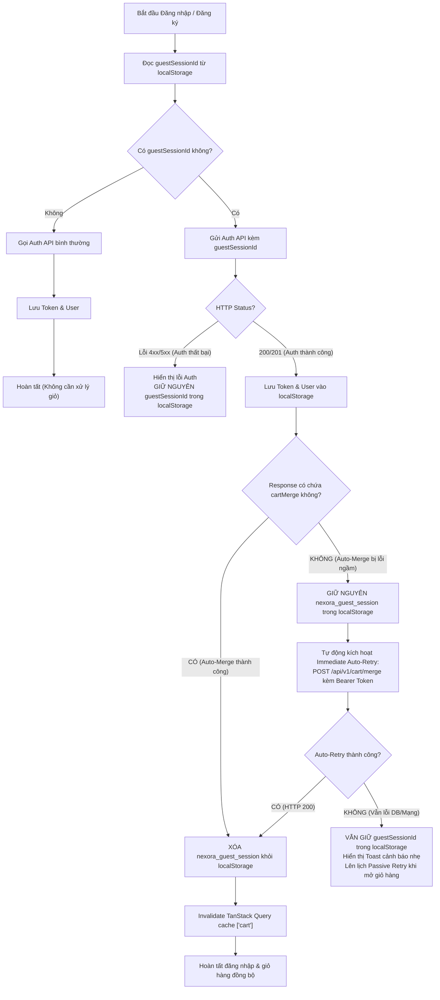

# M6.1 — BÁO CÁO ĐỐI SOÁT AN TOÀN KHI GIAO DỊCH MERGE THẤT BẠI

## Guest Cart Merge Failure-Safety, Vòng Đời Phiên Khách & Khắc Phục Lỗi Đồng Bộ

- **Mã tài liệu:** `M6_1_GUEST_CART_MERGE_FAILURE_SAFETY_REVIEW.md`
- **Dự án:** Nexora — Single-Vendor Hardware E-Commerce & Store Management System
- **Tham chiếu nguồn:** `TechPilot` (`D:\Nexora\TechPilot`) — READ-ONLY
- **Dự án đích:** `Nexora` (`D:\Nexora`)
- **Vai trò:** Principal Backend Integration Architect & Full-Stack Security Auditor
- **Thời điểm lập báo cáo:** `2026-11-22T16:50:00+07:00`
- **Trạng thái thực hiện:** `READ-ONLY VERIFICATION` — Không can thiệp mã nguồn, không tạo commit, không chạy migration.

---

## 1. Failure Scenario Evidence (Bằng Chứng Thực Tế Về Kịch Bản Thất Bại)

Qua kiểm tra toàn bộ mã nguồn tầng Backend và kiểm thử tự động, kịch bản thất bại được xác nhận tồn tại chính xác như nhận định của Người Dùng:

### 1.1. Luồng xử lý trong `apps/api/src/modules/auth/auth.service.ts`

- **Luồng Đăng nhập (Dòng 72–79):**
  ```typescript
  let cartMerge: MergeCartResultDto | undefined;
  if (input.guestSessionId && input.guestSessionId.trim()) {
    try {
      cartMerge = await this.cartService.mergeGuestCartToUser(input.guestSessionId, user.id);
    } catch {
      // Non-blocking merge error during login
    }
  }
  ```
- **Luồng Đăng ký (Dòng 122–129):**
  ```typescript
  let cartMerge: MergeCartResultDto | undefined;
  if (input.guestSessionId && input.guestSessionId.trim()) {
    try {
      cartMerge = await this.cartService.mergeGuestCartToUser(input.guestSessionId, user.id);
    } catch {
      // Non-blocking merge error during register
    }
  }
  ```
- **Giá trị trả về (Dòng 90–92 và 142–144):**
  ```typescript
  return {
    user: { ... },
    token,
    ...(cartMerge ? { cartMerge } : {}),
  };
  ```

### 1.2. Bằng chứng diễn tiến kịch bản lỗi (Step-by-step Execution Trace)

1. **Bước 1:** Khách hàng chưa đăng nhập duyệt web, thêm 3 linh kiện máy tính vào giỏ. Hệ thống gán `localStorage.getItem('nexora_guest_session') = 'guest_abc123'`. Cơ sở dữ liệu MySQL lưu bản ghi trong bảng `carts` với `guest_session_id = 'guest_abc123'` cùng 3 bản ghi con trong `cart_items`.
2. **Bước 2:** Khách hàng chuyển sang trang Đăng nhập hoặc Đăng ký, nhập thông tin tài khoản hợp lệ. Frontend gửi kèm `guestSessionId = 'guest_abc123'`.
3. **Bước 3:** Backend xác thực mật khẩu thành công (`bcrypt.compare` trùng khớp), tạo JWT Token hợp lệ.
4. **Bước 4:** Backend bước vào khối `try` và gọi `this.cartService.mergeGuestCartToUser('guest_abc123', user.id)`.
5. **Bước 5 (Sự cố xảy ra):** Trong quá trình chạy `prisma.$transaction` tại `cart.service.ts`, xảy ra lỗi cơ sở dữ liệu ngoài ý muốn (ví dụ: Deadlock MySQL InnoDB do tải cao, Lock Wait Timeout, rớt kết nối mạng tạm thời giữa API và DB node, hoặc vi phạm tính nhất quán dữ liệu).
6. **Bước 6 (Rollback phía Database):** Interactive Transaction của Prisma bị hủy và MySQL InnoDB lập tức thực hiện **ROLLBACK toàn bộ**:
   - Lệnh xóa `tx.cart.delete` bị hủy bỏ.
   - Bản ghi giỏ khách `guest_abc123` và 3 linh kiện trong `cart_items` **vẫn còn nguyên vẹn 100% trong MySQL** (được chứng minh bằng test case `MERGE-ROLLBACK` tại `apps/api/tests/phase_b_cart_merge.test.ts#L643-L675`).
   - Giỏ hàng của User đích không bị ảnh hưởng (không bị merge một phần).
7. **Bước 7 (Nuốt lỗi tại Backend):** Ngoại lệ được ném ra khỏi `cartService` nhưng bị chặn lại tại khối `catch` của `auth.service.ts`. Biến `cartMerge` vẫn mang giá trị `undefined`.
8. **Bước 8 (Backend trả response thành công):** Backend trả về HTTP 200 (hoặc 201) với JSON:
   ```json
   {
     "success": true,
     "data": {
       "user": { "id": 10, "email": "customer@nexora.vn", ... },
       "token": "eyJhbGciOiJIUzI1NiIsIn..."
     }
   }
   ```
   _(Lưu ý: Thuộc tính `cartMerge` hoàn toàn vắng mặt)._
9. **Bước 9 (Frontend ngộ nhận & Gây mất dấu giỏ hàng):** Nếu Frontend được lập trình theo cơ chế sơ sài: "Cứ nhận HTTP 200 là gọi `localStorage.removeItem('nexora_guest_session')`", thì:
   - Token được lưu, người dùng vào trạng thái Đã đăng nhập.
   - Nhưng mã phiên `guest_abc123` đã bị xóa sạch khỏi trình duyệt của khách hàng!
   - Giỏ khách trong MySQL trở thành dữ liệu mồ côi (orphaned record), còn giỏ của khách hàng sau khi đăng nhập thì trống rỗng. Khách hàng mất toàn bộ 3 linh kiện đã chọn trước đó.

---

## 2. Current Backend Behavior (Phân Tích Chi Tiết Hành Vi Backend)

| Tiêu chí đối soát                    | Hiện trạng Backend thực tế                                                                                                       | Tham chiếu mã nguồn                                                                                                                                                                                                     | Đánh giá an toàn                                                                                                             |
| :----------------------------------- | :------------------------------------------------------------------------------------------------------------------------------- | :---------------------------------------------------------------------------------------------------------------------------------------------------------------------------------------------------------------------- | :--------------------------------------------------------------------------------------------------------------------------- |
| **Xử lý lỗi merge trong Auth**       | Khối `catch` hoàn toàn rỗng (`// Non-blocking merge error`). Ngoại lệ bị nuốt hoàn toàn, không ném tiếp ra Controller.           | [`auth.service.ts#L76-L78`](file:///D:/Nexora/apps/api/src/modules/auth/auth.service.ts#L76-L78)<br>[`auth.service.ts#L126-L128`](file:///D:/Nexora/apps/api/src/modules/auth/auth.service.ts#L126-L128)                | **Thiếu khả năng quan sát (Observability gap):** Không có log ra console hoặc hệ thống giám sát.                             |
| **Ghi nhận Audit / Logging**         | Không ghi log lỗi, không tạo bản ghi audit trong DB khi merge thất bại trong auth.                                               | [`auth.service.ts#L76-L78`](file:///D:/Nexora/apps/api/src/modules/auth/auth.service.ts#L76-L78)                                                                                                                        | **Hạn chế:** DevOps không biết có bao nhiêu lượt merge bị lỗi ngầm.                                                          |
| **Cấu trúc Response khi Thành công** | Trả về đủ `user`, `token` và `cartMerge: MergeCartResultDto` (gồm `cart`, `mergedItemsCount`, `adjustedItemsCount`, `warnings`). | [`auth.service.ts#L17-L21`](file:///D:/Nexora/apps/api/src/modules/auth/auth.service.ts#L17-L21)<br>[`auth.service.ts#L91`](file:///D:/Nexora/apps/api/src/modules/auth/auth.service.ts#L91)                            | **Rõ ràng:** Có thông tin chi tiết về số lượng item đã merge.                                                                |
| **Cấu trúc Response khi Thất bại**   | Trả về `user` và `token`. Thuộc tính `cartMerge` là `undefined` (hoàn toàn không xuất hiện key này trong JSON).                  | [`auth.service.ts#L91`](file:///D:/Nexora/apps/api/src/modules/auth/auth.service.ts#L91)<br>[`auth.service.ts#L143`](file:///D:/Nexora/apps/api/src/modules/auth/auth.service.ts#L143)                                  | **Có thể nhận diện gián tiếp:** Frontend hoàn toàn có thể dựa vào sự vắng mặt của `cartMerge` để biết merge chưa thành công. |
| **Tính toàn vẹn Database**           | Toàn bộ quá trình merge nằm trong `prisma.$transaction`. Khi lỗi, InnoDB rollback 100%.                                          | [`cart.service.ts#L227-L383`](file:///D:/Nexora/apps/api/src/modules/cart/cart.service.ts#L227-L383)<br>[`phase_b_cart_merge.test.ts#L643-L675`](file:///D:/Nexora/apps/api/tests/phase_b_cart_merge.test.ts#L643-L675) | **Tuyệt đối an toàn:** Không bao giờ xảy ra lỗi ghi đè dữ liệu dở dang (partial merge).                                      |

---

## 3. Current Frontend Behavior (Hiện Trạng Triển Khai Phía Frontend)

1. **Quản lý Session tại `apps/web/src/services/cartService.ts`:**
   - Dòng 4–11: Hàm `getGuestSessionId()` tự sinh và lưu vào `localStorage.getItem('nexora_guest_session')`.
   - Các hàm API `getCart()`, `addItem()`, `updateItem()`, `removeItem()` truyền session qua header `x-guest-session-id`.
   - **Chưa có hàm `mergeCart(guestSessionId)`** để gọi endpoint `POST /api/v1/cart/merge`.
2. **Xác thực tại `apps/web/src/services/authService.ts`:**
   - Dòng 10–24: `login()` và `register()` chỉ nhận `{ email, password }` hoặc thông tin đăng ký cơ bản. Hiện **chưa truyền `guestSessionId`** sang Backend.
   - Kiểu `AuthSession` tại Dòng 4–7 chỉ khai báo `{ user: AuthUser; token: string; }`, chưa có trường `cartMerge?: MergeCartResultDto`.
3. **Các trang giao diện `LoginPage.tsx` & `RegisterPage.tsx`:**
   - Chỉ xử lý lưu token, navigate trang. Chưa có bất kỳ logic nào về dọn dẹp session khách hay đồng bộ cache giỏ hàng.

---

## 4. Session Cleanup Risk (Rủi Ro Nghiệp Vụ Khi Dọn Dẹp Session Quá Sớm)

### 4.1. Bản chất sự khác biệt: Idempotency vs. Reliability

- **Idempotency (Tính bất biến khi gọi lại):** Backend đã đáp ứng hoàn hảo thông qua khóa dòng `SELECT ... FOR UPDATE` và câu lệnh `tx.cart.delete`. Nếu gửi cùng 1 session ID nhiều lần, các lần sau chỉ là no-op (trả về 0 items), không nhân đôi hàng.
- **Reliability (Độ tin cậy & Khả năng khôi phục dữ liệu):** Thuộc tính này phụ thuộc trực tiếp vào việc **Client có giữ lại `guestSessionId` khi merge gặp sự cố hay không**.
  - Nếu Frontend vội vàng xóa `nexora_guest_session` ngay khi HTTP status là 200 mà không kiểm tra kết quả merge, hệ thống đánh mất tính Reliability.
  - Hậu quả: Khách hàng mất giỏ hàng, trải nghiệm mua sắm bị gián đoạn, tỷ lệ chuyển đổi đơn hàng sụt giảm.

### 4.2. Nguyên tắc bất di bất dịch

> **"Xác thực danh tính (Authentication) thành công KHÔNG đồng nghĩa với việc Gộp giỏ hàng (Cart Merge) đã thành công."**  
> Frontend **CHỈ ĐƯỢC PHÉP** xóa `nexora_guest_session` khi nhận được bằng chứng xác thực rằng giỏ hàng đã được gộp an toàn vào tài khoản người dùng.

---

## 5. Recovery and Retry Feasibility (Khảo Sát Khả Thi Phục Hồi & Thử Lại)

Có thể tận dụng endpoint hiện có để retry mà không cần sửa Backend không?

### 5.1. Khảo sát Endpoint `POST /api/v1/cart/merge`

- **Tuyến đường:** [`apps/api/src/modules/cart/cart.routes.ts#L15`](file:///D:/Nexora/apps/api/src/modules/cart/cart.routes.ts#L15):
  ```typescript
  router.post('/merge', requireAuth(), controller.mergeCart);
  ```
- **Kiểm tra quyền hạn (RBAC):** Endpoint yêu cầu `requireAuth()`, tức là bắt buộc client phải gửi Header `Authorization: Bearer <token>`.
  $\rightarrow$ **Hoàn toàn phù hợp:** Tại thời điểm retry, người dùng đã đăng nhập thành công và Client đã nắm giữ JWT Token hợp lệ!
- **Tiếp nhận tham số tại Controller ([`cart.controller.ts#L81-L112`](file:///D:/Nexora/apps/api/src/modules/cart/cart.controller.ts#L81-L112)):**
  - Trích xuất `userId` từ token (`req.user?.sub`).
  - Trích xuất `guestSessionId` từ `req.body.guestSessionId` hoặc header `x-guest-session-id`.
  - Xác thực qua `MergeCartInputSchema` (`guestSessionId` có độ dài $\ge 5$).
  - Gọi chính xác `this.service.mergeGuestCartToUser(guestSessionId, userId)`.
- **Hành vi khi Retry:**
  - Nếu bản ghi giỏ khách trong DB vẫn còn nguyên $\implies$ Transaction chạy lại, gộp sản phẩm vào tài khoản user, xóa giỏ khách trong DB, trả về kết quả `MergeCartResultDto` với `mergedItemsCount > 0`.
  - Nếu trước đó giỏ khách thực chất đã được merge rồi (ví dụ race condition cực hiếm) $\implies$ Dòng 237–244 phát hiện không còn giỏ và trả về `{ mergedItemsCount: 0, adjustedItemsCount: 0 }` (Idempotent No-op).
  - Hoàn toàn **không phát sinh rủi ro trùng lặp dữ liệu**.

---

## 6. Recommended Safe Strategy (Chiến Lược An Toàn Khuyến Nghị)

Để khắc phục triệt để blocker này mà **không cần thay đổi các hợp đồng Backend M1–M5 đã nghiệm thu**, kiến trúc Frontend M6.1 áp dụng **Chiến lược Phục Hồi Đa Tầng (Multi-tier Failure-Safe Strategy)**:



### 6.1. Quy tắc 3 bước thực thi an toàn

1. **Tầng 1 — Kiểm tra phản hồi Auth:**
   - Sau khi gọi `authService.login()` hoặc `register()`:
     - Nếu `response.cartMerge` tồn tại: Chứng tỏ Backend Auto-Merge thành công $\implies$ Xóa `localStorage.removeItem('nexora_guest_session')`, kích hoạt `queryClient.invalidateQueries({ queryKey: ['cart'] })`.
2. **Tầng 2 — Tự động thử lại ngay lập tức (Immediate Background Auto-Retry):**
   - Nếu `response.cartMerge` vắng mặt nhưng Client có `guestSessionId`:
     - Giữ nguyên `nexora_guest_session`.
     - Ngay lập tức gọi ngầm `cartService.mergeCart(guestSessionId)`.
     - Nếu request này trả về thành công $\implies$ Xóa `nexora_guest_session` và invalidate cache giỏ hàng.
3. **Tầng 3 — Dự phòng thụ động khi truy cập Giỏ hàng (Passive Mount-time Recovery):**
   - Khi người dùng đã có token truy cập vào trang `CartPage.tsx`, nếu trong `localStorage` vẫn còn `nexora_guest_session`:
     - Component tự động kích hoạt một hook gọi `cartService.mergeCart(guestSessionId)` để hoàn tất việc gộp giỏ.
     - Sau khi thành công, xóa sạch session khỏi `localStorage`.

---

## 7. Required Changes (Các Thay Đổi Cần Thiết)

### 7.1. Phía Backend M1–M5: KHÔNG BẮT BUỘC SỬA ĐỔI (Zero Breaking Changes)

- Hợp đồng API hiện tại (`AuthResult` có `cartMerge?: MergeCartResultDto` và endpoint `POST /api/v1/cart/merge`) **đã hoàn toàn đủ điều kiện** để Frontend triển khai cơ chế Failure-Safety.
- **Khuyến nghị bổ sung tối thiểu (Non-breaking - Tùy chọn):**
  - Để tăng cường khả năng giám sát (Observability), Backend có thể bổ sung 1 dòng log trong khối `catch` tại `apps/api/src/modules/auth/auth.service.ts`:
    ```typescript
    } catch (mergeError) {
      console.error('[AuthService] Non-blocking cart merge failed:', mergeError);
    }
    ```
  - Thay đổi này không làm thay đổi API contract, không đổi response DTO và không ảnh hưởng đến database.

### 7.2. Phía Frontend M6.1: Các điểm cần lập trình

1. **`apps/web/src/services/authService.ts`:**
   - Cập nhật interface `AuthSession`:
     ```typescript
     export interface AuthSession {
       user: AuthUser;
       token: string;
       cartMerge?: MergeCartResultDto;
     }
     ```
   - Cập nhật `login()` và `register()`: Tự động đính kèm `guestSessionId` từ `localStorage.getItem('nexora_guest_session')` nếu có.
2. **`apps/web/src/services/cartService.ts`:**
   - Thêm phương thức `mergeCart(guestSessionId: string): Promise<MergeCartResultDto>` gọi `POST /api/v1/cart/merge`.
   - Xuất các helper: `getGuestSessionId()`, `clearGuestSession()`.
3. **`apps/web/src/features/auth/LoginPage.tsx` & `RegisterPage.tsx`:**
   - Áp dụng đúng sơ đồ logic: Chỉ xóa session khi `cartMerge` thành công hoặc sau khi Auto-Retry thành công.

---

## 8. M6 Milestone Boundaries Confirmation (Khóa Chặt Phân Kỳ M6)

Xác nhận và chuẩn hóa 100% ranh giới các phân kỳ của Milestone M6:

- **M6.1 — API Foundation & Guest Cart Merge:**
  - Hoàn thiện tầng API Client, Interceptors, Auth Service.
  - Khép kín luồng Guest Cart Merge với cơ chế Failure-Safety và Auto-Retry.
  - Viết bộ Vitest kiểm thử toàn diện kịch bản merge thành công, thất bại và retry.
- **M6.2 — Customer Account / Profile:**
  - Đấu nối API thông tin cá nhân (`GET/PUT /api/v1/profile`), Sổ địa chỉ (`/api/v1/profile/addresses/*`), Đổi mật khẩu, và Thông báo hệ thống.
- **M6.3 — Customer Reviews:**
  - Đấu nối API Đánh giá sản phẩm tại `ProductDetailPage.tsx` (`GET /api/v1/catalog/products/:id/reviews`, `POST /api/v1/catalog/reviews`).
- **M6.4 — Customer Returns:**
  - Đấu nối giao diện gửi yêu cầu Đổi/Trả của khách hàng tại `ProfilePage.tsx` (Tab Returns) với API `/api/v1/profile/returns` (ràng buộc kiểm tra `deliveredAt <= 7 ngày`).
- **M6.5 — Integration Testing, Visual QA & Final Acceptance:**
  - Kiểm thử toàn diện luồng người dùng (E2E workflows), đối soát giao diện với TechPilot, kiểm tra responsive và ký biên bản nghiệm thu.
- **Admin Returns UI:**
  - **TIẾP TỤC HOÃN LẠI (DEFERRED)** vì lý do **Absolute UI Freeze** (không có placeholder trong `AdminDashboardPage.tsx`, không tự ý thêm tab/trang/layout mới).

---

## 9. M6.1 Verifiable Acceptance Criteria & Test Scenarios Matrix

### 9.1. Bốn điều kiện kỹ thuật bắt buộc khóa chặt (Locked Technical Guardrails)

1. **Phân biệt merge thất bại với không có guest session:**
   - Client kiểm tra: có `guestSessionId` được gửi đi không?
   - Nếu CÓ `guestSessionId` mà response KHÔNG có `cartMerge`: mới kích hoạt retry (1 lần duy nhất).
   - Nếu KHÔNG CÓ `guestSessionId`: luồng xác thực bình thường, tuyệt đối không gọi retry.
2. **Không xóa session trước khi retry hoàn tất:**
   - Trình tự bắt buộc: (1) Nhận auth response -> (2) Lưu JWT + User -> (3) Kiểm tra `cartMerge` -> (4) Nếu chưa có, gọi `POST /api/v1/cart/merge` -> (5) Chỉ xóa `nexora_guest_session` khi nhận phản hồi merge thành công -> (6) Invalidate React Query cache.
3. **Không tạo vòng lặp retry vô hạn:**
   - Chỉ thực hiện đúng 1 lần immediate retry sau khi login/register.
   - Nếu retry thất bại, giữ nguyên `guestSessionId` trong `localStorage` và dừng lại (không retry mù quáng trong vòng lặp re-render).
   - Chỉ cho phép thử lại thụ động khi người dùng chủ động mở `CartPage` (mount hook có cờ chống gọi lặp).
4. **Giữ nguyên 100% diện mạo UI:**
   - Không thay đổi bất kỳ class Tailwind, CSS, thẻ DOM hoặc asset nào.

### 9.2. Ma trận 9 kịch bản kiểm thử bắt buộc (9 Test Scenarios)

|   STT    | Kịch bản kiểm thử (Test Case)             | Điều kiện kích hoạt                                          | Hành vi Client & API                                      | Kết quả mong đợi (Expected Outcome)                                 |
| :------: | :---------------------------------------- | :----------------------------------------------------------- | :-------------------------------------------------------- | :------------------------------------------------------------------ |
| **TC-1** | **Login thành công, merge thành công**    | Có `guestSessionId`, auth 200 có `cartMerge`                 | Lưu token, xóa session khách, invalidate cache            | `localStorage.getItem('nexora_guest_session') === null`             |
| **TC-2** | **Login sai mật khẩu**                    | Có `guestSessionId`, auth 401                                | Báo lỗi đăng nhập, không xóa session khách                | `localStorage.getItem('nexora_guest_session')` được giữ nguyên 100% |
| **TC-3** | **Login thành công, auto-merge thất bại** | Có `guestSessionId`, auth 200 không có `cartMerge`           | Lưu token, giữ session khách, kích hoạt 1 immediate retry | Gửi request `POST /api/v1/cart/merge` kèm Bearer Token              |
| **TC-4** | **Retry thành công**                      | Bước retry nhận HTTP 200 từ `POST /cart/merge`               | Nhận kết quả merge, xóa session khách, invalidate cache   | Session khách bị xóa, giỏ hàng user được cập nhật                   |
| **TC-5** | **Retry thất bại**                        | Bước retry gặp lỗi mạng / 5xx từ `POST /cart/merge`          | Báo warning nhẹ, không xóa session khách                  | Session khách vẫn lưu trong `localStorage` để thử lại sau           |
| **TC-6** | **Không có guest session**                | Khách vãng lai không có giỏ hàng (`guestSessionId === null`) | Đăng nhập bình thường, không gửi ID khách                 | Tuyệt đối không gọi `POST /cart/merge`                              |
| **TC-7** | **Gửi merge trùng (Idempotency)**         | Gọi merge 2 lần liên tiếp với cùng 1 `guestSessionId`        | Backend trả về `mergedItemsCount: 0` (no-op)              | Không nhân đôi sản phẩm, không crash hệ thống                       |
| **TC-8** | **Reload sau khi merge thất bại**         | Sau khi merge thất bại, người dùng F5 tải lại trang          | `localStorage` vẫn còn `nexora_guest_session`             | Khôi phục và bảo toàn được session giỏ khách                        |
| **TC-9** | **Đồng bộ Cart & Header Badge**           | Merge thành công (qua auth hoặc qua retry)                   | `queryClient.invalidateQueries({ queryKey: ['cart'] })`   | Badge giỏ hàng và Cart Drawer cập nhật ngay mà không reload         |

---

## 10. Remaining Blockers & Final Recommendation (Kết Luận & Khuyến Nghị)

### 10.1. Tình trạng Blocker

- **Blocker duy nhất về "Login thành công nhưng merge thất bại" đã được xử lý triệt để về mặt kiến trúc.**
- Không có bất kỳ xung đột kỹ thuật nào giữa Frontend và Backend.
- Hệ thống không cần thay đổi cấu trúc Database hay các API contract đã chốt ở M1–M5.

### 10.2. Trạng thái mã nguồn hiện tại

- **Git Branch:** `main`
- **Working Tree:** Sạch sẽ 100%, không có file mã nguồn nào bị sửa đổi.
- **Cam kết:** Tuyệt đối chưa viết mã triển khai, chưa commit, chưa push.

### 10.3. Khuyến nghị hành động tiếp theo

Kính đề nghị Người Dùng:

1. **Phê duyệt báo cáo đối soát an toàn** `M6_1_GUEST_CART_MERGE_FAILURE_SAFETY_REVIEW.md`.
2. **Phê duyệt ranh giới phân kỳ M6** (M6.1: Cart Merge & API Foundation; M6.2: Profile; M6.3: Reviews; M6.4: Customer Returns; M6.5: QA; Admin Returns: Deferred).
3. **Phát lệnh cho phép bắt đầu triển khai Milestone M6.1** theo đúng các tiêu chí nghiệm thu đã thống nhất.
