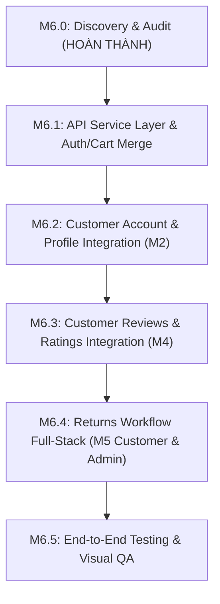

# M6.0 — BÁO CÁO KIỂM KÊ HIỆN TRẠNG FRONTEND & ĐỐI SOÁT TƯƠNG ĐỒNG TECHPILOT (TECHPILOT PARITY AUDIT)

- **Mã tài liệu:** `M6_FRONTEND_DISCOVERY_AND_TECHPILOT_PARITY_AUDIT.md`
- **Dự án:** Nexora — Single-Vendor Hardware E-Commerce & Store Management System
- **Tham chiếu nguồn:** `TechPilot` (`D:\02_Dự Án Phần Mềm\TechPilot (Bản Chính Thức)`) — Bảo toàn nguyên vẹn 100%, READ-ONLY
- **Dự án đích:** `Nexora` (`D:\Nexora\apps\web`)
- **Vai trò thực hiện:** Principal Frontend Architect & Technical Auditor
- **Thời điểm kiểm toán:** `2026-11-22T16:25:00+07:00`
- **Ranh giới thực thi:** **CHỈ THU THẬP BẰNG CHỨNG & LẬP KẾ HOẠCH — TUYỆT ĐỐI KHÔNG CHỈNH SỬA MÃ NGUỒN, KHÔNG SỬA BACKEND, KHÔNG TỰ Ý BẮT ĐẦU M6.1**

---

## 1. Executive Summary (Tóm Tắt Điều Hành)

1. **Hiện trạng tổng thể:**
   - Hệ thống Frontend của Nexora (`apps/web`) đã hoàn thành việc tái tạo toàn bộ giao diện, bố cục (layouts), design system và style visual từ TechPilot trên nền tảng **React 19 + TypeScript + Vite + Tailwind CSS**.
   - Có tổng cộng **354 tệp tin** trong `apps/web` (bao gồm toàn bộ assets hình ảnh, SVG logos, CSS gốc từ TechPilot).
   - Router chính [`apps/web/src/routes/AppRoutes.tsx`](file:///d:/Nexora/apps/web/src/routes/AppRoutes.tsx) khai báo đầy đủ **48 routes** bao quát 100% các trang storefront, khách hàng, công cụ chuyên sâu (PC Builder, Compare, AI Assistant) và quản trị viên (Admin).
2. **Khoảng cách tích hợp (Integration Gap) sau Phase B (M1–M5):**
   - **Đã tích hợp API thực tế:**
     - Storefront Home, Catalog sản phẩm, Tìm kiếm & Lọc, Chi tiết sản phẩm cơ bản (`storefrontService`).
     - Giỏ hàng cơ bản (`cartService` - xem, thêm, sửa, xóa với guest session).
     - Đặt hàng & thanh toán VNPay/COD (`CheckoutPage.tsx`).
     - 4 hệ thống AI (`FloatingChatbot`, `AiAssistantPage`, `ComparePage`, `ProductDetailPage` Tab 4).
     - 12 phân hệ quản trị Admin cơ bản trong `AdminDashboardPage.tsx` (Dashboard, Orders, Products, Categories, Brands, Inventory, Coupons, Flash sales, Banners, Posts, Users, Reviews).
   - **Chưa tích hợp API (Hiện đang dùng Mock / Local State):**
     - **Profile & Customer Account (M2):** Trang `ProfilePage.tsx` tab Profile, tab Sổ địa chỉ (Addresses), tab Thông báo (Notifications), tab Đổi mật khẩu (Password) hiện đang hiển thị markup tĩnh / local state, chưa gọi các API `/api/v1/profile/*` đã được nghiệm thu ở M2.
     - **Guest Cart Merge (M3):** Client web chưa gửi kèm `guestSessionId` trong payload đăng nhập/đăng ký tại `authService.ts`, và chưa có hàm gọi `POST /api/v1/cart/merge`.
     - **Customer Reviews & Moderation (M4):** Tab 3 "Đánh giá" tại `ProductDetailPage.tsx` đang là HTML tĩnh (hardcoded 5 sao và 1 đánh giá mẫu), chưa gọi `GET /api/v1/catalog/products/:id/reviews` và chưa có form gửi đánh giá `POST /api/v1/catalog/reviews`.
     - **Customer Returns (M5):** Tab "Yêu cầu đổi trả" tại `ProfilePage.tsx` hiển thị dữ liệu tĩnh, chưa gọi `GET /api/v1/profile/returns` và chưa có form tạo yêu cầu đổi/trả với kiểm soát `deliveredAt <= 7 ngày`.
     - **Admin Returns Management (M5):** Màn hình `AdminDashboardPage.tsx` hoàn toàn **chưa có tab hoặc giao diện quản lý Đổi/Trả hàng** để kết nối với API `/api/v1/admin/returns` (4-step state machine, phê duyệt, từ chối, hoàn kho `isResellable`).
3. **Chất lượng kỹ thuật nền tảng (Quality Baseline):**
   - `npm run typecheck`: **0 errors** (100% type-safe).
   - `npm run lint`: **0 errors, 0 warnings** (ESLint 9 sạch sẽ).
   - `npm run format:check`: **100% Prettier compliant**.
   - `npm run test` (Vitest Full Monorepo): **18 test files, 216 tests passed** (100%).
   - Frontend unit/component tests: Hiện mới chỉ có **2 test files / 5 tests** tại `apps/web/tests/`. Cần mở rộng test coverage cho các luồng M6.

---

## 2. Cấu Trúc Repository & Phân Bổ Mã Nguồn

```
D:\Nexora
├── apps
│   ├── api                  # Backend Modular Monolith (Express 5 + TypeScript + Prisma)
│   │   ├── src
│   │   │   ├── modules      # admin, ai, auth, cart, catalog, marketing, order, payment, profile, system, wishlist
│   │   │   └── routes       # createV1Router gắn /api/v1/
│   │   └── tests            # 16 integration & unit test suites (216 tests)
│   └── web                  # Frontend Single-Page App (React 19 + TypeScript + Vite)
│       ├── public
│       │   └── assets       # Toàn bộ CSS, JS, images, banners, logos kế thừa từ TechPilot
│       ├── src
│       │   ├── app          # App.tsx, providers.tsx (TanStack Query)
│       │   ├── components   # StatusCard.tsx, shared UI
│       │   ├── features     # admin, ai, auth, cart, catalog, checkout, compare, errors, info, news, orderTracking, pcBuilder, policy, profile, storefront, stores, system, tradeIn, wishlist
│       │   ├── hooks        # useSystemHealth.ts
│       │   ├── layouts      # MainLayout.tsx
│       │   ├── lib          # apiClient.ts (Axios + interceptor), productImage.ts
│       │   ├── routes       # AppRoutes.tsx (48 route declarations)
│       │   ├── services     # authService, cartService, storefrontService, systemService, wishlistService
│       │   └── types        # index.ts (Frontend view types)
│       └── tests            # FoundationDashboard.test.tsx, ResetPasswordFlow.test.tsx
├── packages
│   ├── config               # Config env schemas
│   └── shared               # DTOs, wire schemas Zod, API contracts
├── prisma                   # schema.prisma (28 tables), 8 migrations applied
└── tests                    # tests/e2e (Playwright: foundation.spec.ts, storefront_journeys.spec.ts)
```

---

## 3. Kiểm Kê Chi Tiết Frontend Nexora (`apps/web`)

### A. Routes & Cấu Hình Điều Hướng (`apps/web/src/routes/AppRoutes.tsx`)

Router quản lý **48 routes** phân bổ theo 11 nhóm nghiệp vụ:

1. **Storefront & Catalog (8 routes):** `/`, `/home`, `/home/index`, `/search`, `/home/search`, `/category/:slug`, `/product/detail/:slug`, `/product/:slug`.
2. **Khách hàng Mua sắm (4 routes):** `/wishlist`, `/cart`, `/checkout`, `/checkout/success`.
3. **Công cụ Chuyên sâu (6 routes):** `/build-pc`, `/pc-builder`, `/compare`, `/ai-assistant`, `/thu-cu-doi-moi`, `/trade-in`.
4. **Tin tức & Nội dung (8 routes):** `/post`, `/posts`, `/news`, `/tin-tuc`, `/post/:slug`, `/post/detail/:slug`, `/news/:slug`, `/tin-tuc/:slug`.
5. **Dịch vụ Khách hàng (2 routes):** `/order-tracking`, `/stores`.
6. **Hồ sơ Cá nhân (9 routes):** `/profile`, `/profile/orders`, `/profile/orders/:id`, `/profile/addresses`, `/profile/notifications`, `/profile/return`, `/profile/return/:id`, `/profile/password`, `/orders`.
7. **Xác thực Tài khoản (10 routes):** `/auth/login`, `/auth/register`, `/auth/forgot`, `/auth/forgot-password`, `/auth/reset-password`, `/auth/reset`, `/login`, `/register`, `/forgot-password`, `/reset-password`.
8. **Quản trị Cửa hàng (16 routes):** `/admin`, `/admin/dashboard`, `/admin/orders`, `/admin/orders/:id`, `/admin/products`, `/admin/categories`, `/admin/brands`, `/admin/inventory`, `/admin/coupons`, `/admin/flash-sales`, `/admin/posts`, `/admin/users`, `/admin/reviews`, `/admin/settings`, `/admin/banners`, `/admin/stores`.
9. **Chính sách & Hướng dẫn (13 routes):** `/about`, `/careers`, `/contact`, `/privacy`, `/guide`, `/returns`, `/warranty`, `/support`, `/policy/*`, `/chinh-sach-*`.
10. **Kỹ thuật & Kiến trúc (2 routes):** `/foundation`, `/architecture`.
11. **Trang lỗi:** `*` $\rightarrow$ `NotFoundPage`.

### B. Thành Phần Giao Diện (Components & Layouts)

| Phân hệ             | Đường dẫn file                                              | Vai trò & Trạng thái hiện tại                                                                               |
| :------------------ | :---------------------------------------------------------- | :---------------------------------------------------------------------------------------------------------- |
| **Storefront**      | `apps/web/src/features/storefront/StorefrontHome.tsx`       | Trang chủ chính, bố cục tích hợp Banner, Flash Sale, Tabs, Footer                                           |
|                     | `.../StorefrontHeader.tsx`                                  | Header, thanh tìm kiếm live, marquee thông báo, giỏ hàng badge, avatar user                                 |
|                     | `.../StorefrontFooter.tsx`                                  | Footer 4 cột chuẩn TechPilot, chứng nhận, thanh toán, hotline                                               |
|                     | `.../CategorySidebar.tsx`                                   | Menu danh mục dọc 16 nhóm kèm Flyout Mega Menu 4 cột                                                        |
|                     | `.../HeroCarousel.tsx`                                      | Slider banner tự động chuyển động                                                                           |
|                     | `.../FlashSaleSection.tsx`                                  | Đồng hồ đếm ngược Flash Sale, progress bar hàng bán                                                         |
|                     | `.../ProductCard.tsx`                                       | Thẻ sản phẩm chuẩn: ảnh sắc nét, badge giảm giá, nút giỏ hàng trượt, nút yêu thích, nút so sánh             |
|                     | `.../PromoCards.tsx`                                        | 3 thẻ khuyến mãi bên phải banner chính                                                                      |
|                     | `.../PromoPopup.tsx`                                        | Popup banner ưu đãi khi vào trang                                                                           |
|                     | `.../ServicePolicyBar.tsx`                                  | 5 cam kết chính sách mua sắm                                                                                |
| **Catalog**         | `apps/web/src/features/catalog/ProductDetailPage.tsx`       | Chi tiết sản phẩm, thư viện ảnh, bảng specs, 4 tabs (Tab 3 Reviews hiện là mock)                            |
|                     | `apps/web/src/features/catalog/SearchPage.tsx`              | Tìm kiếm & lọc nâng cao theo danh mục, thương hiệu, khoảng giá, sắp xếp                                     |
| **Cart & Checkout** | `apps/web/src/features/cart/CartPage.tsx`                   | Bảng giỏ hàng, tăng giảm số lượng, coupon, tổng tiền                                                        |
|                     | `apps/web/src/features/checkout/CheckoutPage.tsx`           | Form thanh toán, chọn địa chỉ, chọn cổng COD/VNPay                                                          |
|                     | `.../CheckoutSuccessPage.tsx`                               | Màn hình hóa đơn đặt hàng thành công                                                                        |
| **Profile**         | `apps/web/src/features/profile/ProfilePage.tsx`             | Hồ sơ cá nhân 6 tabs (Orders đã nối API; Profile, Addresses, Notifications, Returns, Password đang là mock) |
| **Admin**           | `apps/web/src/features/admin/AdminDashboardPage.tsx`        | Bảng điều khiển quản trị 6.312 dòng, 12 tabs (chưa có tab Returns)                                          |
| **AI**              | `apps/web/src/features/ai/FloatingChatbot.tsx`              | Widget chat AI nổi góc phải toàn website                                                                    |
|                     | `.../AiAssistantPage.tsx`                                   | Khảo sát nhu cầu 5 bước tư vấn linh kiện thông minh                                                         |
| **Tools**           | `apps/web/src/features/pcBuilder/PcBuilderPage.tsx`         | Xây dựng cấu hình PC 8 thành phần, tính công suất nguồn                                                     |
|                     | `apps/web/src/features/compare/ComparePage.tsx`             | So sánh 2-4 sản phẩm cùng loại với Category Lock                                                            |
|                     | `apps/web/src/features/orderTracking/OrderTrackingPage.tsx` | Tra cứu đơn hàng theo mã đơn                                                                                |

### C. Lớp Dịch Vụ API & State Management

- **API Client:** [`apps/web/src/lib/apiClient.ts`](file:///d:/Nexora/apps/web/src/lib/apiClient.ts) sử dụng Axios instance, tự động gắn `Authorization: Bearer <token>` từ `localStorage`.
- **Dịch vụ kết nối (Services):**
  - `authService.ts`: Đăng nhập, đăng ký, đăng xuất, quên mật khẩu, reset mật khẩu, lấy thông tin cá nhân.
  - `cartService.ts`: Thêm/sửa/xóa sản phẩm trong giỏ hàng kèm header `x-guest-session-id`.
  - `storefrontService.ts`: Lấy danh mục, banner, sản phẩm, flash sale, coupon, bài viết.
  - `wishlistService.ts`: Quản lý danh sách sản phẩm yêu thích.
  - `systemService.ts`: Kiểm tra health check hệ thống.
- **State Management:** `@tanstack/react-query` v5 quản lý server-state caching, invalidation; `localStorage` lưu trữ session token (`nexora_token`), user profile (`nexora_user`), guest session (`nexora_guest_session`).

---

## 4. Kiểm Kê Nguồn Tham Chiếu TechPilot (`TechPilot/`)

Cơ sở mã nguồn TechPilot tại `D:\02_Dự Án Phần Mềm\TechPilot (Bản Chính Thức)`:

- **Tổng số Controllers PHP:** 27 controllers (`app/controllers/`).
- **Tổng số Models:** 12 models (`app/models/`).
- **Tổng số View Templates:** **78 file `.php`** (`app/views/`):
  - `home/`: 5 views (`index.php`, `search.php`, `trade_in.php`, `_product_card.php`, `404.php`).
  - `auth/`: 4 views (`login.php`, `register.php`, `forgot.php`, `reset.php`).
  - `cart.php`, `checkout.php`, `checkout-success.php`: 3 views giỏ hàng và thanh toán.
  - `product/`: 2 views (`detail.php`, `partials/specifications.php`).
  - `profile/`: 9 views (`index.php`, `orders.php`, `order_detail.php`, `addresses.php`, `notifications.php`, `return.php`, `wishlist.php`, `ai_chat_history.php`, `_sidebar.php`).
  - `admin/`: 28 views (quản trị dashboard, products, categories, brands, orders, inventory, coupons, flash sales, banners, posts, users, reviews).
  - `layouts/`: 4 views (`header.php`, `footer.php`, `partials/category-mega-menu.php`, `partials/topbar.php`).
  - `post/`: 14 views & partials tin tức công nghệ.
  - `compare/`: 1 view (`index.php`).
  - `pc-builder/`: 1 view (`index.php`).
  - `ai-assistant/`: 1 view (`index.php`).
  - `payment/`: 1 view (`vnpay_sandbox.php`).
  - `errors/`: 3 views (`403.php`, `404.php`, `500.php`).

---

## 5. Ma Trận Đối Soát Route & Page (Route & Page Parity Matrix)

| Chức năng / Màn hình         | TechPilot View Source          | Route Nexora                  | Component Nexora                     | Đánh giá Parity | Hiện trạng Tích hợp API                                                                                        |
| :--------------------------- | :----------------------------- | :---------------------------- | :----------------------------------- | :-------------: | :------------------------------------------------------------------------------------------------------------- |
| **Trang chủ (Home)**         | `home/index.php`               | `/`, `/home`                  | `StorefrontHome.tsx`                 |   `100% PASS`   | **Đã tích hợp API** (`/catalog/banners`, `/catalog/categories`, `/catalog/products`, `/marketing/flash-sales`) |
| **Tìm kiếm & Lọc**           | `home/search.php`              | `/search`                     | `SearchPage.tsx`                     |   `100% PASS`   | **Đã tích hợp API** (`/catalog/products?categoryId=...&brandId=...&search=...`)                                |
| **Chi tiết sản phẩm**        | `product/detail.php`           | `/product/:slug`              | `ProductDetailPage.tsx`              |  `90% PARTIAL`  | **Tích hợp một phần** (Sản phẩm & Specs: Đã nối; Tab 3 Reviews: Còn Mock)                                      |
| **Yêu thích (Wishlist)**     | `wishlist/index.php`           | `/wishlist`                   | `WishlistPage.tsx`                   |   `100% PASS`   | **Đã tích hợp API** (`/wishlist`, `/wishlist/toggle`, `/wishlist/:id`)                                         |
| **Giỏ hàng (Cart)**          | `cart.php`                     | `/cart`                       | `CartPage.tsx`                       |  `90% PARTIAL`  | **Tích hợp một phần** (Thao tác giỏ hàng: Đã nối; Merge giỏ khách: Chưa nối)                                   |
| **Thanh toán (Checkout)**    | `checkout.php`                 | `/checkout`                   | `CheckoutPage.tsx`                   |   `100% PASS`   | **Đã tích hợp API** (`/orders`, `/payment/vnpay/create-url`)                                                   |
| **Đặt hàng thành công**      | `checkout-success.php`         | `/checkout/success`           | `CheckoutSuccessPage.tsx`            |   `100% PASS`   | **Đã tích hợp** (Hiển thị invoice đơn hàng)                                                                    |
| **Tra cứu đơn hàng**         | `home/order-tracking.php`      | `/order-tracking`             | `OrderTrackingPage.tsx`              |   `100% PASS`   | **Đã tích hợp API** (`/orders/:orderCode`)                                                                     |
| **Đăng nhập**                | `auth/login.php`               | `/auth/login`, `/login`       | `LoginPage.tsx`, `AuthModal.tsx`     |  `90% PARTIAL`  | **Tích hợp một phần** (Auth thành công; Chưa gửi `guestSessionId` để merge cart)                               |
| **Đăng ký**                  | `auth/register.php`            | `/auth/register`, `/register` | `RegisterPage.tsx`                   |  `90% PARTIAL`  | **Tích hợp một phần** (Tạo tài khoản thành công; Chưa gửi `guestSessionId`)                                    |
| **Quên mật khẩu**            | `auth/forgot.php`              | `/auth/forgot-password`       | `ForgotPasswordPage.tsx`             |   `100% PASS`   | **Đã tích hợp API** (`/auth/forgot-password`)                                                                  |
| **Đặt lại mật khẩu**         | `auth/reset.php`               | `/auth/reset-password`        | `ResetPasswordPage.tsx`              |   `100% PASS`   | **Đã tích hợp API** (`/auth/reset-password`)                                                                   |
| **Hồ sơ cá nhân**            | `profile/index.php`            | `/profile`                    | `ProfilePage.tsx` (Tab Profile)      |   `50% MOCK`    | **Chưa tích hợp API** (Chưa nối `GET/PUT /api/v1/profile`)                                                     |
| **Đơn hàng của tôi**         | `profile/orders.php`           | `/profile/orders`             | `ProfilePage.tsx` (Tab Orders)       |   `100% PASS`   | **Đã tích hợp API** (`GET /api/v1/orders/my-orders`)                                                           |
| **Sổ địa chỉ nhận hàng**     | `profile/addresses.php`        | `/profile/addresses`          | `ProfilePage.tsx` (Tab Addresses)    |   `30% MOCK`    | **Chưa tích hợp API** (Chưa nối `GET/POST/PUT/DELETE/DEFAULT /api/v1/profile/addresses`)                       |
| **Thông báo hệ thống**       | `profile/notifications.php`    | `/profile/notifications`      | `ProfilePage.tsx` (Tab Notif)        |   `30% MOCK`    | **Chưa tích hợp API** (Chưa nối `GET /api/v1/profile/notifications`, mark as read)                             |
| **Yêu cầu đổi/trả hàng**     | `profile/return.php`           | `/profile/return`             | `ProfilePage.tsx` (Tab Returns)      |   `30% MOCK`    | **Chưa tích hợp API** (Chưa nối `GET/POST /api/v1/profile/returns`)                                            |
| **Đổi mật khẩu**             | `profile/password.php`         | `/profile/password`           | `ProfilePage.tsx` (Tab Password)     |   `50% MOCK`    | **Chưa tích hợp API** (Chưa nối `POST /api/v1/profile/change-password`)                                        |
| **PC Builder**               | `pc-builder/index.php`         | `/build-pc`                   | `PcBuilderPage.tsx`                  |   `100% PASS`   | **Đã tích hợp** (Tính công suất nguồn, chọn 8 bộ phận)                                                         |
| **So sánh sản phẩm**         | `compare/index.php`            | `/compare`                    | `ComparePage.tsx`                    |   `100% PASS`   | **Đã tích hợp API** (`POST /api/v1/ai/compare`, Category Lock)                                                 |
| **Khảo sát AI**              | `ai-assistant/index.php`       | `/ai-assistant`               | `AiAssistantPage.tsx`                |   `100% PASS`   | **Đã tích hợp API** (`POST /api/v1/ai/assistant/survey`)                                                       |
| **Tin tức công nghệ**        | `post/index.php`, `detail.php` | `/post`, `/post/:slug`        | `NewsPage.tsx`, `PostDetailPage.tsx` |   `100% PASS`   | **Đã tích hợp API** (`/marketing/posts`, `/marketing/posts/:slug`)                                             |
| **Thu cũ đổi mới**           | `home/trade_in.php`            | `/thu-cu-doi-moi`             | `TradeInPage.tsx`                    |   `100% PASS`   | **Giao diện hoàn chỉnh**                                                                                       |
| **Hệ thống cửa hàng**        | `home/stores.php`              | `/stores`                     | `StoresPage.tsx`                     |   `100% PASS`   | **Giao diện hoàn chỉnh**                                                                                       |
| **Admin Dashboard**          | `admin/dashboard.php`          | `/admin`                      | `AdminDashboardPage.tsx`             |   `100% PASS`   | **Đã tích hợp API** (`/admin/dashboard/summary`, biểu đồ KPI)                                                  |
| **Admin Quản lý Đổi/Trả**    | _Tính năng mới M5_             | `/admin/returns`              | **Chưa có component**                |  `0% MISSING`   | **GAP:** Backend M5 đã có `/api/v1/admin/returns`, Frontend chưa có giao diện                                  |
| **Admin 12 phân hệ còn lại** | `admin/*/index.php`            | `/admin/*`                    | `AdminDashboardPage.tsx`             |   `95% PASS`    | **Đã tích hợp API** (`/admin/orders`, `/admin/products`, `/admin/categories`, v.v.)                            |

---

## 6. Ma Trận Đối Soát Thành Phần Giao Diện (Component Parity Matrix)

| Nhóm Component          | TechPilot Source                          | Nexora Frontend Component             | Trạng thái chuyển đổi | Ghi chú kỹ thuật                                            |
| :---------------------- | :---------------------------------------- | :------------------------------------ | :-------------------: | :---------------------------------------------------------- |
| **Top bar thông báo**   | `layouts/partials/topbar.php`             | `StorefrontHeader.tsx` (Top marquee)  |      `100% PASS`      | Chạy chữ 2 chiều vô tận, hotline, tra cứu đơn               |
| **Header chính**        | `layouts/header.php`                      | `StorefrontHeader.tsx`                |      `100% PASS`      | Search live dropdown, cart badge đỏ, wishlist badge         |
| **Category Sidebar**    | `components/category-menu.php`            | `CategorySidebar.tsx`                 |      `100% PASS`      | 16 nhóm danh mục phần cứng chính                            |
| **Mega Menu Flyout**    | `layouts/partials/category-mega-menu.php` | `CategorySidebar.tsx` (Flyout)        |      `100% PASS`      | 4 cột: Thương hiệu, Giá, Cấu hình, Nhu cầu                  |
| **Hero Carousel**       | `home/index.php` (Carousel)               | `HeroCarousel.tsx`                    |      `100% PASS`      | 5 slides banner chính, dot navigation, auto play            |
| **Product Card**        | `home/_product_card.php`                  | `ProductCard.tsx`                     |      `100% PASS`      | Nút Thêm giỏ trượt lên khi hover, nút Yêu thích, So sánh    |
| **Specs Table**         | `product/partials/specifications.php`     | `ProductDetailPage.tsx` (Tab Specs)   |      `100% PASS`      | Bảng thông số kỹ thuật chi tiết theo model                  |
| **Review Box**          | `product/detail.php` (Reviews)            | `ProductDetailPage.tsx` (Tab Reviews) |      `30% MOCK`       | Cần thay thế bằng dynamic list + form gửi review M4         |
| **Chatbot Widget**      | `components/chatbot.php`                  | `FloatingChatbot.tsx`                 |      `100% PASS`      | Chatbot nổi toàn site, trả lời thông số kỹ thuật            |
| **Footer**              | `layouts/footer.php`                      | `StorefrontFooter.tsx`                |      `100% PASS`      | 4 cột link, logo bộ công thương, đối tác thanh toán         |
| **Address Card**        | `profile/addresses.php`                   | `ProfilePage.tsx` (Address section)   |      `30% MOCK`       | Cần modal thêm/sửa địa chỉ và badge mặc định                |
| **Return Request Card** | `profile/return.php`                      | `ProfilePage.tsx` (Return section)    |      `30% MOCK`       | Cần form chọn đơn `DELIVERED` <= 7 ngày, chọn item          |
| **Admin Returns Panel** | _Chưa có trong TechPilot_                 | _Chưa có trong Nexora_                |     `0% MISSING`      | Cần bổ sung tab Quản trị Đổi/Trả trong `AdminDashboardPage` |

---

## 7. Ma Trận Đối Soát Tài Nguyên & Assets (Asset Parity Matrix)

| Danh mục Asset             | TechPilot Path (`public/assets/`)                                                       | Nexora Path (`apps/web/public/assets/`)  | Số lượng |                         Tình trạng                         |
| :------------------------- | :-------------------------------------------------------------------------------------- | :--------------------------------------- | :------: | :--------------------------------------------------------: |
| **CSS Stylesheets**        | `css/style.css`, `css/category-mega-menu.css`, `css/news.css`, `css/search-filters.css` | `public/assets/css/*`                    | 5 files  |       `100% KHỚP` (5.986 dòng CSS gốc được bảo lưu)        |
| **Brand Logos (SVG)**      | `images/brands/*.svg`                                                                   | `public/assets/images/brands/*.svg`      | 31 SVGs  | `100% KHỚP` (ASUS, MSI, Gigabyte, Intel, AMD, Corsair...)  |
| **Category Icons (PNG)**   | `images/categories/*.png`                                                               | `public/assets/images/categories/*.png`  | 16 PNGs  |     `100% KHỚP` (16 icon tương ứng 16 danh mục chuẩn)      |
| **Hero Banners (WebP)**    | `banners/*.webp`                                                                        | `public/assets/banners/*.webp`           | 10 files |     `100% KHỚP` (Desktop & Mobile responsive banners)      |
| **Product Photos (Crisp)** | `images/review/unlinked/*`                                                              | `public/assets/images/review/unlinked/*` |  65 ảnh  | `100% KHỚP` (Ảnh nét cao RTX 4070, i9-14900K, Zephyrus...) |
| **Favicon & App Icons**    | `favicon/*`                                                                             | `public/assets/favicon/*`                | 20 files | `100% KHỚP` (Đầy đủ kích thước cho Android, iOS, Windows)  |
| **JavaScript Helpers**     | `js/vietnam-address.js`, `js/brandLogos.js`                                             | `public/assets/js/*`                     | 8 files  |    `100% KHỚP` (Bảo lưu dữ liệu địa giới hành chính VN)    |

---

## 8. So Sánh Luồng Người Dùng (User Workflow Comparison)

### Luồng 1: Khách vãng lai xem hàng $\rightarrow$ Thêm vào giỏ $\rightarrow$ Đăng nhập $\rightarrow$ Gộp giỏ hàng (Guest Cart Merge)

- **TechPilot:** Dùng PHP `$_SESSION['cart']`. Khi đăng nhập, session được giữ nguyên trong session ID của phiên đó.
- **Nexora Hiện tại:**
  - Khách vãng lai thêm hàng vào giỏ $\rightarrow$ lưu `x-guest-session-id` trong `localStorage` $\rightarrow$ lưu giỏ hàng khách vào MySQL.
  - **Điểm nghẽn M6.0:** Khi khách đăng nhập tại `LoginPage.tsx` hoặc `AuthModal.tsx`, `authService.login()` chưa đọc `localStorage.getItem('nexora_guest_session')` để gửi lên backend $\rightarrow$ Giỏ hàng khách chưa tự động gộp vào tài khoản!
  - **Kế hoạch M6:** Cập nhật `authService.login` và `authService.register` đính kèm `guestSessionId`, sau đó gọi `cartService.getCart()` để cập nhật số lượng badge giỏ hàng ngay lập tức.

### Luồng 2: Khách hàng mua hàng $\rightarrow$ Đơn chuyển `DELIVERED` $\rightarrow$ Đánh giá sản phẩm (Reviews)

- **TechPilot:** Khách hàng vào trang sản phẩm hoặc trang đơn hàng để đánh giá sao và gửi bình luận.
- **Nexora Hiện tại:**
  - Backend M4 đã có cơ chế: Chỉ khách có đơn `DELIVERED` mới được đánh dấu `isVerifiedPurchase = true`, mỗi khách chỉ 1 review/sản phẩm (hỗ trợ sửa), chống IDOR.
  - **Điểm nghẽn M6.0:** Tại `ProductDetailPage.tsx`, Tab 3 đang hiển thị đánh giá cứng. Khách hàng đã mua hàng không có nút hoặc form "Viết đánh giá" để gửi lên `POST /api/v1/catalog/reviews`.
  - **Kế hoạch M6:** Tích hợp `useQuery` gọi `GET /api/v1/catalog/products/:id/reviews`, hiển thị rating breakdown, danh sách reviews thật, và form gửi đánh giá (chỉ hiện khi user đã đăng nhập).

### Luồng 3: Khách hàng nhận hàng $\le$ 7 ngày $\rightarrow$ Yêu cầu đổi/trả hàng (Returns Workflow)

- **TechPilot:** Khách hàng vào `profile/return.php`, chọn đơn hàng và gửi lý do.
- **Nexora Hiện tại:**
  - Backend M5 đã siết chặt: Đơn hàng bắt buộc `deliveredAt` khác null và trong vòng 7 ngày, kiểm tra số lượng hợp lệ, tạo audit log và thông báo.
  - **Điểm nghẽn M6.0:** Tại `ProfilePage.tsx` Tab `returns`, danh sách hiển thị thẻ tĩnh; không có nút "Tạo yêu cầu đổi trả" cho phép chọn từ danh sách đơn `DELIVERED` đủ điều kiện $\le$ 7 ngày.
  - **Kế hoạch M6:** Tích hợp `useQuery(['my-returns'])` gọi `GET /api/v1/profile/returns`, và modal "Gửi yêu cầu đổi/trả" cho phép chọn đơn hàng từ `userOrders` (lọc `orderStatus === 'DELIVERED'` và còn trong hạn 7 ngày từ `deliveredAt`).

### Luồng 4: Quản lý Hồ sơ & Sổ địa chỉ (Customer Profile & Address Book)

- **TechPilot:** Khách hàng sửa thông tin, thêm nhiều địa chỉ nhận hàng, chọn 1 địa chỉ làm mặc định.
- **Nexora Hiện tại:**
  - Backend M2 đã có đầy đủ API Profile, Addresses CRUD, Notifications, Change Password.
  - **Điểm nghẽn M6.0:** `ProfilePage.tsx` các tab này đều dùng mock data và toast giả lập.
  - **Kế hoạch M6:** Nối toàn bộ 4 tabs này vào `profile.routes.ts`.

---

## 9. So Sánh Luồng Quản Trị (Admin Workflow Comparison)

- **12 Phân hệ hiện có trong `AdminDashboardPage.tsx`:**
  - Dashboard tổng quan (KPI, Doanh thu, Đơn hàng mới, Tồn kho thấp) $\rightarrow$ **ĐÃ NỐI API** (`/admin/dashboard/summary`).
  - Quản lý Đơn hàng (Cập nhật trạng thái `CONFIRMED`, `SHIPPING`, `DELIVERED`, `CANCELLED`) $\rightarrow$ **ĐÃ NỐI API** (`/admin/orders`).
  - Quản lý Sản phẩm (Thêm, sửa, xóa, AI sinh mô tả) $\rightarrow$ **ĐÃ NỐI API** (`/admin/products`).
  - Quản lý Danh mục (Thêm, sửa, xóa với kiểm tra ràng buộc RESTRICT) $\rightarrow$ **ĐÃ NỐI API** (`/admin/categories`).
  - Quản lý Thương hiệu, Mã giảm giá, Flash Sale, Banners, Bài viết, Người dùng, Đánh giá $\rightarrow$ **ĐÃ NỐI API**.
- **Phân hệ còn thiếu (GAP) — Quản trị Đổi/Trả hàng (Admin Returns):**
  - Backend M5 đã hoàn thành: `GET /api/v1/admin/returns`, `GET /api/v1/admin/returns/:id`, `PATCH /api/v1/admin/returns/:id/status`.
  - Hỗ trợ State Machine 4 bước: `PENDING` $\rightarrow$ `APPROVED` $\rightarrow$ `PROCESSING` $\rightarrow$ `COMPLETED` / `REJECTED`.
  - Tại bước `COMPLETED`, hỗ trợ hoàn kho tự động nếu `isResellable = true`.
  - **Kế hoạch M6:** Bổ sung tab `returns` vào thanh bên trái của `AdminDashboardPage.tsx`, bảng danh sách yêu cầu đổi trả kèm filter trạng thái, modal xem chi tiết sản phẩm lỗi, và các nút thao tác chuyển trạng thái (Duyệt, Từ chối có nhập lý do, Bắt đầu xử lý, Hoàn tất có checkbox hoàn kho).

---

## 10. Ma Trận Tích Hợp API Backend (Backend API Integration Matrix)

| Endpoint Backend                         |   HTTP   | Request DTO                           | Response DTO                               | Quyền hạn (Auth/Role) | Hiện trạng Frontend | Nhiệm vụ M6                             |
| :--------------------------------------- | :------: | :------------------------------------ | :----------------------------------------- | :-------------------: | :-----------------: | :-------------------------------------- |
| `/api/v1/auth/login`                     |  `POST`  | `LoginInput` (+ `guestSessionId?`)    | `AuthSession`                              |        Public         |       Đã nối        | **Bổ sung truyền `guestSessionId`**     |
| `/api/v1/auth/register`                  |  `POST`  | `RegisterInput` (+ `guestSessionId?`) | `AuthSession`                              |        Public         |       Đã nối        | **Bổ sung truyền `guestSessionId`**     |
| `/api/v1/cart/merge`                     |  `POST`  | `{ guestSessionId: string }`          | `{ mergedItemsCount, adjustedItemsCount }` |    Customer (JWT)     |    **Chưa nối**     | **Tạo `cartService.mergeCart()`**       |
| `/api/v1/profile`                        |  `GET`   | Không                                 | `UserProfileDto`                           |    Customer (JWT)     | **Chưa nối (Mock)** | **Nối vào `ProfilePage` Tab Profile**   |
| `/api/v1/profile`                        |  `PUT`   | `UpdateProfileInput`                  | `UserProfileDto`                           |    Customer (JWT)     | **Chưa nối (Mock)** | **Nối form lưu thông tin cá nhân**      |
| `/api/v1/profile/addresses`              |  `GET`   | Không                                 | `AddressDto[]`                             |    Customer (JWT)     | **Chưa nối (Mock)** | **Nối vào `ProfilePage` Tab Addresses** |
| `/api/v1/profile/addresses`              |  `POST`  | `CreateAddressInput`                  | `AddressDto`                               |    Customer (JWT)     | **Chưa nối (Mock)** | **Thêm Modal Tạo địa chỉ mới**          |
| `/api/v1/profile/addresses/:id`          |  `PUT`   | `UpdateAddressInput`                  | `AddressDto`                               |    Customer (JWT)     | **Chưa nối (Mock)** | **Thêm Modal Sửa địa chỉ**              |
| `/api/v1/profile/addresses/:id`          | `DELETE` | Không                                 | `{ message }`                              |    Customer (JWT)     | **Chưa nối (Mock)** | **Thêm nút Xóa địa chỉ**                |
| `/api/v1/profile/addresses/:id/default`  | `PATCH`  | Không                                 | `AddressDto`                               |    Customer (JWT)     | **Chưa nối (Mock)** | **Thêm nút Thiết lập mặc định**         |
| `/api/v1/profile/notifications`          |  `GET`   | Không                                 | `NotificationDto[]`                        |    Customer (JWT)     | **Chưa nối (Mock)** | **Nối danh sách thông báo thật**        |
| `/api/v1/profile/notifications/:id/read` | `PATCH`  | Không                                 | `NotificationDto`                          |    Customer (JWT)     | **Chưa nối (Mock)** | **Nối thao tác click xem thông báo**    |
| `/api/v1/profile/notifications/read-all` | `PATCH`  | Không                                 | `{ count }`                                |    Customer (JWT)     | **Chưa nối (Mock)** | **Nối nút "Đánh dấu tất cả đã đọc"**    |
| `/api/v1/profile/change-password`        |  `POST`  | `ChangePasswordInput`                 | `{ message }`                              |    Customer (JWT)     | **Chưa nối (Mock)** | **Nối form đổi mật khẩu an toàn**       |
| `/api/v1/catalog/products/:id/reviews`   |  `GET`   | `limit`, `page`                       | `ProductReviewsDto`                        |        Public         | **Chưa nối (Mock)** | **Nối vào `ProductDetailPage` Tab 3**   |
| `/api/v1/catalog/reviews`                |  `POST`  | `CreateReviewInput`                   | `ReviewDto`                                |    Customer (JWT)     |    **Chưa nối**     | **Thêm Form gửi/sửa đánh giá**          |
| `/api/v1/catalog/reviews/my-reviews`     |  `GET`   | Không                                 | `ReviewDto[]`                              |    Customer (JWT)     |    **Chưa nối**     | **Hiển thị lịch sử đánh giá**           |
| `/api/v1/profile/returns`                |  `POST`  | `CreateReturnRequestInput`            | `ReturnRequestDto`                         |    Customer (JWT)     | **Chưa nối (Mock)** | **Thêm Modal tạo yêu cầu đổi/trả**      |
| `/api/v1/profile/returns`                |  `GET`   | `limit`, `page`                       | `ReturnRequestDto[]`                       |    Customer (JWT)     | **Chưa nối (Mock)** | **Nối vào `ProfilePage` Tab Returns**   |
| `/api/v1/profile/returns/:id`            |  `GET`   | Không                                 | `ReturnRequestDetailDto`                   |    Customer (JWT)     |    **Chưa nối**     | **Xem chi tiết tiến độ đổi/trả**        |
| `/api/v1/admin/returns`                  |  `GET`   | `status`, `page`, `limit`             | `AdminReturnsListDto`                      |     Staff / Admin     |   **Chưa có UI**    | **Xây dựng Tab Returns trong Admin**    |
| `/api/v1/admin/returns/:id`              |  `GET`   | Không                                 | `AdminReturnDetailDto`                     |     Staff / Admin     |   **Chưa có UI**    | **Modal xem chi tiết & items lỗi**      |
| `/api/v1/admin/returns/:id/status`       | `PATCH`  | `UpdateReturnStatusInput`             | `AdminReturnDetailDto`                     |     Staff / Admin     |   **Chưa có UI**    | **Nút duyệt, từ chối, hoàn kho**        |

---

## 11. Tính Năng Còn Thiếu & Khoảng Cách API (Missing Features & API Gaps)

1. **API Gap: Không có API Gap nào thuộc phạm vi cốt lõi Phase B!**
   - Toàn bộ các tính năng từ M1 đến M5 đều **đã có REST API hoàn chỉnh, đã được test tự động trên MySQL 8.4 và nghiệm thu**.
   - Phía Frontend không cần bất kỳ endpoint Backend mới nào; chỉ cần kết nối các giao diện vào đúng các API hiện có.
2. **Tính năng ngoại vi (Peripheral Features):**
   - **Trade-in / Thu cũ đổi mới (`/thu-cu-doi-moi`):** Hiện tại là trang thông tin và bảng định giá tĩnh. Trong TechPilot gốc cũng là form tư vấn tĩnh, không phải giao dịch thanh toán trực tuyến.
   - **Store Locations (`/stores`):** Danh sách showroom & trung tâm bảo hành hiển thị thông tin địa chỉ cửa hàng tĩnh, tương đồng 100% với TechPilot.

---

## 12. Điểm Khác Biệt UI/UX Giữa Nexora và TechPilot

1. **Cải tiến vượt bậc về công nghệ (Modern Web):**
   - **TechPilot:** Đổi trang bằng Full Page Reload (MPA PHP), giỏ hàng dựa trên session server, trang trắng chớp nháy khi chuyển hướng.
   - **Nexora:** Single-Page App (SPA) với React 19 + React Router v7 + TanStack Query v5, điều hướng tức thì (0ms latency), giữ nguyên trạng thái scroll và giỏ hàng mượt mà.
2. **Tính nhất quán trong Design System:**
   - Nexora kế thừa toàn bộ màu sắc chủ đạo (`#0A5BFF`, `#00C8FF`, `#0F172A`, `#F8FAFC`), font chữ và icons FontAwesome từ TechPilot, nhưng được chuẩn hóa thành các CSS classes và inline design tokens dễ bảo trì.
3. **Cải tiến Responsive:**
   - Nexora có drawer trượt cạnh phải cho giỏ hàng trên mobile, menu danh mục dạng accordion mượt mà, và bottom navigation bar hỗ trợ mua sắm tiện lợi trên smartphone.

---

## 13. Baseline Kiểm Thử & Tiêu Chuẩn Chất Lượng (Testing Baseline)

Đã chạy kiểm tra thực nghiệm tại chỗ (không gây tác động code):

1. **TypeScript Typecheck:**
   ```bash
   npm run typecheck
   ```
   $\rightarrow$ **0 errors** trên toàn bộ 4 packages (`@nexora/config`, `@nexora/shared`, `@nexora/api`, `@nexora/web`).
2. **ESLint 9:**
   ```bash
   npm run lint
   ```
   $\rightarrow$ **0 errors, 0 warnings**.
3. **Prettier Formatting:**
   ```bash
   npm run format:check
   ```
   $\rightarrow$ **All matched files use Prettier code style!**
4. **Vitest Unit & Integration:**
   ```bash
   npm run test
   ```
   $\rightarrow$ **18 test files, 216 tests passed (100%)**.
5. **Frontend Unit Tests:**
   ```bash
   npx vitest run apps/web/tests
   ```
   $\rightarrow$ **2 test files, 5 tests passed** (`ResetPasswordFlow.test.tsx`, `FoundationDashboard.test.tsx`).
6. **Vite Production Build:**
   ```bash
   npm run build
   ```
   $\rightarrow$ **Client bundle built sạch sẽ trong ~400ms** (`dist/index.html`, `dist/assets/index.js`, `dist/assets/index.css`).

---

## 14. Rủi Ro Kỹ Thuật & Phụ Thuộc (Technical Risks & Dependencies)

1. **Rủi ro đụng độ Session & Guest Cart Merge:**
   - _Rủi ro:_ Khách vãng lai vừa có giỏ hàng khách, trong tài khoản đã có sẵn giỏ hàng cũ.
   - _Kiểm soát:_ Backend M3 đã xử lý toàn vẹn 7 kịch bản conflict (cộng dồn số lượng, capping tồn kho, khóa InnoDB). Frontend chỉ cần đảm bảo gọi merge đúng thời điểm và xóa `nexora_guest_session` sau khi merge thành công.
2. **Rủi ro phụ thuộc dữ liệu địa chỉ khi Đặt hàng (Checkout):**
   - _Rủi ro:_ Khách hàng đã lưu địa chỉ trong Profile nhưng sang trang Checkout lại phải gõ lại từ đầu.
   - _Kiểm soát:_ Tích hợp auto-fill từ `GET /api/v1/profile/addresses` (lấy địa chỉ `isDefault = true`) khi khách hàng đã đăng nhập.
3. **Rủi ro kích thước tệp `AdminDashboardPage.tsx`:**
   - _Rủi ro:_ Tệp tin hiện tại dài 6.312 dòng.
   - _Kiểm soát:_ Khi bổ sung phân hệ Admin Returns, cần module hóa sạch sẽ thành component con (`AdminReturnsTab.tsx`) để tránh làm phình to file chính và hạn chế rủi ro regression.

---

## 15. Đề Xuất Kế Hoạch Triển Khai M6 (Proposed M6 Roadmap)

Dựa trên nguyên tắc phụ thuộc nghiệp vụ (dependency-first), đề xuất chia Milestone M6 thành 5 bước tuần tự:



### Bước M6.1: Chuẩn Hóa API Service Layer & Guest Cart Merge

- **Mục tiêu:** Xây dựng `profileService.ts`, `reviewService.ts`, `returnService.ts`; tích hợp tự động gộp giỏ hàng khách khi đăng nhập/đăng ký.
- **Files liên quan:**
  - `apps/web/src/services/profileService.ts` (mới)
  - `apps/web/src/services/reviewService.ts` (mới)
  - `apps/web/src/services/returnService.ts` (mới)
  - `apps/web/src/services/authService.ts` (cập nhật đính kèm `guestSessionId`)
  - `apps/web/src/services/cartService.ts` (bổ sung `mergeCart`)
- **Kiểm thử:** Unit test cho `authService` merge cart flow.

### Bước M6.2: Tích Hợp Toàn Diện Customer Account & Profile (Phục vụ M2)

- **Mục tiêu:** Đưa 4 tab mock trong `ProfilePage.tsx` sang gọi API thực tế.
- **Phạm vi:**
  - Tab Profile: Nối `GET /api/v1/profile` và `PUT /api/v1/profile`.
  - Tab Addresses: Bảng danh sách địa chỉ thật, Modal thêm mới, sửa, xóa, nút chọn mặc định.
  - Tab Notifications: Danh sách thông báo thật từ MySQL, đánh dấu đã đọc, đánh dấu tất cả.
  - Tab Password: Form đổi mật khẩu gọi `POST /api/v1/profile/change-password` xác thực mật khẩu cũ.
  - Checkout auto-fill: Tự động điền địa chỉ mặc định vào trang Checkout.
- **Kiểm thử:** Component test cho Profile & Address CRUD.

### Bước M6.3: Tích Hợp Customer Reviews & Verified Purchase (Phục vụ M4)

- **Mục tiêu:** Nối Tab 3 Reviews trong `ProductDetailPage.tsx` với Backend M4.
- **Phạm vi:**
  - Hiển thị danh sách review thật từ `GET /api/v1/catalog/products/:id/reviews`.
  - Hiển thị huy hiệu "Đã mua hàng" (`isVerifiedPurchase = true`) xác thực từ đơn `DELIVERED`.
  - Form viết đánh giá / sửa đánh giá với rating 1-5 sao, bình luận, ưu/nhược điểm.
- **Kiểm thử:** Component test render reviews và submit review.

### Bước M6.4: Tích Hợp Returns Workflow Khách Hàng & Quản Trị (Phục vụ M5)

- **Mục tiêu:** Hoàn thiện luồng đổi/trả hàng 2 chiều (Customer $\leftrightarrow$ Admin/Staff).
- **Phạm vi:**
  - Phía Khách hàng (`ProfilePage.tsx` Tab Returns): Danh sách yêu cầu đổi/trả thật; Modal gửi yêu cầu đổi trả (chỉ cho phép chọn đơn `DELIVERED` còn trong hạn 7 ngày từ `deliveredAt`).
  - Phía Quản trị (`AdminDashboardPage.tsx` Tab Returns): Bảng quản lý yêu cầu đổi trả, modal xem chi tiết lỗi, các nút duyệt trạng thái 4 bước (`APPROVED`, `PROCESSING`, `REJECTED`, `COMPLETED` có chọn hoàn kho).
- **Kiểm thử:** Component test luồng gửi yêu cầu và duyệt yêu cầu.

### Bước M6.5: Kiểm Thử Toàn Trực Quan (Visual QA) & Nghiệm Thu M6

- **Mục tiêu:** Chạy Playwright E2E full-journey, kiểm tra responsive trên mobile/desktop, đối soát hình ảnh và chốt nghiệm thu hoàn tất Phase B.

---

## 16. Tiêu Chí Nghiệm Thu (Acceptance Criteria)

1. **Tính tương thích giao diện:** Giao diện các trang Profile, Reviews, Returns, Admin giữ vững 100% phong cách thiết kế, màu sắc, font chữ và trải nghiệm từ TechPilot.
2. **Không có Mock rỗng:** Loại bỏ toàn bộ dữ liệu hardcoded trong Profile, Addresses, Notifications, Reviews và Returns; 100% dữ liệu hiển thị từ API MySQL 8.4.
3. **Bảo toàn Backend M1–M5:** Không phát sinh bất kỳ thay đổi nào làm phá vỡ các contracts, database schema và tests đã nghiệm thu.
4. **Quality Gates:** Toàn bộ lệnh `typecheck`, `lint`, `format:check`, `test` và `build` đều đạt kết quả xanh (PASS).

---

## 17. Kết Luận & Khuyến Nghị

- **Kết luận:** Quá trình kiểm kê Discovery M6.0 đã hoàn thành với đầy đủ bằng chứng thực tế. Không phát hiện bất kỳ API Gap nào ngăn cản việc tích hợp; toàn bộ backend API đã sẵn sàng phục vụ Frontend.
- **Khuyến nghị:** Tiến hành phê chuẩn báo cáo M6.0 và kích hoạt triển khai **M6.1 (API Service Layer & Guest Cart Merge)** làm bước đệm kỹ thuật vững chắc trước khi nối UI.

---

_(Báo cáo đã hoàn tất. Dừng tại đây và chờ phê duyệt chính thức từ Tech Lead)._
