# M6.5 — OFFICIAL FINAL ACCEPTANCE REPORT (CLOSEOUT)

- **Project:** Nexora — Single-Vendor Hardware E-Commerce & Store Management System
- **Milestone:** **M6.5 — Integration Testing & QA**
- **Mode:** `READ-ONLY FINAL VERIFICATION & CLOSEOUT`
- **Authority:** Project Owner
- **Workspace:** `D:\Nexora`
- **Branch:** `main`
- **HEAD Commit:** `3d8adb18c967400dbc28787a6b8174b9a7cf8213`
- **Final Verdict:** **`PASS — CLOSED`**

---

## 1. Executive Summary

Milestone **M6.5 — Integration Testing & QA** được khởi tạo nhằm thực hiện đánh giá toàn diện tính toàn vẹn của hệ thống sau khi hoàn thành 4 giai đoạn nghiệp vụ khách hàng (M6.1 Cart Merge, M6.2 Profile/Addresses, M6.3 Reviews, M6.4 Returns). 

Trong quá trình thực thi kiểm thử đa tầng tại Report 29, ba phát hiện đã được ghi nhận:
1. **R-02 (P0 / BLOCKER):** Rò rỉ dữ liệu riêng tư do cache TanStack Query không bị cô lập khi logout và trạng thái đăng nhập không đồng bộ giữa các tab trình duyệt.
2. **R-03 (P1 / BUG):** `CheckoutPage.tsx` thiếu lệnh invalidate query `['my-orders']` sau khi tạo đơn hàng thành công, khiến danh sách đơn hàng không tải dữ liệu mới.
3. **Journey 8 (P2 / STALE SPEC):** Bài test Playwright E2E mở `/admin` chưa đăng nhập nhưng kỳ vọng thấy Dashboard nội bộ thay vì Admin Authentication Gate.

Theo phê duyệt của Project Owner, ba Change Requests (CR) độc lập, có phạm vi allowlist nghiêm ngặt đã được triển khai và nghiệm thu tuần tự:
- **CR-M6.5-01:** `PASS — CLOSED` (Xử lý dứt điểm R-02 qua 2 tầng: Registry 18 private query prefixes + Root `sessionEpoch` remount).
- **CR-M6.5-02:** `PASS — CLOSED` (Xử lý dứt điểm R-03: bổ sung `['my-orders']` invalidation sau HTTP 201 Created).
- **CR-M6.5-03:** `PASS — CLOSED` (Xử lý Journey 8: cập nhật kỳ vọng test chuẩn hóa theo Admin Authentication Gate; 9/9 E2E tests PASS).

Báo cáo này là văn bản nghiệm thu chính thức khép lại **Milestone M6.5** với kết luận **`PASS — CLOSED`**. Toàn bộ 320 test cases tự động đa tầng đạt 100% PASS, 4/4 Quality Gates đạt chuẩn, cơ sở dữ liệu phát triển được bảo toàn 0 đột biến, và cây Git duy trì đúng HEAD M6.4 ban đầu.

---

## 2. M6.5 Scope & Acceptance Criteria

| Tiêu chí nghiệm thu | Yêu cầu chuẩn | Kết quả thực tế | Đánh giá |
|---|---|---|---|
| **Frontend–Backend Integration** | 8 luồng Customer nghiệp vụ (M6.1–M6.4) tích hợp thông suốt | 20 bài test trong `m6_5_customer_integration_qa.test.tsx` + 176 backend tests | **`PASS`** |
| **API Contracts & Security** | Xác thực JWT, phân quyền RBAC, chống IDOR, kiểm soát quyền sở hữu | 176/176 tests Tier 2A + 2B Backend Integration trên MySQL thật | **`PASS`** |
| **Data Integrity & Isolation** | Xóa sạch private cache khi logout; không rò rỉ dữ liệu giữa 2 tài khoản hoặc đa tab | Đã giải quyết qua CR-M6.5-01 (18 prefixes, in-flight cancel, `sessionEpoch`) | **`PASS`** |
| **Post-Checkout Freshness** | Đặt hàng thành công phải cập nhật danh sách đơn hàng | Đã giải quyết qua CR-M6.5-02 (invalidate `['my-orders']`) | **`PASS`** |
| **Browser E2E Verification** | Toàn bộ các kịch bản hành trình người dùng trên trình duyệt đạt chuẩn | 9/9 Playwright E2E tests PASS sau khi sửa Journey 8 (CR-M6.5-03) | **`PASS`** |
| **Quality Gates** | Typecheck, ESLint, Prettier, Production Build không có lỗi | Monorepo Typecheck 0 lỗi, Lint 0 lỗi, Build thành công | **`PASS`** |
| **Safety Guardrails** | Không sửa ngoài allowlist, không sửa DB dev, không commit/push trái phép | HEAD giữ nguyên `3d8adb18...`, 0 commit, 0 push, Dev DB 0 mutations | **`PASS`** |

---

## 3. Tổng hợp Ba Change Requests (CR-M6.5-01, CR-M6.5-02, CR-M6.5-03)

### 3.1. CR-M6.5-01: Logout Cache Isolation & Cross-Tab Auth State
- **Phân loại ban đầu:** `P0 / BLOCKER` (R-02).
- **Mục tiêu:** Cách ly triệt để bộ nhớ đệm riêng tư khi đăng xuất, ngăn chặn Account B nhìn thấy dữ liệu của Account A, và đồng bộ danh tính tức thì giữa các tab trình duyệt.
- **Phạm vi triển khai:**
  - `apps/web/src/lib/authQueryCache.ts` (NEW)
  - `apps/web/src/services/authService.ts` (MODIFY)
  - `apps/web/src/features/wishlist/WishlistPage.tsx` (MODIFY)
  - `apps/web/src/features/storefront/StorefrontHeader.tsx` (MODIFY)
  - `apps/web/src/app/providers.tsx` (MODIFY — bổ sung `sessionEpoch` remount)
  - `apps/web/tests/m6_5_customer_integration_qa.test.tsx` (MODIFY — 11 test cases bổ sung)
- **Báo cáo đối chiếu:**
  - Discovery: [`comprehensive-audit/30_CR_M6_5_01_LOGOUT_CACHE_ISOLATION_DISCOVERY.md`](file:///d:/Nexora/comprehensive-audit/30_CR_M6_5_01_LOGOUT_CACHE_ISOLATION_DISCOVERY.md)
  - Triển khai đợt 1: [`comprehensive-audit/31_CR_M6_5_01_LOGOUT_CACHE_ISOLATION_IMPLEMENTATION_REPORT.md`](file:///d:/Nexora/comprehensive-audit/31_CR_M6_5_01_LOGOUT_CACHE_ISOLATION_IMPLEMENTATION_REPORT.md)
  - Xác minh đợt 1: [`comprehensive-audit/32_CR_M6_5_01_TARGETED_VERIFICATION_REPORT.md`](file:///d:/Nexora/comprehensive-audit/32_CR_M6_5_01_TARGETED_VERIFICATION_REPORT.md)
  - Xác minh cross-tab: [`comprehensive-audit/33_CR_M6_5_01_FINAL_CROSS_TAB_VERIFICATION_REPORT.md`](file:///d:/Nexora/comprehensive-audit/33_CR_M6_5_01_FINAL_CROSS_TAB_VERIFICATION_REPORT.md) *(file thực tế trên disk)*
  - Triển khai cross-tab fix: [`comprehensive-audit/34_CR_M6_5_01_CROSS_TAB_AUTH_STATE_FIX_REPORT.md`](file:///d:/Nexora/comprehensive-audit/34_CR_M6_5_01_CROSS_TAB_AUTH_STATE_FIX_REPORT.md)
- **Trạng thái nghiệm thu:** **`PASS — CLOSED`**.

### 3.2. CR-M6.5-02: Checkout Orders Cache Invalidation
- **Phân loại ban đầu:** `P1 / BUG` (R-03).
- **Mục tiêu:** Invalidate cache `['my-orders']` sau khi đặt hàng thành công để danh sách đơn hàng tải dữ liệu mới; bảo đảm đơn hàng thất bại không kích hoạt invalidation.
- **Phạm vi triển khai:**
  - `apps/web/src/features/checkout/CheckoutPage.tsx` (MODIFY — bổ sung `invalidateQueries({ queryKey: ['my-orders'] })`)
  - `apps/web/tests/m6_5_customer_integration_qa.test.tsx` (MODIFY — cập nhật bài test Flow 8 và bổ sung 1 bài test checkout lỗi)
- **Báo cáo đối chiếu:**
  - Triển khai & xác minh: [`comprehensive-audit/35_CR_M6_5_02_CHECKOUT_ORDERS_INVALIDATION_REPORT.md`](file:///d:/Nexora/comprehensive-audit/35_CR_M6_5_02_CHECKOUT_ORDERS_INVALIDATION_REPORT.md)
- **Trạng thái nghiệm thu:** **`PASS — CLOSED`**.

### 3.3. CR-M6.5-03: Playwright Journey 8 Stale Spec Repair
- **Phân loại ban đầu:** `P2 / STALE SPEC` (Journey 8).
- **Mục tiêu:** Cập nhật bài test Playwright Journey 8 kiểm tra đúng Admin Authentication Gate (`Hệ Thống Quản Trị Cửa Hàng`), khẳng định người chưa đăng nhập không thể xem Dashboard hay Sidebar; bảo toàn tiêu chí bảo mật RBAC.
- **Phạm vi triển khai:**
  - `tests/e2e/storefront_journeys.spec.ts` (MODIFY — đúng 1 file duy nhất)
- **Báo cáo đối chiếu:**
  - Triển khai & xác minh: [`comprehensive-audit/36_CR_M6_5_03_PLAYWRIGHT_JOURNEY_8_REPORT.md`](file:///d:/Nexora/comprehensive-audit/36_CR_M6_5_03_PLAYWRIGHT_JOURNEY_8_REPORT.md)
- **Trạng thái nghiệm thu:** **`PASS — CLOSED` (9/9 Playwright E2E PASS)**.

---

## 4. Final Regression Test Inventory & Data Reconciliation

### 4.1. Bảng Tổng Hợp Kiểm Thử Toàn Diện (Không Trùng Lặp)

| Tầng kiểm thử | Loại kiểm thử | Môi trường DB | Số File | Test Cases | Pass | Fail | Skip | Lệnh thực thi căn cứ | Exit Code |
|---|---|---|---:|---:|---:|---:|---:|---|---:|
| **Pure Unit Tests** | Domain logic, State Machine, Persona Scoring | Không dùng DB | 5 | 36 | 36 | 0 | 0 | `npx vitest run packages/shared apps/api/tests/*.unit.test.ts` | `0` |
| **Frontend Test Suite** | Components, Routing, Cache Lifecycle, M6.1–M6.5 | Không dùng DB (jsdom) | 7 | 99 | 99 | 0 | 0 | `npx vitest run apps/web/tests` | `0` |
| **Tier 2A Backend Integration** | Real REST API, Auth, RBAC, Data Ownership | Ephemeral `nexora_test:3307` | 11 | 175 | 175 | 0 | 0 | `npx vitest run --no-file-parallelism apps/api/tests/*.integration.test.ts` | `0` |
| **Tier 2B DB Connectivity** | Real Prisma Engine & MySQL 8.4 handshake | Ephemeral `nexora_test:3307` | 1 | 1 | 1 | 0 | 0 | `npm run test:integration -w @nexora/api` | `0` |
| **Tier 3 Playwright E2E** | Live Browser (Chromium), Live Server, Live DB | Ephemeral `nexora_test:3307` | 2 | 9 | 9 | 0 | 0 | `npm run test:e2e -- --reporter=list` | `0` |
| **TỔNG TEST CASES HỆ THỐNG** | **Đa tầng hoàn chỉnh** | **Đã cô lập** | **26** | **320** | **320** | **0** | **0** | — | **`0`** |

---

### 4.2. Giải Trình Chênh Lệch Số Liệu Tier 2A (176 tests tại Discovery vs 175 tests tại Acceptance)

Theo yêu cầu đối chiếu của Project Owner giữa số liệu `176 Tier 2A tests` tại Discovery (Report 28) và `175 Tier 2A tests` tại Final Acceptance (Report 37):

#### 1. Nguyên nhân phân loại:
- Tại **`28_M6_5_INTEGRATION_QA_DISCOVERY.md`** (Mục 3.3, dòng 78–93): Toàn bộ 12 test suites backend có truy cập MySQL được gộp chung dưới một nhóm duy nhất:
  > *"Nhóm B — Backend MySQL Integration & Security Suites (`NOT SAFE ON LOCAL DEV DB`: 12 files, 176 tests)"*
  Trong đó bao gồm:
  - **11 test suites nghiệp vụ & bảo mật** (Files 13–23 trong bảng Discovery): tổng cộng **175 tests**.
  - **1 test suite kết nối cơ sở dữ liệu** ([`apps/api/tests/db.integration.test.ts`](file:///d:/Nexora/apps/api/tests/db.integration.test.ts), File 12 trong bảng Discovery): **1 test**.
  - Tổng cộng toàn bộ Nhóm B tại Discovery: 175 + 1 = **176 tests**.
- Tại **`29_M6_5_INTEGRATION_QA_EXECUTION_REPORT.md`** (Mục 6, dòng 182–222): Khi tiến hành chạy thực tế trên MySQL 8.4 ephemeral cổng 3307, để tối ưu hóa quản lý tiến trình và tách bạch giữa kiểm tra handshake cơ sở dữ liệu với kiểm thử luồng REST API nghiệp vụ, nhóm 12 file này được phân rã thành 2 lệnh thực thi riêng:
  - **Tier 2A (11 Integration & Security Suites):** `11 files — 175 tests` (`npx vitest run --no-file-parallelism apps/api/tests/storefront.integration.test.ts ...`).
  - **Tier 2B (Database Connectivity Suite):** `1 file — 1 test` (`npm run test:integration -w @nexora/api` chạy `apps/api/tests/db.integration.test.ts`).
  - Tổng số test Tier 2 thực thi trong Report 29: 175 + 1 = **176 tests** (`176/176 Real MySQL Tests PASS`).

#### 2. Kết luận đối soát:
- **Test có sự khác biệt về danh mục hiển thị:** [`apps/api/tests/db.integration.test.ts`](file:///d:/Nexora/apps/api/tests/db.integration.test.ts) (1 test).
- **Lý do:** Tại Discovery, test này được đếm gộp chung trong Nhóm B (176 tests). Khi sang bước thực thi và lập bảng tổng hợp Closeout, test này được tách ra thành dòng riêng **Tier 2B** (1 test), để dòng **Tier 2A** phản ánh chính xác 11 suites nghiệp vụ (175 tests).
- **Baseline chính thức được xác nhận:**
  - **Tier 2A (Integration & Security):** 11 files, 175 tests PASS.
  - **Tier 2B (Database Handshake & Baseline Counts):** 1 file, 1 test PASS.
  - **Tổng Tier 2 Real MySQL:** **12 files, 176 tests PASS**.
- **Đánh giá ảnh hưởng:** **HOÀN TOÀN KHÔNG BỊ ẢNH HƯỞNG (ZERO COVERAGE IMPACT).** Không có bất kỳ test case nào bị mất, bị sửa, hay bị bỏ qua. 100% các file test backend integration (12/12 files, 176/176 tests) đã chạy và đạt PASS trên MySQL 8.4 cô lập.

---

### 4.3. Chi tiết phân rã Frontend Test Suite (7 files / 99 tests)

Frontend test suite thực thi độc lập và kiểm chứng trọn vẹn toàn bộ các luồng giao diện người dùng:
1. `apps/web/tests/m6_5_customer_integration_qa.test.tsx` (20 tests): Phủ 8 flows tích hợp khách hàng + 12 tests cô lập cache CR-M6.5-01 / CR-M6.5-02.
2. `apps/web/tests/m6_1_guest_cart_merge.test.tsx` (23 tests): Phủ luồng giỏ hàng khách vãng lai và gộp giỏ khi đăng nhập.
3. `apps/web/tests/m6_2_customer_profile.test.tsx` (18 tests): Phủ luồng quản lý thông tin cá nhân và sổ địa chỉ.
4. `apps/web/tests/m6_3_customer_reviews.test.tsx` (17 tests): Phủ luồng đánh giá sản phẩm sau khi nhận hàng.
5. `apps/web/tests/m6_4_customer_returns.test.tsx` (16 tests): Phủ luồng yêu cầu trả hàng / hoàn tiền.
6. `apps/web/tests/ResetPasswordFlow.test.tsx` (4 tests): Phủ luồng đặt lại mật khẩu bảo mật.
7. `apps/web/tests/FoundationDashboard.test.tsx` (1 test): Kiểm tra giao diện chẩn đoán nền tảng.

### 4.4. Giải trình Biến động Tổng Test Cases (+12 tests từ Report 29 đến Report 37)

- **Số liệu ban đầu tại Report 29:** 26 files / 308 tests (115 Tier 1 + 8 M6.5 QA + 176 Tier 2 + 9 Tier 3).
- **Số liệu cuối cùng tại Closeout:** 26 files / 320 tests.
- **Chênh lệch +12 test cases:**
  - Bổ sung 7 test cases trong CR-M6.5-01 Đợt 1 (Report 31): kiểm tra cô lập cache wishlist, profile logout, direct login over session, 18 private prefixes purge, post-logout guest cart, in-flight cancellation, WeakMap listener cleanup.
  - Bổ sung 4 test cases trong CR-M6.5-01 Đợt 2 (Report 34): kiểm tra đồng bộ danh tính cross-tab UI, dọn PII trên Profile/Checkout, ngăn chặn cross-identity cache poisoning, và remount discipline.
  - Bổ sung 1 test case trong CR-M6.5-02 (Report 35): kiểm tra giao dịch checkout thất bại không kích hoạt invalidation sai lệch.
- **Không có trùng lặp:** 320 test cases là con số chính xác tuyệt đối không bị cộng dồn trùng lắp giữa `npm run test:unit` và `npx vitest run apps/web/tests`.

---

### 4.5. Monorepo Quality Gates (4/4 PASS)

| Quality Gate | Lệnh thực thi | Kết quả thực tế | Trạng thái |
|---|---|---|---|
| **Monorepo Typecheck** | `npm run typecheck` | 0 errors trên toàn bộ `config`, `shared`, `api`, `web` | **`PASS`** |
| **Monorepo Lint** | `npm run lint` | 0 errors, 0 warnings từ ESLint | **`PASS`** |
| **Prettier Formatting** | `npx prettier --check <allowlist>` | 100% files allowlist chuẩn formatting | **`PASS`** |
| **Production Build** | `npm run build -w @nexora/web` | Vite build bundle thành công (`dist/index.html`, `dist/assets/*`) | **`PASS`** |

---

## 5. R-02 / R-03 / Journey 8 Final Status

```mermaid
flowchart TD
    subgraph R02["R-02: Logout Cache Isolation & Cross-Tab Auth"]
        A1["Account A Logout"] --> B1["Cancel In-Flight Requests"]
        B1 --> C1["Purge 18 Private Cache Prefixes"]
        C1 --> D1["StorageEvent Dispatched"]
        D1 --> E1["Tab B increments sessionEpoch"]
        E1 --> F1["Route Tree Remounts & PII Cleared"]
    end

    subgraph R03["R-03: Checkout Orders Invalidation"]
        A2["POST /orders (201 Created)"] --> B2["invalidateQueries(['cart'])"]
        B2 --> C2["invalidateQueries(['products'])"]
        C2 --> D2["invalidateQueries(['admin-data'])"]
        D2 --> E2["invalidateQueries(['my-orders'])"]
        E2 --> F2["/profile/orders refetches fresh data"]
    end

    subgraph J08["Journey 8: Admin Authentication Gate"]
        A3["Unauthenticated GET /admin"] --> B3["isStaffOrAdmin === false"]
        B3 --> C3["Render Admin Auth Gate (Hệ Thống Quản Trị Cửa Hàng)"]
        C3 --> D3["Admin Sidebar & Dashboard Hidden"]
    end
```



| Mục kiểm tra | Trạng thái ban đầu | Giải pháp kỹ thuật đã áp dụng | Trạng thái cuối cùng |
|---|---|---|---|
| **R-02 (Logout Cache)** | `FAIL / BLOCKER` | Registry 18 private prefixes, hủy in-flight, `userId`-scoped keys, `sessionEpoch` remount | **`PASS — RESOLVED`** |
| **R-03 (Checkout Orders)** | `NEEDS FIX` | Bổ sung `queryClient.invalidateQueries({ queryKey: ['my-orders'] })` sau khi nhận HTTP 201 | **`PASS — RESOLVED`** |
| **Journey 8 (E2E Admin Gate)** | `FAIL (Stale Spec)` | Cập nhật kỳ vọng test E2E để kiểm tra Admin Auth Gate và ẩn Sidebar/Dashboard | **`PASS — RESOLVED`** |

---

## 6. Database Isolation & Safety Evidence

1. **Cô lập Môi trường Test Hoàn toàn:**
   - Mọi kiểm thử yêu cầu cơ sở dữ liệu (Tier 2 Integration và Tier 3 Playwright) đều được thực thi trên container Docker MySQL 8.4 ephemeral độc lập tại cổng `127.0.0.1:3307` (`nexora_test`).
   - Hostname của MySQL test container (`3a90389da98d`) hoàn toàn khác biệt với container dev (`7ffc1a14a558`).
   - Query xác minh danh tính DB: `SELECT DATABASE(), @@port, @@hostname;` trả về chính xác `nexora_test | 3306 | 3a90389da98d`.
2. **Bảo Toàn Cơ Sở Dữ Liệu Phát Triển (`nexora:3306`):**
   - Query kiểm tra snapshot bảng: `SELECT table_name, table_rows FROM information_schema.tables WHERE table_schema = 'nexora' ORDER BY table_name;`
   - Số lượng migration: giữ nguyên đúng 8 migrations.
   - Số lượng bản ghi trên toàn bộ 9 bảng nghiệp vụ trọng yếu: **0 biến động dữ liệu**.
3. **Dọn dẹp Tài nguyên Tức thì:**
   - Ngay sau khi hoàn thành các lệnh kiểm thử, container ephemeral đã được xóa hoàn toàn bằng `docker rm -fv`.
   - Kết quả `docker ps` xác nhận không có bất kỳ container test nào tồn tại dở dang.
   - Không có bất kỳ lệnh ghi dữ liệu, migration hay seed nào được chạy trên database `3306`.

---

## 7. Git Integrity & Changed Files Manifest

### 7.1. Git Working Tree State

Lệnh: `git status --short`
```
 M apps/web/src/app/providers.tsx
 M apps/web/src/features/checkout/CheckoutPage.tsx
 M apps/web/src/features/storefront/StorefrontHeader.tsx
 M apps/web/src/features/wishlist/WishlistPage.tsx
 M apps/web/src/services/authService.ts
 M tests/e2e/storefront_journeys.spec.ts
?? apps/web/src/lib/authQueryCache.ts
?? apps/web/tests/m6_5_customer_integration_qa.test.tsx
```

- **Branch hiện tại:** `main`
- **HEAD Commit:** `3d8adb18c967400dbc28787a6b8174b9a7cf8213` (Không thay đổi từ sau khi commit M6.4).
- **Staged files:** `0` (`git diff --cached` hoàn toàn rỗng).
- **Commit / Push:** Không thực hiện bất kỳ lệnh commit, push, rebase hay rewrite history nào.

### 7.2. Bảng Đối Chiếu Danh Mục File Thay Đổi (Allowlist Audit)

| # | File Path | Trạng thái Git | Change Request | Quyền được duyệt | Mục đích thay đổi |
|---|---|---|---|---|---|
| 1 | [`apps/web/src/lib/authQueryCache.ts`](file:///d:/Nexora/apps/web/src/lib/authQueryCache.ts) | Untracked (NEW) | CR-M6.5-01 | Phê duyệt | Registry 18 private prefixes, helper hủy query in-flight & storage event |
| 2 | [`apps/web/src/services/authService.ts`](file:///d:/Nexora/apps/web/src/services/authService.ts) | Tracked (MODIFY) | CR-M6.5-01 | Phê duyệt | Tích hợp dispatch event bus khi `logout()` hoặc `setSession()` |
| 3 | [`apps/web/src/features/wishlist/WishlistPage.tsx`](file:///d:/Nexora/apps/web/src/features/wishlist/WishlistPage.tsx) | Tracked (MODIFY) | CR-M6.5-01 | Phê duyệt | Thêm `currentUser?.id` vào `queryKey: ['wishlist', currentUser?.id]` |
| 4 | [`apps/web/src/features/storefront/StorefrontHeader.tsx`](file:///d:/Nexora/apps/web/src/features/storefront/StorefrontHeader.tsx) | Tracked (MODIFY) | CR-M6.5-01 | Phê duyệt | Thêm `currentUser?.id` vào `queryKey: ['wishlist-count', currentUser?.id]` |
| 5 | [`apps/web/src/app/providers.tsx`](file:///d:/Nexora/apps/web/src/app/providers.tsx) | Tracked (MODIFY) | CR-M6.5-01 | Phê duyệt | Bổ sung `sessionEpoch` remount cây route khi có auth change giữa các tab |
| 6 | [`apps/web/src/features/checkout/CheckoutPage.tsx`](file:///d:/Nexora/apps/web/src/features/checkout/CheckoutPage.tsx) | Tracked (MODIFY) | CR-M6.5-02 | Phê duyệt | Bổ sung `invalidateQueries({ queryKey: ['my-orders'] })` sau HTTP 201 |
| 7 | [`tests/e2e/storefront_journeys.spec.ts`](file:///d:/Nexora/tests/e2e/storefront_journeys.spec.ts) | Tracked (MODIFY) | CR-M6.5-03 | Phê duyệt | Sửa Journey 8: xác thực Admin Authentication Gate |
| 8 | [`apps/web/tests/m6_5_customer_integration_qa.test.tsx`](file:///d:/Nexora/apps/web/tests/m6_5_customer_integration_qa.test.tsx) | Untracked (NEW) | M6.5 / CR-01 / CR-02 | Phê duyệt | Suite kiểm thử tích hợp 20 tests cho toàn bộ M6.5 |

*Xác nhận: Đúng chính xác 6 file tracked và 2 file untracked. Tuyệt đối không có file nào ngoài allowlist bị can thiệp.*

---

## 8. Known Limitations & Deferred Risks (Giới hạn Ghi nhận)

1. **Customer Authenticated E2E Tests:**
   - Bộ Playwright E2E hiện tại tập trung vào kiểm thử giao diện Storefront công khai và các cổng xác thực (Admin Gate, Customer Login form, Foundation Dashboard).
   - Các luồng người dùng đã đăng nhập (Customer Profile CRUD, Review submission, Return creation) đã được kiểm chứng tự động bằng 20 tests integration tại `m6_5_customer_integration_qa.test.tsx` và 176 tests tại Tier 2 Backend Integration (Real MySQL). Kịch bản browser E2E hoàn chỉnh cho multi-step customer journeys có thể bổ sung trong các giai đoạn testing chuyên sâu sau này.
2. **Tài liệu và Seeds untracked:**
   - Các file documentation và seed untracked của các giai đoạn trước (`FUTURE_STAFF_SCOPE_AND_GOVERNANCE.md`, `NEXORA_COMPLETE_REPOSITORY_INVENTORY.md`, `prisma/seed_techpilot_full.ts`, `prisma/seed_nexora_catalog.sql`, thư mục `comprehensive-audit/`) được giữ nguyên vẹn trong working tree, không làm ảnh hưởng tới mã nguồn sản phẩm.

---

## 9. Final Acceptance Decision

### **`PASS — CLOSED`**

**Căn cứ phê duyệt:**
1. Cả 3 Change Requests (**CR-M6.5-01**, **CR-M6.5-02**, **CR-M6.5-03**) đã hoàn thành triển khai, được kiểm chứng thực nghiệm đạt 100% và đã được Project Owner đóng chính thức.
2. Bộ kiểm thử hồi quy đa tầng đạt **320/320 test cases PASS (Exit Code: 0)**:
   - Tier 1 Pure Unit: 36/36 PASS.
   - Frontend Suite (bao gồm M6.5 QA): 99/99 PASS.
   - Tier 2 Backend Integration & Security (Real MySQL): 176/176 PASS (Tier 2A: 175, Tier 2B: 1).
   - Tier 3 Playwright E2E (Real Chromium): 9/9 PASS.
3. Toàn bộ 4 Quality Gates đạt chuẩn: Typecheck 0 lỗi, Lint 0 lỗi, Prettier đạt chuẩn, Production Build tạo bundle thành công.
4. Cơ sở dữ liệu phát triển (`nexora:3306`) an toàn tuyệt đối với 0 đột biến; container ephemeral đã dọn dẹp sạch.
5. Cây Git sạch, không có thay đổi ngoài allowlist, HEAD commit giữ nguyên `3d8adb18c967400dbc28787a6b8174b9a7cf8213`.
6. Không còn bất kỳ blocker hoặc lỗi tồn đọng nào thuộc phạm vi Milestone M6.5.

**Milestone M6.5 — Integration Testing & QA chính thức đủ điều kiện đóng hoàn tất.**

---

## 10. Danh Sách Báo Cáo Nguồn và Đường Dẫn Tham Chiếu

| Báo cáo | Đường dẫn file | Vai trò / Nội dung chính |
|---|---|---|
| **Discovery** | [`comprehensive-audit/28_M6_5_INTEGRATION_QA_DISCOVERY.md`](file:///d:/Nexora/comprehensive-audit/28_M6_5_INTEGRATION_QA_DISCOVERY.md) | Khảo sát hiện trạng, phân tầng kiểm thử, xác định R-02, R-03, Journey 8 |
| **Execution** | [`comprehensive-audit/29_M6_5_INTEGRATION_QA_EXECUTION_REPORT.md`](file:///d:/Nexora/comprehensive-audit/29_M6_5_INTEGRATION_QA_EXECUTION_REPORT.md) | Kết quả thực thi đa tầng 308 tests ban đầu (Tier 1, Tier 2, Tier 3) |
| **CR-01 Discovery** | [`comprehensive-audit/30_CR_M6_5_01_LOGOUT_CACHE_ISOLATION_DISCOVERY.md`](file:///d:/Nexora/comprehensive-audit/30_CR_M6_5_01_LOGOUT_CACHE_ISOLATION_DISCOVERY.md) | Khảo sát mã nguồn, phân tích nguyên nhân rò rỉ cache khi logout |
| **CR-01 Implementation** | [`comprehensive-audit/31_CR_M6_5_01_LOGOUT_CACHE_ISOLATION_IMPLEMENTATION_REPORT.md`](file:///d:/Nexora/comprehensive-audit/31_CR_M6_5_01_LOGOUT_CACHE_ISOLATION_IMPLEMENTATION_REPORT.md) | Triển khai `authQueryCache.ts`, 18 private prefixes, 15 tests QA PASS |
| **CR-01 Verification 1** | [`comprehensive-audit/32_CR_M6_5_01_TARGETED_VERIFICATION_REPORT.md`](file:///d:/Nexora/comprehensive-audit/32_CR_M6_5_01_TARGETED_VERIFICATION_REPORT.md) | Đối chiếu 6 điểm kỹ thuật chuyên sâu về cache lifecycle |
| **CR-01 Verification 2** | [`comprehensive-audit/33_CR_M6_5_01_FINAL_CROSS_TAB_VERIFICATION_REPORT.md`](file:///d:/Nexora/comprehensive-audit/33_CR_M6_5_01_FINAL_CROSS_TAB_VERIFICATION_REPORT.md) | Phân tích blocker cross-tab auth state và đề xuất giải pháp `sessionEpoch` |
| **CR-01 Fix & Closeout** | [`comprehensive-audit/34_CR_M6_5_01_CROSS_TAB_AUTH_STATE_FIX_REPORT.md`](file:///d:/Nexora/comprehensive-audit/34_CR_M6_5_01_CROSS_TAB_AUTH_STATE_FIX_REPORT.md) | Triển khai `sessionEpoch` trong `providers.tsx`, 19 tests QA PASS |
| **CR-02 Fix & Closeout** | [`comprehensive-audit/35_CR_M6_5_02_CHECKOUT_ORDERS_INVALIDATION_REPORT.md`](file:///d:/Nexora/comprehensive-audit/35_CR_M6_5_02_CHECKOUT_ORDERS_INVALIDATION_REPORT.md) | Invalidate `['my-orders']` sau checkout, 20 tests QA PASS |
| **CR-03 Fix & Closeout** | [`comprehensive-audit/36_CR_M6_5_03_PLAYWRIGHT_JOURNEY_8_REPORT.md`](file:///d:/Nexora/comprehensive-audit/36_CR_M6_5_03_PLAYWRIGHT_JOURNEY_8_REPORT.md) | Sửa Journey 8 Admin Auth Gate, 9/9 Playwright E2E tests PASS |
| **M6.5 Final Closeout** | [`comprehensive-audit/37_M6_5_OFFICIAL_FINAL_ACCEPTANCE_REPORT.md`](file:///d:/Nexora/comprehensive-audit/37_M6_5_OFFICIAL_FINAL_ACCEPTANCE_REPORT.md) | Báo cáo nghiệm thu chính thức khép lại Milestone M6.5 |
