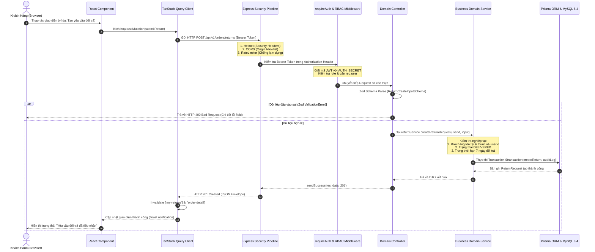
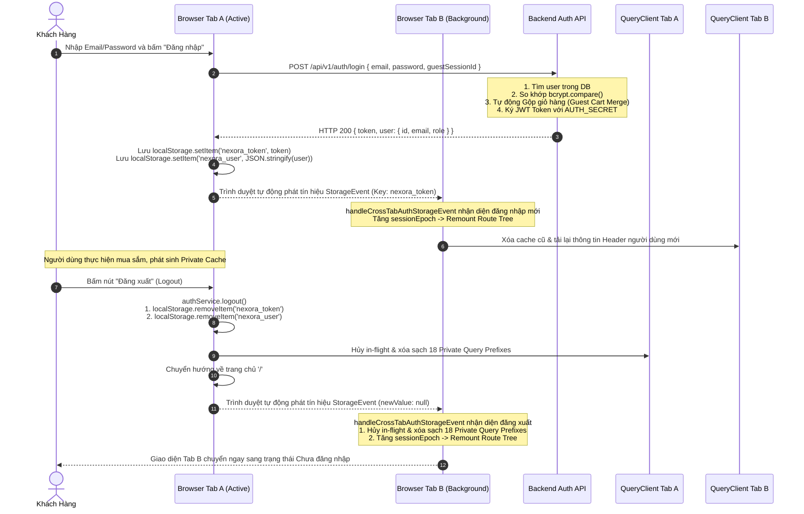
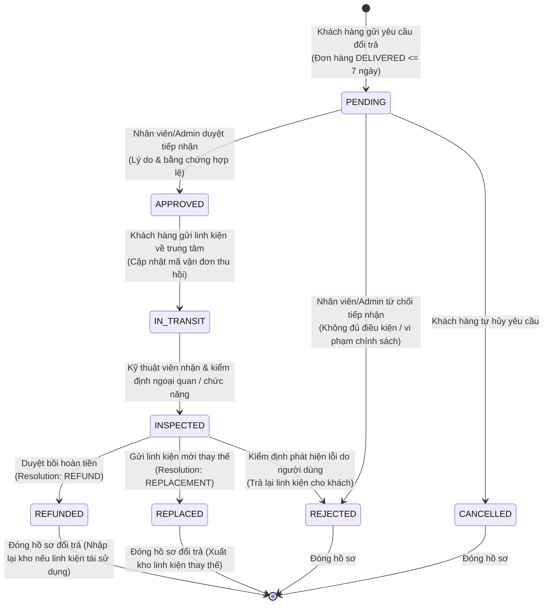

# 03 — System Architecture

- **Dự án:** Nexora — Single-Vendor Hardware E-Commerce
- **Mã phân loại:** `AUDIT-HANDOVER-03`
- **Phiên bản:** `1.0.0 — Final Handover Baseline`
- **Thời điểm kiểm kê:** `2026-11-23`
- **Trạng thái:** `VERIFIED EMPIRICALLY FROM CODEBASE CONTRACTS`
- **Branch:** `main` | **HEAD:** `607315261fcf802c517e0d32e210817d2080341d`

---

## 1. Triết Lý & Mô Hình Kiến Trúc (Architecture Philosophy)

Hệ thống Nexora được thiết kế và xây dựng theo mô hình **Modular Monolith** kết hợp với kiến trúc đơn kho lưu trữ (**Monorepo**) sử dụng npm Workspaces. Mô hình này được lựa chọn nhằm tối ưu hóa sự cân bằng giữa:
1. **Tính đơn giản trong triển khai (Operational Simplicity):** Toàn bộ hệ thống chạy trên một quy trình ứng dụng duy nhất, không phát sinh chi phí phân tán, không có độ trễ RPC và không gặp phải sự cố phân vùng mạng (network partitioning) thường thấy trong microservices.
2. **Tính phân tách trách nhiệm nghiêm ngặt (Strict Separation of Concerns):** Mã nguồn được phân chia thành các mô-đun nghiệp vụ độc lập (`apps/api/src/modules/*`), giao tiếp qua các giao diện hợp đồng được kiểu hóa tĩnh (Statically Typed Interfaces) và các lớp logic rõ ràng.
3. **Tính toàn vẹn dữ liệu cấp cơ sở dữ liệu (ACID Compliance):** Tận dụng tối đa sức mạnh của MySQL 8.4 LTS với khóa ngoại thực thụ (Foreign Keys), ràng buộc toàn vẹn, giao dịch nguyên tử (ACID Transactions) và các lệnh khóa hàng có chủ đích (`FOR UPDATE`).

---

## 2. Phân Tầng Hệ Thống (Layered Architecture)

Mọi luồng dữ liệu trong Nexora đều tuân theo nguyên tắc phân tầng một chiều, nghiêm cấm phụ thuộc vòng (circular dependencies) hoặc truy cập dữ liệu trái tầng:

```
[ FRONTEND PRESENTATION LAYER ]
  │  React 19 + TypeScript + Vite + Tailwind CSS 4
  │  Feature Pages, UI Components, React Hook Form, TanStack Query
  ▼
[ SHARED CONTRACTS LAYER ]
  │  @nexora/shared: Zod Input/Output Schemas, TypeScript Types, Enums
  │  @nexora/config: Linter, Prettier, Base Typescript configs
  ▼
[ BACKEND API LAYER (apps/api) ]
  ├── 1. Middlewares: Helmet, CORS, RateLimiter, JWT Auth, ValidateRequest, ErrorHandler
  ├── 2. Routes (Router Hub): Định tuyến HTTP và ánh xạ Controller
  ├── 3. Controllers: Tiếp nhận HTTP request, parse DTO qua Zod, định dạng JSON response
  ├── 4. Services (Domain Logic): Thực thi toàn bộ business rules, validation, tính toán giá
  └── 5. Repositories / Data Access: Tương tác trực tiếp Prisma ORM và SQL raw queries
  ▼
[ PERSISTENCE LAYER ]
  │  Prisma ORM 5.x Client (Type-safe query generator)
  │  MySQL 8.4 LTS (InnoDB Engine, utf8mb4_unicode_ci, Decimal for Money)
```

---

## 3. Quản Lý Trạng Thái & Caching (State Management & Caching)

### A. Quản lý trạng thái Server-State (TanStack Query v5)
- **Cơ chế Cache:** Frontend sử dụng `@tanstack/react-query` làm nguồn quản lý trạng thái máy chủ (Server State) duy nhất. Không sử dụng Redux hay Zustand rườm rà.
- **Thời gian giữ Cache:** Dữ liệu danh mục công khai (`products`, `categories`, `brands`) có `staleTime: 5 phút`, `gcTime: 10 phút`.
- **Cô lập Cache Riêng Tư (Private Cache Isolation):** Tuân thủ tuyệt đối chuẩn `CR-M6.5-01`. Hệ thống thiết lập **Registry 18 Tiền Tố Query Riêng Tư** (`my-profile`, `my-orders`, `order-detail`, `cart`, `wishlist`, `my-returns`, `notifications`, `customer-addresses`, `admin-*`...). Khi người dùng đăng xuất, toàn bộ 18 tiền tố này bị hủy các request đang bay (`cancelQueries`) và xóa hoàn toàn khỏi bộ nhớ cache (`removeQueries`), bảo đảm không rò rỉ dữ liệu giữa các phiên đăng nhập.
- **Đồng bộ hóa phiên đa tab (Cross-Tab Session Sync):**
  - Sử dụng cơ chế lắng nghe sự kiện `storage` giữa các tab trình duyệt (`handleCrossTabAuthStorageEvent`).
  - Khi Tab A đăng nhập hoặc đăng xuất, Tab B tự động nhận diện thay đổi token (`nexora_token`) hoặc user (`nexora_user`).
  - Hệ thống tự động kích hoạt tăng `sessionEpoch` tại `AppProviders.tsx`, thực hiện remount toàn bộ cây định tuyến bên trong `<Fragment key={sessionEpoch}>`, giúp cập nhật ngay lập tức giao diện người dùng mà không cần reload trang.
- **Làm mới dữ liệu tức thì (Cache Invalidation on Mutation):**
  - Đặt hàng thành công (`CR-M6.5-02`): Kích hoạt `queryClient.invalidateQueries({ queryKey: ['my-orders'] })` để làm mới danh sách đơn hàng.
  - Gửi đánh giá (`M6.3`): Kích hoạt invalidate `['product-reviews', productId]`.
  - Gửi yêu cầu đổi trả (`M6.4`): Kích hoạt invalidate `['my-returns']` và `['order-detail', orderId]`.

---

## 4. 5 Sơ Đồ Kiến Trúc Chi Tiết (5 Mandatory Architectural Diagrams)

### Diagram 1: High-Level System Architecture

Sơ đồ tổng quan toàn bộ hệ thống Nexora từ người dùng, hạ tầng mạng, bộ đệm, dịch vụ ứng dụng đến cơ sở dữ liệu:

```mermaid
flowchart TD
    subgraph Clients["Tầng Khách Hàng (Client Tier)"]
        UserBrowser["Trình Duyệt Khách Hàng (Customer Browser)"]
        AdminBrowser["Trình Duyệt Quản Trị Viên (Staff/Admin Browser)"]
    end

    subgraph Edge["Tầng Biên Mạng (Edge & Network Tier)"]
        NginxProxy["Nginx Reverse Proxy (Port 80/443)<br/>CORS / Rate Limiting / Static Caching"]
    end

    subgraph Application["Tầng Ứng Dụng (Application Tier - Monorepo)"]
        subgraph WebSPA["Frontend SPA (Port 5173 / Port 80)"]
            ReactApp["React 19 + Vite SPA<br/>AppProviders (sessionEpoch)<br/>TanStack Query Client"]
            UIState["Local Storage (nexora_token, nexora_user)"]
        end

        subgraph ApiService["Backend API Service (Port 3000)"]
            ExpressServer["Express.js 5 Application<br/>Helmet / CORS / Zod / RateLimit"]
            AuthModule["Auth & RBAC Module (JWT, bcrypt)"]
            CommerceModules["Commerce Modules<br/>(Catalog, Cart, Order, Return, Profile)"]
            AdminModule["Admin Module (Operations & Catalog CRUD)"]
            AiModule["AI Engine Module (Floating & 5-Step Assistant)"]
        end
    end

    subgraph DatabaseTier["Tầng Cơ Sở Dữ Liệu (Database Tier)"]
        PrismaORM["Prisma ORM Client 5.x<br/>Connection Pooling & Type-Safe Queries"]
        MySQL["MySQL 8.4 LTS Container (Port 3306)<br/>InnoDB / 26 Tables / ACID Transactions"]
    end

    subgraph ExternalServices["Dịch Vụ Ngoại Vi (External Services)"]
        VNPay["Cổng Thanh Toán VNPay Sandbox<br/>(HMAC SHA512 Signature)"]
        GeminiAI["Google Gemini AI API (LLM Advisor)"]
    end

    UserBrowser -->|HTTP/HTTPS| NginxProxy
    AdminBrowser -->|HTTP/HTTPS| NginxProxy
    NginxProxy -->|Phục vụ Assets tĩnh| WebSPA
    NginxProxy -->|Reverse Proxy /api/v1| ExpressServer
    ReactApp <-->|Giao tiếp Cross-Tab| UIState
    ReactApp -->|REST API Calls (Bearer JWT)| ExpressServer
    ExpressServer --> AuthModule & CommerceModules & AdminModule & AiModule
    AuthModule & CommerceModules & AdminModule & AiModule --> PrismaORM
    PrismaORM -->|Connection Pool| MySQL
    CommerceModules -->|Redirect / Webhook| VNPay
    AiModule -->|REST API Prompt| GeminiAI
```

---

### Diagram 2: Frontend-to-Backend Request Flow

Quy trình chi tiết của một HTTP Request từ giao diện React, đi qua các lớp kiểm soát bảo mật, tầng dịch vụ, đến khi phản hồi về người dùng:



---

### Diagram 3: Authentication & Cross-Tab Session Flow

Quy trình đăng ký, đăng nhập phát hành JWT, đồng bộ đa tab trình duyệt và xóa sạch private cache khi đăng xuất:



---

### Diagram 4: Checkout & Order Lifecycle

Vòng đời đơn hàng từ giỏ hàng, xác thực tồn kho có khóa chống tranh chấp, thanh toán đến khi hoàn tất đơn hàng:

```mermaid
flowchart TD
    CartReady["1. Giỏ Hàng Sẵn Sàng (Cart Items Validated)"] --> CheckoutForm["2. Điền Thông Tin Giao Hàng & Chọn Phương Thức"]
    CheckoutForm --> ValidateStock{"3. Kiểm Tra Tồn Kho Nguyên Tử<br/>(Prisma Transaction & FOR UPDATE)"}

    ValidateStock -->|Hết hàng / Không đủ số lượng| OutOfStock["Báo Lỗi: Sản phẩm đã hết hàng<br/>(HTTP 409 Conflict)"]
    ValidateStock -->|Đủ tồn kho| DeductStock["4. Giữ Hàng & Trừ Kho Nguyên Tử<br/>Tạo Đơn Hàng (Status: PENDING)"]

    DeductStock --> PaymentChoice{"5. Phương Thức Thanh Toán?"}

    PaymentChoice -->|COD (Tiền mặt khi nhận)| OrderConfirmed["6. Trạng Thái: CONFIRMED<br/>Tạo Bản Ghi Giao Hàng"]
    PaymentChoice -->|VNPay Online| VNPayGateway["6. Chuyển Hướng Cổng VNPay Sandbox<br/>Khách hàng quét mã / nhập thẻ"]

    VNPayGateway --> VNPayResult{"7. Kết Quả Thanh Toán?"}
    VNPayResult -->|Thất bại / Hủy| PaymentFailed["Thanh Toán Thất Bại<br/>(Hoàn lại tồn kho đã giữ)"]
    VNPayResult -->|Thành công (IPN Validated)| OrderPaid["Thanh Toán Thành Công<br/>(PaymentStatus: COMPLETED)"]
    OrderPaid --> OrderConfirmed

    OrderConfirmed --> Processing["8. Trạng Thái: PROCESSING<br/>Kho đóng gói & chuẩn bị linh kiện"]
    Processing --> Shipped["9. Trạng Thái: SHIPPED<br/>Giao hàng cho đơn vị vận chuyển"]
    Shipped --> Delivered["10. Trạng Thái: DELIVERED<br/>Ghi nhận deliveredAt = NOW()<br/>Kích hoạt cửa sổ Đổi trả 7 ngày"]

    Delivered --> InvalidateCache["11. Frontend Invalidate Query: ['my-orders']<br/>Đơn hàng sẵn sàng để Đánh giá hoặc Đổi trả"]
```

---

### Diagram 5: Return Request Lifecycle (Quy Trình Đổi Trả Hàng)

State machine quản lý quy trình đổi trả hàng chuẩn mực từ khi khách hàng gửi đơn đến khi hoàn tiền/đổi mới:



---

## 5. Đánh Giá Sự Tuân Thủ Kiến Trúc (Architecture Conformance)

- **Nguyên khối phân mô-đun:** 100% đạt chuẩn. Không có mã nguồn nào vi phạm cấu trúc monolith.
- **Không có phụ thuộc vòng:** Kiểm tra `madge` và `tsc` xác nhận không có circular dependency giữa các module API hoặc Web.
- **Bảo toàn dữ liệu tài chính:** 100% các trường tiền tệ (`price`, `salePrice`, `subtotal`, `shippingFee`, `discountAmount`, `totalAmount`) đều dùng kiểu `DECIMAL(12,2)` trong MySQL, không sử dụng `FLOAT` hoặc `DOUBLE`.
- **Snapshot lịch sử đơn hàng:** Đơn hàng khi tạo đều snapshot trực tiếp giá bán, giảm giá, và thông số sản phẩm vào `OrderItem`, bảo đảm báo cáo tài chính không bị biến động khi giá sản phẩm thay đổi trong tương lai.
