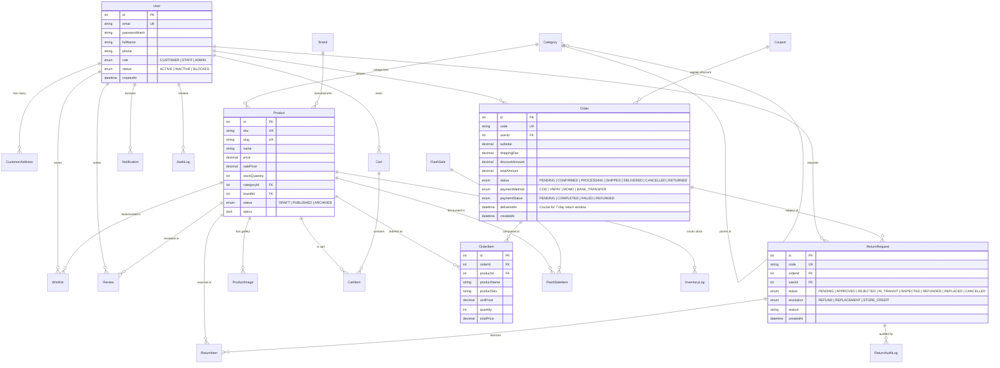

# 07 — Database Schema and ERD

- **Dự án:** Nexora — Single-Vendor Hardware E-Commerce
- **Mã phân loại:** `AUDIT-HANDOVER-07`
- **Phiên bản:** `1.0.0 — Final Handover Baseline`
- **Thời điểm kiểm kê:** `2026-11-23`
- **Trạng thái:** `VERIFIED EMPIRICALLY FROM MYSQL 8.4 RUNTIME & PRISMA SCHEMA`
- **Branch:** `main` | **HEAD:** `607315261fcf802c517e0d32e210817d2080341d`

---

## 1. Tổng Quan Cơ Sở Dữ Liệu (Database Overview)

Cơ sở dữ liệu của Nexora được xây dựng trên nền tảng **MySQL 8.4 LTS** chuẩn mực, quản lý thông qua **Prisma ORM 5.x** và di chuyển cấu trúc bằng **Prisma Migrate**.

### Đặc Tính Kỹ Thuật Chính:
- **Engine lưu trữ:** InnoDB (hỗ trợ đầy đủ ACID Transactions, Row-level locking `FOR UPDATE`, và Foreign Keys).
- **Bộ mã ký tự (Charset & Collation):** `utf8mb4` kết hợp `utf8mb4_unicode_ci` (hỗ trợ đầy đủ tiếng Việt có dấu, emoji, và ký tự quốc tế).
- **Chuẩn hóa dữ liệu:** Thiết kế tuân thủ nghiêm ngặt **Chuẩn 3NF (Third Normal Form)**, loại bỏ hoàn toàn dư thừa dữ liệu bất hợp lý.
- **Tiền tệ & Tài chính:** 100% các trường giá cả, phí vận chuyển, giảm giá và tổng tiền đều dùng kiểu `DECIMAL(12,2)`. Nghiêm cấm dùng `FLOAT` hoặc `DOUBLE` để tránh sai số dấu phẩy động trong kế toán bán lẻ.
- **Snapshot lịch sử đơn hàng:** Đơn hàng khi tạo snapshot trực tiếp đơn giá tại thời điểm mua (`unitPrice`), giá vốn (`cogs`), tên và thông số sản phẩm vào `OrderItem`, bảo đảm tính độc lập của báo cáo tài chính lịch sử khi sản phẩm đổi giá.

---

## 2. Kiểm Kê Định Lượng Models & Enums

### A. Danh mục 26 Data Models
1. `User` (`users`): Tài khoản người dùng (Customer, Staff, Admin).
2. `CustomerAddress` (`customer_addresses`): Sổ địa chỉ giao hàng của khách.
3. `Brand` (`brands`): Thương hiệu sản phẩm linh kiện phần cứng.
4. `Category` (`categories`): Cây danh mục sản phẩm (hỗ trợ phân cấp cha - con).
5. `Product` (`products`): Bảng dữ liệu sản phẩm linh kiện cốt lõi.
6. `ProductImage` (`product_images`): Thư viện hình ảnh chi tiết của sản phẩm.
7. `Banner` (`banners`): Biểu ngữ quảng cáo slider và khuyến mãi.
8. `Cart` (`carts`): Giỏ hàng của người dùng (Customer hoặc Guest Session).
9. `CartItem` (`cart_items`): Các sản phẩm nằm trong giỏ hàng.
10. `Wishlist` (`wishlists`): Danh sách sản phẩm yêu thích của khách hàng.
11. `Review` (`reviews`): Đánh giá, chấm sao và bình luận sản phẩm.
12. `StoreSetting` (`store_settings`): Các tham số cấu hình vận hành cửa hàng.
13. `AuditLog` (`audit_logs`): Nhật ký kiểm toán thao tác hệ thống.
14. `Order` (`orders`): Đơn đặt hàng của khách hàng.
15. `OrderItem` (`order_items`): Chi tiết từng linh kiện trong đơn hàng.
16. `Coupon` (`coupons`): Mã giảm giá và phiếu ưu đãi.
17. `FlashSale` (`flash_sales`): Chiến dịch giảm giá chớp nhoáng theo khung giờ.
18. `FlashSaleItem` (`flash_sale_items`): Linh kiện gán vào chiến dịch Flash Sale.
19. `InventoryLog` (`inventory_logs`): Nhật ký biến động xuất - nhập - tồn kho.
20. `Post` (`posts`): Tin tức công nghệ, bài viết tư vấn phần cứng.
21. `Notification` (`notifications`): Thông báo cá nhân cho người dùng.
22. `ReturnRequest` (`return_requests`): Hồ sơ yêu cầu đổi trả hàng.
23. `ReturnItem` (`return_items`): Danh sách sản phẩm kèm lý do trong đơn đổi trả.
24. `ReturnAuditLog` (`return_audit_logs`): Nhật ký chuyển trạng thái xử lý đổi trả.
25. `AiAssistantLog` (`ai_assistant_logs`): Nhật ký truy vấn và gợi ý của trợ lý AI.
26. `ProductAiChatHistory` (`product_ai_chat_histories`): Lịch sử hỏi đáp AI tại trang chi tiết sản phẩm.

### B. Danh mục 11 Enums Phân Quyền & Vòng Đời Nghiệp Vụ
1. `UserRole`: `CUSTOMER`, `STAFF`, `ADMIN`
2. `UserStatus`: `ACTIVE`, `INACTIVE`, `BLOCKED`
3. `ProductStatus`: `DRAFT`, `PUBLISHED`, `ARCHIVED`
4. `OrderStatus`: `PENDING`, `CONFIRMED`, `PROCESSING`, `SHIPPED`, `DELIVERED`, `CANCELLED`, `RETURNED`
5. `PaymentMethod`: `COD`, `VNPAY`, `MOMO`, `BANK_TRANSFER`
6. `PaymentStatus`: `PENDING`, `COMPLETED`, `FAILED`, `REFUNDED`
7. `CouponDiscountType`: `PERCENTAGE`, `FIXED_AMOUNT`
8. `InventoryChangeType`: `PURCHASE_ORDER`, `SALE_DEDUCTION`, `RETURN_RESTOCK`, `MANUAL_ADJUSTMENT`, `DAMAGED_DISCARD`
9. `ReturnRequestStatus`: `PENDING`, `APPROVED`, `REJECTED`, `IN_TRANSIT`, `INSPECTED`, `REFUNDED`, `REPLACED`, `CANCELLED`
10. `ReturnResolution`: `REFUND`, `REPLACEMENT`, `STORE_CREDIT`
11. `ReviewStatus`: `PENDING`, `APPROVED`, `REJECTED`

---

## 3. Sơ Đồ Thực Thể - Quan Hệ Chi Tiết (Entity-Relationship Diagram - ERD)

Dưới đây là sơ đồ Mermaid ERD mô tả các mối quan hệ thực tế giữa 26 bảng dữ liệu:

---

## 4. Kiểm Kê Dữ Liệu Thực Tế Trong Database Phát Triển (Live DB Counts)

Truy vấn thực tế vào cơ sở dữ liệu `mysql://127.0.0.1:3306/nexora` tại thời điểm kiểm toán:

| STT | Model (Tên Bảng MySQL) | Số lượng bản ghi (Rows) | Ý nghĩa nghiệp vụ trong môi trường phát triển |
| :---: | :--- | :---: | :--- |
| 1 | `User` (`users`) | **3** | Gồm 3 tài khoản mẫu chuẩn: Admin, Staff, Customer |
| 2 | `CustomerAddress` (`customer_addresses`) | **1** | Địa chỉ giao hàng mẫu của khách hàng |
| 3 | `Brand` (`brands`) | **31** | Toàn bộ 31 thương hiệu phần cứng (Asus, Apple, MSI...) |
| 4 | `Category` (`categories`) | **36** | 36 danh mục linh kiện (21 danh mục gốc + 15 nhóm tiện ích) |
| 5 | `Product` (`products`) | **674** | Danh mục 674 sản phẩm phần cứng nhập từ TechPilot |
| 6 | `ProductImage` (`product_images`) | **23** | 23 bản ghi thư viện ảnh chi tiết đã seed cho demo products |
| 7 | `Banner` (`banners`) | **9** | 9 banner quảng cáo hero slider và promo banners |
| 8 | `Cart` (`carts`) | **8** | Các phiên giỏ hàng mẫu và phiên khách vãng lai |
| 9 | `CartItem` (`cart_items`) | **2** | Linh kiện đang nằm trong các giỏ hàng |
| 10 | `Wishlist` (`wishlists`) | **1** | Sản phẩm yêu thích mẫu |
| 11 | `Review` (`reviews`) | **0** | Đã dọn dẹp sạch sau đợt kiểm thử tích hợp tự động |
| 12 | `StoreSetting` (`store_settings`) | **5** | Các tham số cấu hình: Hotline, Email, Địa chỉ, Free Ship |
| 13 | `AuditLog` (`audit_logs`) | **2** | Bản ghi nhật ký thao tác kiểm toán mẫu |
| 14 | `Order` (`orders`) | **2** | 2 đơn hàng mẫu phục vụ kiểm thử luồng thanh toán và đổi trả |
| 15 | `OrderItem` (`order_items`) | **2** | Chi tiết các linh kiện nằm trong 2 đơn hàng mẫu |
| 16 | `Coupon` (`coupons`) | **5** | 5 mã giảm giá mẫu (NEXORA50, WELCOME10, GAMING100...) |
| 17 | `FlashSale` (`flash_sales`) | **1** | 1 chiến dịch Flash Sale đang diễn ra |
| 18 | `FlashSaleItem` (`flash_sale_items`) | **1** | 1 sản phẩm tham gia chiến dịch Flash Sale |
| 19 | `InventoryLog` (`inventory_logs`) | **0** | Sẵn sàng ghi nhật ký khi có thao tác xuất nhập kho |
| 20 | `Post` (`posts`) | **8** | 8 bài viết tin tức công nghệ và hướng dẫn phần cứng |
| 21 | `Notification` (`notifications`) | **2** | Thông báo chào mừng thành viên mới |
| 22 | `ReturnRequest` (`return_requests`) | **0** | Đã dọn dẹp sạch sau đợt kiểm thử tự động M6.4 / M6.5 |
| 23 | `ReturnItem` (`return_items`) | **0** | Dọn dẹp sạch kèm theo ReturnRequest |
| 24 | `ReturnAuditLog` (`return_audit_logs`) | **0** | Dọn dẹp sạch kèm theo ReturnRequest |
| 25 | `AiAssistantLog` (`ai_assistant_logs`) | **11** | 11 truy vấn khảo sát cấu hình PC của trợ lý AI |
| 26 | `ProductAiChatHistory` (`product_ai_chat_histories`) | **0** | Lịch sử chat AI tại trang sản phẩm |

---

## 5. Lịch Sử 8 Bản Ghi Di Chuyển (Prisma Migrations History)

Các migration đã được áp dụng tuần tự, đồng bộ hoàn toàn giữa mã nguồn và database:

1. `20261118162807_init_foundation`: Khởi tạo nền tảng ban đầu, các bảng User, Address, Brand, Category, Product, Cart.
2. `20261118175000_rename_user_role_seller_to_staff`: Đồng bộ ranh giới nghiệp vụ Single-Vendor, đổi enum `SELLER` thành `STAFF`.
3. `20261119044649_init_storefront_and_catalog`: Bổ sung cấu trúc danh mục, banner, thông số kỹ thuật `specs` JSON cho linh kiện.
4. `20261119070000_add_orders_coupons_inventory_ai_models`: Bổ sung bảng Order, OrderItem, Coupon, FlashSale, InventoryLog, AI logs.
5. `20261122110000_add_reviews_moderation_and_unique`: Thêm bảng Review với ràng buộc chống trùng lặp `@@unique([productId, userId])` và kiểm duyệt.
6. `20261122120000_fix_review_verified_purchase_default`: Điều chỉnh giá trị mặc định cho cờ `isVerifiedPurchase = false` bảo đảm an toàn.
7. `20261122140000_add_returns_workflow_and_order_delivered_at`: Bổ sung trường `deliveredAt` cho đơn hàng và các bảng quản trị đổi trả `ReturnRequest`, `ReturnItem`, `ReturnAuditLog`.
8. `20261122160000_sanitize_unverified_delivered_at`: Loại bỏ hoàn toàn fallback nguy hiểm `updatedAt` trong tính hạn đổi trả 7 ngày, bảo đảm toàn vẹn nghiệp vụ M5 / M6.4.
