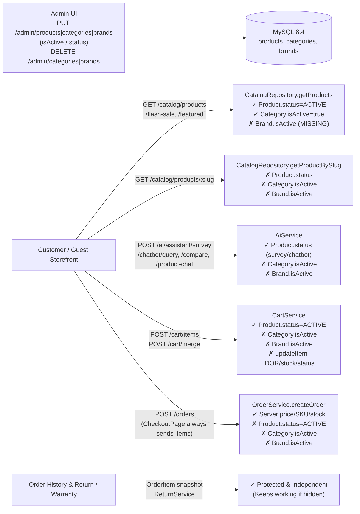

# NEXORA — READ-ONLY DISCOVERY: PRODUCT, CATEGORY & BRAND VISIBILITY INTEGRITY (B-01..B-05 + FULL RUNTIME AUDIT)

- **Audit Mode:** STRICT `READ-ONLY DISCOVERY` (0 source edits, 0 test edits, 0 schema/DB mutations, 0 commits/pushes)
- **Workspace:** `D:\Nexora`
- **Branch:** `main`
- **HEAD Commit:** `bddbf444d651bcf8bd43765318fb4fd6bd9654d6` (`fix(catalog): dong bo danh muc category va toi uu anh san pham laptop`)
- **Prior Baseline Preserved:** `DEF-RT-01` modified tree (`M apps/web/src/lib/productImage.ts`, untracked `apps/web/tests/def_rt_01_product_image.test.ts`, `DEF-RT-01_IMPLEMENTATION_REPORT.md`) — 100% untouched.
- **Audit Date:** `2026-11-25`

---

## 1. Executive Summary

Đợt kiểm toán đọc-duy-nhất (**READ-ONLY DISCOVERY**) đã xác minh đầy đủ toàn bộ luồng từ HTTP Controller -> Zod Validation -> Service -> Repository -> Prisma/MySQL 8.4 -> Frontend UI -> Test Suite cho **5 phát hiện `B-01` đến `B-05`**, đối chiếu cả mã nguồn tham chiếu **TechPilot (`D:\02_Dự Án Phần Mềm\TechPilot (Bản Chính Thức)`)**, Dev DB `127.0.0.1:3306/nexora`, và các lỗi UI/UX thực tế do Project Owner phát hiện trên ảnh chụp màn hình.

### Kết luận tổng hợp 5 phát hiện trọng tâm

| ID | Thành phần | Trạng thái | Mức độ | Tóm tắt xác minh |
| --- | --- | --- | --- | --- |
| **B-01** | `OrderService.createOrder` | **`CONFIRMED`** | **P0 / Critical** | `POST /api/v1/orders` (kể cả khi `CheckoutPage` gửi `items`) **chỉ kiểm tra tồn tại ID và `stockQuantity`**, không kiểm tra `product.status === 'ACTIVE'`, `category.isActive === true`, hay `brand.isActive === true`. Bất kỳ sản phẩm `INACTIVE` còn tồn kho (như lúc Project Owner test ẩn ID `815` với `stockQuantity = 51`) hoặc sản phẩm thuộc danh mục ẩn đều có thể bị đặt mua qua API trực tiếp. Giá/tên/SKU vẫn lấy từ DB (không thể giả mạo giá). |
| **B-02** | `CartService.addItem` (+ `updateItem`, `mergeGuestCartToUser`) | **`CONFIRMED`** | **P1 / High** | `addItem` đã chặn `product.status !== 'ACTIVE'`, nhưng **không chặn** `category.isActive === false` và `brand.isActive === false`, và không kiểm tra `existingItem.quantity + qty <= stockQuantity`. `mergeGuestCartToUser` chặn `product.status !== 'ACTIVE'` (`MERGE-SC4`) nhưng cũng **bỏ sót `category.isActive` / `brand.isActive`**. Phát hiện thêm `updateItem` không check ownership/cartId, status hay stock. |
| **B-03** | `AiService.runSurveyRecommendation` (+ toàn bộ `AiService`) | **`CONFIRMED`** | **P1 / High** | Cả `runSurveyRecommendation` và `queryFloatingChatbot` chỉ lọc `status: 'ACTIVE'` mà **không lọc `category: { isActive: true }` hay `brand` active**; nhánh fallback khi rỗng ứng viên còn quét toàn bộ `{ status: 'ACTIVE' }` xuyên cả danh mục ẩn. Hai endpoint `compareProducts` và `queryProductChat` còn **không kiểm tra cả `status: 'ACTIVE'`** lẫn `category.isActive`. |
| **B-04** | `CatalogRepository.getProducts` (+ `getProductBySlug` & Flash Sale) | **`CONFIRMED`** | **P1 / High** | `getProducts()` đã lọc `status: 'ACTIVE'` và `category: { isActive: true }`, nhưng **không lọc `brand.isActive`** dù `getBrands()` có lọc `isActive: true`. Đáng chú ý trong Dev DB hiện có **`7` sản phẩm có `brandId = null`** nên khi sửa phải lọc `OR: [{ brandId: null }, { brand: { isActive: true } }]`. Ngoài ra `getProductBySlug()` không ẩn sản phẩm `INACTIVE` / category ẩn / brand ẩn, và `MarketingService.getActiveFlashSale()` bỏ sót `category.isActive` & `brand.isActive`. |
| **B-05** | `AdminService.deleteCategory` (+ `deleteBrand`) | **`CONFIRMED`** | **P2 / Medium** *(Policy Decision)* | `deleteCategory()` hiện chặn khi có sản phẩm hoặc danh mục con, nhưng **xóa cứng (`tx.category.delete`)** danh mục rỗng — và đang được khóa chặt bởi test M5 (`CAT-04`). Trong khi đó TechPilot (`AdminCategoryController.php:256-265`) và `AdminService.deleteProduct()` đều dùng **ẩn mềm (`INACTIVE`/`isActive=false`)** và đồng bộ ẩn danh mục con. Ngoài ra `AdminService.deleteBrand()` thậm chí **xóa cứng không kiểm tra sản phẩm**, có thể âm thầm `SetNull` trường `brandId` trên sản phẩm đang bán. Cần **Project Owner quyết định** vì ảnh hưởng contract M5 (`CAT-04`). |

### Phát hiện bổ sung từ kiểm tra thực tế của Project Owner (READ-ONLY — Chờ phê duyệt sửa)

1. **`PO-BUG-01` (`60 vs 50` & không gõ trực tiếp số lượng — `ProductDetailPage.tsx` & `CartPage.tsx`):** Hiển thị số lượng đang là thẻ `` (không click nhập tay được), nút `+` không chặn `max = product.stockQuantity`, và `useState(1)` không reset khi đổi `slug` nên khi chuyển từ sản phẩm này sang sản phẩm khác con số `60` vẫn bị giữ nguyên dù kho chỉ còn `50` hoặc `30`.
2. **`PO-BUG-02` (`Ảnh bé tí` — `ProductDetailPage.tsx`, `CartPage.tsx` & bộ icon `56x56`):** Các ảnh fallback `category-power-bank.png`, `category-chair.png`, `category-mainboard.png`, `category-speaker.png`, `category-accessories.png` có kích thước gốc **`56×56` px**. Do `ProductDetailPage.tsx:578-579` chỉ đặt `maxWidth: '90%', maxHeight: '90%'` (thiếu `width`/`height` cố định theo khung) nên trình duyệt hiển thị ảnh đúng `56×56` px lọt thỏm giữa khung `460×460` px.
3. **`PO-BUG-03` (`Chỉ người đã mua mới được đánh giá` — `ReviewService` & `ReviewList`):** Đã được bảo vệ chặt cả ở Backend (`ReviewService.createOrUpdateReview:48-66`, `getReviewEligibility:268-302`, yêu cầu đơn `DELIVERED`) và Frontend (`ReviewList.tsx:390-433`).

---

## 2. System Flow

---

## 3. B-01 đến B-05 Findings

---

### B-01 — `OrderService.createOrder` — **`CONFIRMED`** (P0 / Critical)

- **File path & line range:**
  - `apps/api/src/routes/index.ts:33`
  - `apps/api/src/modules/order/order.routes.ts:11`
  - `apps/api/src/modules/order/order.controller.ts:10-31`
  - `packages/shared/src/index.ts:212-233` (`CreateOrderItemInputSchema`, `CreateOrderInputSchema`)
  - `apps/api/src/modules/order/order.service.ts:12-276` (trọng tâm `32-81` và `179-200`)
  - `apps/web/src/features/checkout/CheckoutPage.tsx:136-150`
- **Controller / Service / Repository liên quan:**
  - `OrderRouter` (`optionalAuth()` + `commerceWrite` rate limiter) -> `OrderController.createOrder` -> `OrderService.createOrder` (truy vấn trực tiếp `PrismaClient`, không có lớp Repository tách riêng).
- **Luồng xử lý thực tế:**
  1. `OrderController.createOrder` validate body bằng `CreateOrderInputSchema` (`packages/shared/src/index.ts:217-232`). Trường `items` chỉ nhận `{ productId: number, quantity: number }` — **không nhận giá, tên sản phẩm, SKU hay trạng thái**.
  2. `OrderService.createOrder` (dòng `16-29`): Nếu `input.items` có dữ liệu (`CheckoutPage.tsx:149` **luôn gửi `items`** ngay cả khi user đã đăng nhập!), service lấy thẳng `rawItems = input.items`; ngược lại (chỉ khi `userId` có và `items` rỗng/không truyền), mới đọc `cart.items`.
  3. Dòng `33-39`: Truy vấn `prisma.product.findMany({ where: { id: { in: productIds } } })` **không `include: { category: true, brand: true }`** và không có điều kiện `status`, `category.isActive`, `brand.isActive`. Kiểm tra `products.length !== rawItems.length` (lưu ý phụ: nếu `input.items` có 2 phần tử trùng `productId` sẽ bị lỗi sai thành `PRODUCT_NOT_FOUND` thay vì gộp số lượng).
  4. Dòng `55-81`: Chỉ kiểm tra `prod.stockQuantity < item.quantity` (`INSUFFICIENT_STOCK`). **Hoàn toàn bỏ qua `prod.status` (`INACTIVE` / `OUT_OF_STOCK`), `category.isActive` và `brand.isActive`**.
  5. Nguồn giá, tên, SKU, thumbnail snapshot (`dòng 67-80`): Lấy từ bản ghi DB (`Number(prod.salePrice || prod.price)`, `prod.name`, `prod.sku`, `prod.thumbnailUrl`). **Client không thể giả mạo giá tiền hay tên/SKU sản phẩm.**
  6. Transaction & locking (`dòng 130-245`): Mở `prisma.$transaction` (retry tối đa 3 lần khi gặp `P2034` deadlock/write conflict). Sắp xếp item theo `productId` tăng dần để chống deadlock, rồi thực thi `tx.product.updateMany({ where: { id: item.productId, stockQuantity: { gte: item.quantity } }, data: { stockQuantity: { decrement: item.quantity } } })` — khóa hàng InnoDB nguyên tử cho tồn kho nhưng **vẫn không kèm điều kiện `status: 'ACTIVE'`** bên trong `where` của `updateMany`.
- **Test hiện tại & test còn thiếu:**
  - *Hiện có:* `commerce_and_ai.integration.test.ts:66-110` (chỉ test đặt 1 sản phẩm hợp lệ); `rbac_and_concurrency.test.ts:103-213` (`CONCURRENCY-1`, `CONCURRENCY-2` test quá tải tồn kho và race condition `Promise.all`).
  - *Còn thiếu:* Không có bất kỳ test nào kiểm tra `POST /api/v1/orders` với: (1) `product.status = 'INACTIVE'`; (2) `category.isActive = false`; (3) `brand.isActive = false`; (4) giỏ hàng chứa sản phẩm vừa bị admin ẩn trước khi bấm Thanh toán; (5) payload `items` có trùng `productId`.
- **Điều kiện tái hiện:**
  1. Admin tạm ẩn bất kỳ sản phẩm còn tồn kho nào (`status = 'INACTIVE'`, `stockQuantity > 0`, như trường hợp ID `815` `stockQuantity = 51` trong phiên test của Project Owner) hoặc ẩn danh mục có sản phẩm còn tồn kho.
  2. Gửi `POST /api/v1/orders` với `items: [{ productId, quantity: 1 }]` (kèm thông tin giao hàng hợp lệ) — hoặc khách thêm sản phẩm vào giỏ trước khi Admin bấm ẩn sản phẩm/danh mục, rồi khách bấm Đặt hàng trên `/checkout`.
- **Kết quả xác minh:** **`CONFIRMED`** bằng phân tích đầy đủ luồng code + schema + đối soát toàn bộ test suite (`order.service.ts:33-65, 182-190` không có một dòng kiểm tra nào cho `status === 'ACTIVE'`, `category.isActive`, hay `brand.isActive`). Không gửi `POST /api/v1/orders` ghi vào Dev DB để tuân thủ quy tắc READ-ONLY mục 5.
- **Mức độ ảnh hưởng:** **Critical (P0)** — Khách hàng hoặc kịch bản API có thể mua và trừ tồn kho sản phẩm đã ngừng bán hoặc thuộc danh mục/thương hiệu đã tắt hiển thị.
- **Đề xuất sửa tối thiểu:**
  1. Trước vòng lặp kiểm tra ở `order.service.ts:33`, gộp `rawItems` theo `productId` và `include: { category: { select: { isActive: true, name: true } }, brand: { select: { isActive: true, name: true } } }`.
  2. Chặn với mã lỗi rõ ràng (`400 PRODUCT_UNAVAILABLE`) nếu `prod.status !== 'ACTIVE'`, `!prod.category.isActive`, hoặc `(prod.brand && !prod.brand.isActive)`.
  3. Bên trong `$transaction`, bổ sung `status: 'ACTIVE'` vào `where` của `tx.product.updateMany(...)` (`dòng 183-186`) và cập nhật `status: 'OUT_OF_STOCK'` nếu tồn kho sau khi trừ về `0` (hoặc giữ rule nhất quán với `adjustStock`).
- **Module có nguy cơ bị ảnh hưởng:** `OrderModule`, `CheckoutPage` (cần hiển thị toast lỗi rõ khi BE từ chối đơn do sản phẩm vừa ngừng kinh doanh), `PaymentModule` (VNPay tạo đơn trước rồi mới redirect), `CartModule`.

---

### B-02 — `CartService.addItem` (cùng `updateItem` & `mergeGuestCartToUser`) — **`CONFIRMED`** (P1 / High)

- **File path & line range:**
  - `apps/api/src/modules/cart/cart.routes.ts:11-16`
  - `apps/api/src/modules/cart/cart.controller.ts:19-112`
  - `apps/api/src/modules/cart/cart.service.ts:47-112` (`getCartSummary`), `114-168` (`addItem`), `170-188` (`updateItem`), `213-393` (`mergeGuestCartToUser`)
  - `apps/api/tests/phase_b_cart_merge.test.ts:118-133, 353-387`
- **Controller / Service / Repository liên quan:**
  - `CartRouter` (`optionalAuth()`, `requireAuth()` cho `/merge`) -> `CartController` -> `CartService` (dùng trực tiếp `PrismaClient`).
- **Luồng xử lý thực tế:**
  - `POST /api/v1/cart/items` -> `CartController.addItem` -> `CartService.addItem`:
    - *Product `INACTIVE`:* **ĐÃ BỊ CHẶN ở phía server** tại `cart.service.ts:127-133` (`if (!product || product.status !== 'ACTIVE') throw AppError(404, 'PRODUCT_NOT_AVAILABLE', ...)`).
    - *Category `INACTIVE`:* **KHÔNG BỊ CHẶN** (`cart.service.ts:123-125` dùng `findUnique({ where: { id: params.productId } })` không kèm `category`, không kiểm tra `category.isActive`).
    - *Brand `INACTIVE`:* **KHÔNG BỊ CHẶN** (tương tự không include/kiểm tra `brand.isActive`).
    - *Tồn kho cộng dồn (`addItem:152-156`):* Nếu sản phẩm đã nằm trong giỏ, `existingItem.quantity + qty` được cộng thẳng **không kiểm tra tổng `existingItem.quantity + qty <= product.stockQuantity`** (chỉ kiểm tra `product.stockQuantity < qty` ở dòng `135`).
  - `PATCH /api/v1/cart/items/:id` -> `CartService.updateItem` (`170-188`):
    - Cập nhật trực tiếp theo `where: { id: params.cartItemId }` — **không kiểm tra `cartItem` có thuộc `userId`/`guestSessionId` hiện tại hay không** (IDOR), không kiểm tra `product.status`, `category.isActive`, `brand.isActive`, và không giới hạn `stockQuantity`.
  - `POST /api/v1/cart/merge` -> `CartService.mergeGuestCartToUser` (`213-393`):
    - Dòng `254`: Chỉ `include: { items: { include: { product: true } } }`.
    - Dòng `306`: Kiểm tra `if (!product || product.status !== 'ACTIVE')` -> **đã xử lý tốt với `product.status = INACTIVE`**, **NHƯNG bỏ sót trường hợp sản phẩm vẫn `ACTIVE` trong khi `category.isActive === false` hoặc `brand.isActive === false`**. Sản phẩm thuộc danh mục ẩn sẽ vẫn được merge hợp lệ vào giỏ hàng user sau khi đăng nhập!
- **Test hiện tại & test còn thiếu:**
  - *Hiện có:* `storefront.integration.test.ts:77-95` (thêm `productId: 1` vào giỏ); `phase_b_cart_merge.test.ts:353-387` (`MERGE-SC4` test skip `product.status = 'INACTIVE'`).
  - *Còn thiếu:* Chưa có test unit/integration nào kiểm tra `POST /api/v1/cart/items` với `product.status = 'INACTIVE'`, `category.isActive = false`, `brand.isActive = false`, cộng dồn vượt tồn kho; chưa có test `POST /api/v1/cart/merge` với `category.isActive = false` / `brand.isActive = false`; chưa có test ownership & stock limit cho `PATCH /api/v1/cart/items/:id`.
- **Điều kiện tái hiện:**
  1. Admin đặt `isActive = false` cho một danh mục (ví dụ `power-bank`) hoặc thương hiệu, giữ `product.status = 'ACTIVE'`.
  2. Gọi `POST /api/v1/cart/items` với `{ productId, quantity: 1 }` -> trả `200 OK` và thêm thành công.
  3. Hoặc khách vãng lai đã thêm sản phẩm đó trước khi danh mục bị ẩn rồi đăng nhập kích hoạt `POST /api/v1/cart/merge` -> item vẫn được gộp vào giỏ của user thay vì skip + cảnh báo.
- **Kết quả xác minh:** **`CONFIRMED`**.
- **Mức độ ảnh hưởng:** **High (P1)** — Cho phép thêm/giữ/merge sản phẩm thuộc danh mục/thương hiệu đã ẩn vào giỏ hàng; cộng dồn `addItem`/`updateItem` vượt tồn kho; `updateItem` thiếu kiểm tra ownership `cartId`.
- **Đề xuất sửa tối thiểu:**
  1. Trong `addItem` (`cart.service.ts:123-133`): `include: { category: { select: { isActive: true } }, brand: { select: { isActive: true } } }`, chặn nếu `product.status !== 'ACTIVE' || !product.category.isActive || (product.brand && !product.brand.isActive)`. Kiểm tra `const desiredQty = (existingItem?.quantity ?? 0) + qty; if (product.stockQuantity < desiredQty) throw INSUFFICIENT_STOCK`.
  2. Trong `mergeGuestCartToUser` (`cart.service.ts:252-311`): Include `category` + `brand` trong `guestCart.items.product`; tại dòng `306` bổ sung check `!product.category.isActive || (product.brand && !product.brand.isActive)` và đẩy warning vào `warnings` tương tự Scenario 4.
  3. Trong `updateItem` (`cart.service.ts:170-188`): Xác thực item thuộc cart của `userId`/`guestSessionId` hiện tại và kiểm tra `ACTIVE` + `stockQuantity` khi `quantity > 0`.
- **Module có nguy cơ bị ảnh hưởng:** `CartModule`, `AuthModule`/`LoginPage` (guest merge), `CartPage`, `CheckoutPage`, `phase_b_cart_merge.test.ts`, `m6_1_guest_cart_merge.test.tsx`.

---

### B-03 — `AiService.runSurveyRecommendation` (và các endpoint khác trong `AiService`) — **`CONFIRMED`** (P1 / High)

- **File path & line range:**
  - `apps/api/src/modules/ai/ai.routes.ts:11-23`
  - `apps/api/src/modules/ai/ai.controller.ts:15-75`
  - `apps/api/src/modules/ai/ai.service.ts:86-119` (`queryFloatingChatbot`), `137-369` (`runSurveyRecommendation`), `374-453` (`compareProducts`), `458-502` (`queryProductChat`)
  - *Ghi chú tên hàm:* Prompt ghi `AiService.recommendProducts`, tên phương thức thực tế trong code là `AiService.runSurveyRecommendation` (endpoint `POST /api/v1/ai/assistant/survey`).
- **Controller / Service / Repository liên quan:**
  - `AiRouter` (`rateLimiters.ai`) -> `AiController` -> `AiService` (truy vấn trực tiếp `PrismaClient`).
- **Luồng xử lý thực tế:**
  1. **`runSurveyRecommendation` (`POST /api/v1/ai/assistant/survey`, `ai.service.ts:166-209`):**
     - `whereClause` khởi tạo `{ status: 'ACTIVE' }` (`dòng 166-168`).
     - Nếu có `input.categoryPreference` (`dòng 170-187`), gán `whereClause.category = { slug: ... }` mà **không kèm `isActive: true`**. Nếu không có `categoryPreference`, không có bất kỳ filter `category` nào.
     - Nếu `candidates.length === 0` (`dòng 197-205`), **fallback quét toàn bộ `{ status: 'ACTIVE' }`** (càng làm rò rỉ sản phẩm từ danh mục bị ẩn / thương hiệu bị ẩn).
     - Đồng thời không kiểm tra `brand.isActive` hay `stockQuantity > 0` (có thể đề xuất sản phẩm đã hết hàng hoặc thuộc danh mục/thương hiệu đang ẩn).
  2. **`queryFloatingChatbot` (`POST /api/v1/ai/chatbot/query`, `ai.service.ts:95-108`):**
     - Chỉ lọc `status: 'ACTIVE'` với `OR` tên hoặc `category.slug` — **thiếu `category: { isActive: true }` và `brand` active**.
  3. **`compareProducts` (`POST /api/v1/ai/compare`, `ai.service.ts:391-412`):**
     - Truy vấn `prisma.product.findMany({ where: { id: { in: productIds } } })` — **không lọc `status: 'ACTIVE'`, không lọc `category.isActive`, không lọc `brand.isActive`**.
  4. **`queryProductChat` (`POST /api/v1/ai/product-chat`, `ai.service.ts:463-470`):**
     - Truy vấn `prisma.product.findUnique({ where: { id: productId } })` — **không kiểm tra `status === 'ACTIVE'`, `category.isActive`, hay `brand.isActive`**.
- **Test hiện tại & test còn thiếu:**
  - *Hiện có:* `commerce_and_ai.integration.test.ts:112-154` (test happy path 3 endpoint AI chatbot/survey/compare).
  - *Còn thiếu:* Không có test kiểm tra hành vi của cả 4 endpoint AI khi có sản phẩm `INACTIVE`, sản phẩm thuộc `category.isActive = false`, hoặc `brand.isActive = false`.
- **Điều kiện tái hiện:**
  1. Admin tạm ẩn danh mục (ví dụ `laptop`, `isActive: false`) trong khi các sản phẩm bên trong vẫn `status: 'ACTIVE'`.
  2. Gửi `POST /api/v1/ai/assistant/survey` với `{ persona: 'gaming', budgetRange: '15m-25m', categoryPreference: 'laptop' }` -> AI vẫn trả về danh sách laptop thuộc danh mục đang tạm ẩn trong `recommendations`.
  3. Gửi `POST /api/v1/ai/chatbot/query` với `{ message: 'laptop' }` -> `suggestedProducts` vẫn đề xuất sản phẩm thuộc danh mục ẩn.
- **Kết quả xác minh:** **`CONFIRMED`** trên toàn bộ 4 endpoint của `AiService`.
- **Mức độ ảnh hưởng:** **High (P1)** — Trợ lý AI quảng bá sản phẩm từ danh mục/thương hiệu đang ẩn hoặc sản phẩm đã ngừng bán.
- **Đề xuất sửa tối thiểu:**
  1. Tạo điều kiện visibility dùng chung cho AI storefront: `status: 'ACTIVE'`, `category: { isActive: true }`, `OR: [{ brandId: null }, { brand: { isActive: true } }]`.
  2. Trong `runSurveyRecommendation`: kết hợp `{ ...categoryFilter, isActive: true }` khi có `categoryPreference` và giữ nguyên điều kiện `category: { isActive: true }` + brand active ở cả nhánh chính và nhánh fallback (`198`).
  3. Trong `queryFloatingChatbot`, `compareProducts`, `queryProductChat`: áp dụng điều kiện active cho product + category + brand (lưu ý `ProductDetailPage` aiChat vẫn hoạt động cho sản phẩm active).
- **Module có nguy cơ bị ảnh hưởng:** `AiModule`, `AiAssistantPage`, `FloatingChatbot`, `ComparePage`, `ProductDetailPage`.

---

### B-04 — `CatalogRepository.getProducts` (cùng `getProductBySlug` & Storefront Endpoints) — **`CONFIRMED`** (P1 / High)

- **File path & line range:**
  - `apps/api/src/modules/catalog/catalog.routes.ts:11-43`
  - `apps/api/src/modules/catalog/catalog.controller.ts:8-96`
  - `apps/api/src/modules/catalog/catalog.service.ts:17-136`
  - `apps/api/src/modules/catalog/catalog.repository.ts:21-43` (`getCategories`, `getBanners`, `getBrands`), `45-139` (`getProducts`), `141-158` (`getProductBySlug`)
  - `apps/api/src/modules/marketing/marketing.service.ts:95-155` (`getActiveFlashSale`), `205-224` (`getPublicReviews`)
  - `apps/web/src/features/catalog/SearchPage.tsx:13-25, 1019`
  - `apps/web/src/features/catalog/ProductDetailPage.tsx:244-248, 467-468, 844-886`
- **Controller / Service / Repository liên quan:**
  - `CatalogRouter` -> `CatalogController` -> `CatalogService` -> `CatalogRepository` (ngoài ra `MarketingService` phụ trách flash-sale & reviews trang chủ).
- **Luồng xử lý thực tế:**
  1. **`getProducts()` (`catalog.repository.ts:45-139`):** Được dùng chung bởi 3 endpoint: `GET /api/v1/catalog/products` (search, filter, pagination, related products trên `ProductDetailPage`), `GET /api/v1/catalog/products/flash-sale` (`catalog.service.ts:98-104`), và `GET /api/v1/catalog/products/featured` (`106-112`).
     - *Product `ACTIVE`:* Có lọc `status: 'ACTIVE'` tại dòng `47`.
     - *Category `ACTIVE`:* Có lọc `category: { isActive: true }` tại các dòng `69-83` (cả khi có `categorySlug` lẫn khi không có `categorySlug`). Lưu ý kỹ thuật: nếu sau này có danh mục cha-con 2 cấp mà chỉ tắt `isActive` của cha trong khi con vẫn `true`, query chỉ check trực tiếp `category.isActive` của danh mục lá.
     - *Brand `INACTIVE`:* **`CatalogRepository.getBrands()` (dòng `38-43`) có lọc `where: { isActive: true }`**, chứng tỏ hệ thống **có chính sách ẩn thương hiệu** (Admin tab Thương hiệu cũng có nút Tạm ẩn/Đang hoạt động ở `AdminDashboardPage.tsx:3623-3645`). Tuy nhiên trong `getProducts()`:
       - Khi `options.brandSlug` **không truyền**: **hoàn toàn không lọc `brand.isActive`**.
       - Khi `options.brandSlug` **có truyền** (`dòng 85-87`): chỉ lọc `{ slug: options.brandSlug }`, **thiếu `isActive: true`**.
       - *Thực tế Dev DB (`check_visibility_db.cjs`):* Có **`7` sản phẩm có `brandId = null`**. Nếu sửa thô bằng `where.brand = { isActive: true }`, 7 sản phẩm không gắn hãng sẽ bị mất khỏi storefront! Phải dùng `AND` với `OR: [{ brandId: null }, { brand: { isActive: true } }]`.
  2. **`getProductBySlug()` (`catalog.repository.ts:141-158`, `catalog.service.ts:114-136`):**
     - `GET /api/v1/catalog/products/:slug` truy vấn `findUnique({ where: { slug } })` **không lọc `status`, `category.isActive`, hay `brand.isActive`**. Hệ quả: Khi truy cập trực tiếp URL `/product/detail/:slug` của bất kỳ sản phẩm nào đang ở trạng thái `INACTIVE` (hoặc thuộc danh mục ẩn), trang chi tiết vẫn mở bình thường và `ProductDetailPage.tsx:467` chỉ kiểm tra `stockQuantity <= 0` nên vẫn hiển thị nút `Thêm vào giỏ hàng` / `Mua ngay` màu xanh hoạt động!
  3. **Related products & Filter Brand trên Frontend:**
     - `ProductDetailPage.tsx:244-248, 468` tải `storefrontService.getProducts({ limit: 120 })` rồi lọc `item.id !== product.id`, lấy 4 sản phẩm đầu (không lọc theo danh mục sản phẩm hiện tại, chỉ hưởng quy tắc của `getProducts()`).
     - `SearchPage.tsx:13-25, 1019` hardcode danh sách `BRANDS` (11 hãng) thay vì gọi `storefrontService.getBrands()`, nên nếu Admin ẩn 1 trong 11 hãng đó thì nút lọc hãng vẫn hiện trên `/search`.
  4. **`MarketingService` (`marketing.service.ts:127`, `207`):**
     - `getActiveFlashSale` (`127`) lọc `.filter(item => item.product && item.product.status === 'ACTIVE')` nhưng **bỏ sót `category.isActive` & `brand.isActive`**.
     - `getPublicReviews` (`207`) chỉ lọc `rating: { gte: 4 }`, **bỏ sót `status: 'APPROVED'`** và sản phẩm active!
- **Test hiện tại & test còn thiếu:**
  - *Hiện có:* `storefront.integration.test.ts:11-55` (test có >=14 categories, >=10 products, flash-sale); `rbac_and_concurrency.test.ts:210` (chỉ check `GET /products/:slug` đọc lại `stockQuantity`).
  - *Còn thiếu:* Chưa có test integration nào kiểm tra `GET /api/v1/catalog/products`, `/flash-sale`, `/featured`, `/:slug` khi ẩn product, ẩn category, ẩn brand, và sản phẩm `brandId = null`.
- **Điều kiện tái hiện:**
  1. Admin tắt `isActive = false` cho một Brand (ví dụ `asus`) ở tab Thương hiệu.
  2. Gọi `GET /api/v1/catalog/brands` -> ASUS biến mất; gọi `GET /api/v1/catalog/products?brand=asus` hoặc `GET /api/v1/catalog/products` -> 156 sản phẩm ASUS vẫn hiển thị bình thường!
- **Kết quả xác minh:** **`CONFIRMED`**.
- **Mức độ ảnh hưởng:** **High (P1)** — Bất nhất giữa `/catalog/brands` và `/catalog/products`, làm rò rỉ sản phẩm của thương hiệu bị ẩn; truy cập trực tiếp `/:slug` vẫn cho hiển thị nút mua hàng với sản phẩm đã ẩn; Flash Sale rò rỉ sản phẩm thuộc category/brand ẩn.
- **Đề xuất sửa tối thiểu:**
  1. Trong `CatalogRepository.getProducts()` (`catalog.repository.ts:85-87`):
     - Nếu có `options.brandSlug`: `where.brand = { slug: options.brandSlug, isActive: true }`.
     - Nếu không có `options.brandSlug`: dùng `where.AND` bổ sung `{ OR: [{ brandId: null }, { brand: { isActive: true } }] }`.
  2. Trong `MarketingService.getActiveFlashSale()` (`104-128`): Include `category.isActive` & `brand.isActive` và lọc đủ điều kiện như Storefront; trong `getPublicReviews()` thêm `status: 'APPROVED'`.
  3. Cần **xác nhận policy của Project Owner cho `getProductBySlug`**: khi mở link trực tiếp `/product/detail/:slug` của sản phẩm đã ẩn (ví dụ khách click từ lịch sử đơn hàng/bảo hành), muốn trả **`404`** hay vẫn trả DTO kèm cờ `isAvailableForPurchase: false` để `ProductDetailPage` hiện banner `"Sản phẩm đã ngừng kinh doanh"` và khóa nút Mua/Thêm giỏ? (Xem phân tích ở Section 4 & 5).
- **Module có nguy cơ bị ảnh hưởng:** `CatalogModule`, `MarketingModule`, `SearchPage`, `ProductDetailPage`, `StorefrontHome`, `PcBuilderPage`, `storefront.integration.test.ts`.

---

### B-05 — `AdminService.deleteCategory` (và liên hệ `AdminService.deleteBrand`) — **`CONFIRMED`** (P2 / Medium — **Chờ Project Owner phê duyệt thay đổi policy**)

- **File path & line range:**
  - `apps/api/src/modules/admin/admin.routes.ts:23-26, 67-70`
  - `apps/api/src/modules/admin/admin.controller.ts:90-128`
  - `apps/api/src/modules/admin/admin.service.ts:352-358` (`deleteProduct` soft-hide), `374-457` (`getCategories`, `createCategory`, `updateCategory`, `deleteCategory`), `954-1000` (`deleteBrand`)
  - `prisma/schema.prisma:132-206, 370-391, 530-548`
  - `apps/api/tests/phase_b_returns_and_admin_crud.test.ts:1129-1195` (`CAT-01..CAT-05`)
  - `apps/web/src/features/admin/AdminDashboardPage.tsx:3321-3397, 3551-3659`
  - Legacy reference: `D:\02_Dự Án Phần Mềm\TechPilot (Bản Chính Thức)\app\controllers\AdminCategoryController.php:238-315` & `AdminBrandController.php:211-238`
- **Controller / Service / Repository liên quan:**
  - `AdminRouter` (`requireAuth(['ADMIN', 'STAFF'])`) -> `AdminController.deleteCategory` -> `AdminService.deleteCategory`.
- **Luồng xử lý thực tế & Quan hệ dữ liệu:**
  1. `DELETE /api/v1/admin/categories/:id` -> `AdminService.deleteCategory`:
     - Trong `$transaction`, query `category` kèm `_count: { products, children }`.
     - Nếu không tồn tại -> `404 CATEGORY_NOT_FOUND`.
     - Nếu `category._count.products > 0` -> chặn `400 CATEGORY_HAS_PRODUCTS`.
     - Nếu `category._count.children > 0` -> chặn `400 CATEGORY_HAS_CHILDREN`.
     - Nếu danh mục **rỗng** (`0` sản phẩm, `0` danh mục con) -> **xóa cứng (`tx.category.delete({ where: { id } })`)**.
  2. `AdminService.updateCategory` (`403-415`) cho phép đặt `isActive: false` để tạm ẩn danh mục, và chính `AdminDashboardPage.tsx:3360-3385` dùng switch gọi `PUT /admin/categories/:id` (UI Admin không gắn nút Delete).
  3. **Quan hệ FK & dữ liệu lịch sử (`schema.prisma`):**
     - `Product.categoryId` -> `Category.id` (`onDelete: Restrict`); `OrderItem` / `ReturnItem` / `Review` tham chiếu tới `Product` (`OrderItem.productId` là `onDelete: SetNull`, có snapshot tên/SKU/giá; `ReturnItem.productId` là `onDelete: Restrict`).
     - Không có FK trực tiếp từ `OrderItem`, `ReturnItem`, hay `Review` sang `Category`. Do `deleteCategory` đã chặn hoàn toàn khi `products > 0`, xóa cứng một danh mục rỗng không phá vỡ FK của sản phẩm, đơn hàng hay lịch sử đổi trả đã phát sinh.
     - **Tuy nhiên phát hiện rủi ro lớn ở `AdminService.deleteBrand` (`admin.service.ts:998-1000`):** `deleteBrand(id)` gọi thẳng `prisma.brand.delete({ where: { id } })` **không kiểm tra `_count.products > 0`**! Vì `Product.brand` là `onDelete: SetNull` (`schema.prisma:190`), gọi `DELETE /admin/brands/:id` trên hãng đang có sản phẩm (ví dụ ASUS có 156 sản phẩm) sẽ **xóa mất hãng và âm thầm chuyển `brandId` của 156 sản phẩm về `NULL`**!
  4. **Quy định tại TechPilot & các module khác trong Nexora:**
     - **TechPilot (`AdminCategoryController.php:256-265`):** *`"// Khóa xóa cứng danh mục để bảo toàn dữ liệu"`* -> Endpoint `delete()` của TechPilot tự động chuyển `UPDATE categories SET status = 'inactive' WHERE id = :id` **và đồng bộ tạm ẩn danh mục con (`WHERE parent_id = :id`)**, kèm flash thông báo hệ thống đã khóa xóa cứng danh mục! Tương tự [`AdminBrandController.php:229`](file:///D:/02_Dự%20Án%20Phần%20Mềm/TechPilot%20(Bản%20Chính%20Thức)/app/controllers/AdminBrandController.php#L229) cũng khóa xóa cứng brand và chuyển sang `status = 'inactive'`.
     - **Nexora (`admin.service.ts:352-358`):** `deleteProduct(id)` **đã** áp dụng soft-hide (`status: 'INACTIVE'`).
- **Test hiện tại & test còn thiếu:**
  - *Hiện có:* `phase_b_returns_and_admin_crud.test.ts:1131-1195` (`CAT-01` 404, `CAT-02` 400 has products, `CAT-03` 400 has children, **`CAT-04` assert `DELETE` empty category xóa row khỏi MySQL (`deletedCat === null`)**, `CAT-05` 403 customer).
  - *Còn thiếu:* Không có test nào cho `DELETE /admin/brands/:id`; không có test đồng bộ ẩn danh mục con khi ẩn danh mục cha (`PUT /admin/categories/:id`).
- **Điều kiện tái hiện:** Gọi `DELETE /api/v1/admin/categories/:id` trên một danh mục chưa có sản phẩm -> bản ghi bị xóa vĩnh viễn khỏi bảng `categories` trong MySQL thay vì đặt `isActive = false`.
- **Kết quả xác minh:** **`CONFIRMED`** với bằng chứng trực tiếp từ cả Nexora lẫn TechPilot. Có đủ cơ sở để đề xuất chuyển `deleteCategory` (và `deleteBrand`) sang ẩn mềm (`isActive = false`) nhằm đồng bộ nguyên tắc *"CRUD chỉ được ẩn, không xóa cứng"* như Project Owner đã nêu, nhưng **không tự ý thay đổi** vì đang xung đột với test contract M5 (`CAT-04`).
- **Mức độ ảnh hưởng:** **Medium (P2)** đối với `deleteCategory` (mất metadata/audit danh mục rỗng, lệch parity TechPilot); **High (P1)** đối với `deleteBrand` do thiếu guard `_count.products > 0` làm mất liên kết `brandId` hàng loạt sản phẩm.
- **Đề xuất sửa tối thiểu (chỉ triển khai khi Project Owner phê duyệt):**
  - *Phương án A (Khuyến nghị — Đồng bộ TechPilot & ý định Project Owner):* Đổi `deleteCategory(id)` thành `isActive: false` (kèm đồng bộ danh mục con nếu có) thay vì `tx.category.delete`, và bổ sung cơ chế tương tự (`isActive: false`) cho `deleteBrand(id)` (hoặc chặn nếu còn sản phẩm), đồng thời cập nhật test `CAT-04` theo contract mới.
  - *Phương án B (Giữ nguyên M5 `deleteCategory` cho danh mục rỗng):* Chỉ giữ `deleteCategory` như hiện tại vì đã có guard sản phẩm/con an toàn, nhưng **bắt buộc sửa `deleteBrand`** để chặn hoặc soft-hide khi có sản phẩm liên kết.
- **Module có nguy cơ bị ảnh hưởng:** `AdminModule`, `CatalogModule`, `phase_b_returns_and_admin_crud.test.ts` (`CAT-04`).

---

## 4. Evidence Index

| Chủ đề | File & Dòng | Bằng chứng cụ thể |
| --- | --- | --- |
| **B-01** | `apps/api/src/modules/order/order.service.ts:33-65, 182-190` | `prisma.product.findMany` và `tx.product.updateMany` chỉ kiểm tra `id` & `stockQuantity`, không check `status`/`category.isActive`/`brand.isActive` |
| **B-01** | `apps/web/src/features/checkout/CheckoutPage.tsx:149` | Browser checkout luôn gửi `items: [{ productId, quantity }]` trực tiếp vào `POST /api/v1/orders` |
| **B-01** | `packages/shared/src/index.ts:212-233` & `order.service.ts:67` | Giá tính trên server từ DB; client không gửi được giá giả mạo |
| **B-02** | `apps/api/src/modules/cart/cart.service.ts:123-156, 170-188, 252-311` | `addItem` & `mergeGuestCartToUser` chỉ check `product.status !== 'ACTIVE'`, thiếu `category.isActive` & `brand.isActive`; `addItem` thiếu check stock cộng dồn; `updateItem` thiếu check ownership/status/stock |
| **B-03** | `apps/api/src/modules/ai/ai.service.ts:95-108, 166-209, 391-412, 463-470` | `chatbot` và `survey` chỉ lọc `status: 'ACTIVE'`; fallback survey quét `{ status: 'ACTIVE' }`; `compareProducts` & `queryProductChat` thiếu cả product `status` |
| **B-04** | `apps/api/src/modules/catalog/catalog.repository.ts:38-43, 45-139, 141-158` | `getBrands()` lọc `isActive: true`; `getProducts()` bỏ sót `brand.isActive` (`7` sp có `brandId = null`); `getProductBySlug()` không check active |
| **B-04** | `apps/api/src/modules/marketing/marketing.service.ts:127, 207` | `getActiveFlashSale` chỉ check `product.status === 'ACTIVE'`; `getPublicReviews` thiếu `status: 'APPROVED'` |
| **B-04** | `apps/web/src/features/catalog/SearchPage.tsx:13-25, 1019` | Hardcode mảng `BRANDS` 11 tên thay vì lấy từ `/catalog/brands` |
| **B-05** | `apps/api/src/modules/admin/admin.service.ts:352-358, 417-457, 998-1000` | `deleteProduct` ẩn mềm; `deleteCategory` xóa cứng danh mục rỗng; `deleteBrand` xóa cứng không kiểm tra sản phẩm |
| **B-05** | `apps/api/tests/phase_b_returns_and_admin_crud.test.ts:1131-1195` | Integration test `CAT-04` đang assert `deletedCat === null` |
| **B-05** | `TechPilot/.../AdminCategoryController.php:256-265` & `AdminBrandController.php:229` | Legacy TechPilot khóa xóa cứng và tự động chuyển `status = 'inactive'` + đồng bộ danh mục con |
| **Lịch sử / Bảo hành** | `apps/api/src/modules/order/return.service.ts:116-215` & `prisma/schema.prisma:370-391` | Đổi trả/bảo hành dùng snapshot `OrderItem`, hoạt động bình thường cả khi sản phẩm/danh mục bị ẩn |
| **Reviews** | `apps/api/src/modules/catalog/review.service.ts:40-66, 268-302` & `ReviewList.tsx:390-433` | Bắt buộc có đơn hàng `DELIVERED`; `createOrUpdateReview:40` chặn sản phẩm `INACTIVE` (test `REV-PROD-INACTIVE`) |
| **PO-BUG-01** | `apps/web/src/features/catalog/ProductDetailPage.tsx:164, 383-399, 790-841` & `CartPage.tsx:361-389` | Quantity dùng `` không nhập tay được, nút `+` không cap `stockQuantity`, không reset khi đổi `slug` -> hiển thị `60` vs tồn kho `50`/`30` |
| **PO-BUG-02** | `apps/web/src/features/catalog/ProductDetailPage.tsx:578-579` & `apps/web/public/assets/images/categories/category-*.png` | `category-power-bank.png` cùng nhiều icon `category-*.png` là `56×56` px; `ProductDetailPage` chỉ dùng `maxWidth: '90%'` khiến ảnh hiện tí hon |

---

## 5. Business Rule Consistency Matrix

*(Phân biệt 4 lớp hành vi: **1. Ẩn khỏi storefront** — **2. Không cho phép mua mới** — **3. Dữ liệu lịch sử / Bảo hành** — **4. Xóa cứng dữ liệu**)*

| # | Quy tắc nghiệp vụ cần đánh giá | Storefront | Cart & Checkout | AI & Marketing | Admin & Lịch sử | Trạng thái tuân thủ |
| --- | --- | --- | --- | --- | --- | --- |
| 1 | `Product INACTIVE` không được mua mới | Ẩn ở list (`/products`), nhưng **còn mở được nút mua ở `/:slug`** | `CartService.addItem` & `merge` chặn (**PASS**), nhưng `updateItem` và **`OrderService.createOrder` KHÔNG chặn (FAIL)** | `compareProducts`, `productChat` không lọc `ACTIVE` | `AdminService` quản lý & khôi phục qua toggle `ACTIVE`/`INACTIVE` | **INCONSISTENT / FAIL** (`B-01`, `B-04`) |
| 2 | `Product` thuộc `Category INACTIVE` không được mua mới | Ẩn ở list & sidebar, nhưng **vẫn truy cập & bấm mua qua `/:slug`** | **`addItem`, `updateItem`, `merge` và `createOrder` ĐỀU KHÔNG CHẶN (FAIL)** | **`AiService` và `getActiveFlashSale` KHÔNG LỌC `category.isActive` (FAIL)** | Admin bật/tắt `isActive` ở tab Danh mục (nhưng chưa đồng bộ con) | **FAIL** (`B-01`, `B-02`, `B-03`, `B-04`) |
| 3 | `Cart` không được thêm/giữ sản phẩm không đủ điều kiện bán | N/A | Chặn được `product.INACTIVE` ở `addItem`/`merge`, **nhưng lọt `category.INACTIVE`, `brand.INACTIVE`, `updateItem`, và vượt tồn kho cộng dồn** | N/A | N/A | **PARTIAL / FAIL** (`B-02`) |
| 4 | `AI Recommendation` không giới thiệu sản phẩm không đủ điều kiện hiển thị | N/A | N/A | **`runSurveyRecommendation`, `queryFloatingChatbot`, `compareProducts`, `queryProductChat` bỏ sót `category.isActive` & `brand.isActive`** | Log lịch sử AI không bị phá vỡ | **FAIL** (`B-03`) |
| 5 | Storefront catalog không trả sản phẩm thuộc `Brand INACTIVE` | `/catalog/brands` lọc `isActive: true`, nhưng **`getProducts()` KHÔNG LỌC `brand.isActive`** & `SearchPage` hardcode `BRANDS` | Chưa kiểm tra `brand.isActive` khi add/order | Chưa kiểm tra `brand.isActive` | Admin UI có nút Tạm ẩn thương hiệu (`AdminDashboardPage:3625`) | **FAIL** (`B-04`, `B-01`, `B-02`, `B-03`) |
| 6 | Đơn hàng đã tạo giữ nguyên snapshot cho lịch sử, bảo hành & đổi trả | `OrderItem` giữ tên, SKU, giá, ảnh tại thời điểm mua | N/A | N/A | `OrderService.getUserOrders`, `trackOrder`, `ReturnService.createReturnRequest` đọc snapshot `OrderItem` độc lập trạng thái `ACTIVE` | **PASS** (Giữ nguyên) |
| 7 | Ẩn sản phẩm/danh mục không làm hỏng dữ liệu lịch sử | Lịch sử đơn hàng vẫn giữ đủ thông tin | N/A | N/A | FK `Product.categoryId` = `Restrict`; `OrderItem.productId` = `SetNull` + snapshot; ẩn mềm không xóa dòng cha. *(Chú ý: `deleteBrand` xóa cứng hiện có thể làm `brandId = null`!)* | **PASS** cho ẩn mềm / **RISK** ở `deleteBrand` |
| 8 | Admin quản lý & khôi phục được sản phẩm/danh mục đã ẩn | N/A | N/A | N/A | `AdminService.getProducts`, `getCategories`, `getBrands` hiển thị đầy đủ cả ẩn lẫn hiện + toggle bật lại | **PASS** (trừ `DELETE` API xóa cứng ở `B-05`) |

---

## 6. Test Coverage Gaps

| Khu vực | Test hiện có | Khoảng trống cần bổ sung (Integration & Unit Tests) |
| --- | --- | --- |
| **B-01 (`OrderService`)** | `commerce_and_ai.integration.test.ts:66-110`, `rbac_and_concurrency.test.ts:103-213` | Test `POST /orders` phải trả `400` khi: (a) sản phẩm `INACTIVE`; (b) `category.isActive = false`; (c) `brand.isActive = false`; (d) giỏ hàng chứa sản phẩm vừa bị ẩn; (e) `items` chứa trùng `productId`. |
| **B-02 (`CartService`)** | `storefront.integration.test.ts:77-95`, `phase_b_cart_merge.test.ts:353-387` | Test `POST /cart/items` chặn `INACTIVE`, `category.isActive = false`, `brand.isActive = false`, vượt tồn kho cộng dồn; `POST /cart/merge` bỏ qua & cảnh báo item thuộc category/brand ẩn; `PATCH /cart/items/:id` chống IDOR & cap tồn kho. |
| **B-03 (`AiService`)** | `commerce_and_ai.integration.test.ts:112-154` | Test `survey`, `chatbot/query`, `compare`, `product-chat` không trả về sản phẩm `INACTIVE` hoặc thuộc category/brand ẩn (kể cả nhánh fallback của `runSurveyRecommendation`). |
| **B-04 (`CatalogRepository` & Marketing)** | `storefront.integration.test.ts:11-55` | Test `/products`, `/flash-sale`, `/featured`: ẩn đúng sản phẩm thuộc brand ẩn nhưng **vẫn trả đủ 7 sản phẩm `brandId = null`**; test `GET /products/:slug` và `/marketing/reviews` theo chính sách được duyệt. |
| **B-05 (`AdminService`)** | `phase_b_returns_and_admin_crud.test.ts:1131-1195` (`CAT-01..05`) | Nếu Project Owner duyệt chuyển sang ẩn mềm: cập nhật `CAT-04` sang `isActive = false` + thêm test ẩn đồng bộ danh mục con + thêm suite test cho `DELETE /admin/brands/:id` bảo vệ không `SetNull` sản phẩm. |
| **PO UI Bugs** | Chưa có test | Unit/component test cho `ProductDetailPage` & `CartPage`: nhập số lượng trực tiếp, clamp `1..stockQuantity`, reset khi đổi `slug`, kích thước ảnh showcase và nút mua bị khóa nếu ngừng bán. |

---

## 7. Risk & Severity

| Hạng mục | Severity | Rủi ro vận hành / nghiệp vụ nếu không sửa |
| --- | --- | --- |
| **B-01 (`createOrder`)** | **P0 — Critical** | Có thể bán và trừ tồn kho sản phẩm đang ẩn (`status = INACTIVE`) hoặc thuộc danh mục/thương hiệu ẩn ngay qua checkout thông thường hoặc API trực tiếp. |
| **B-02 (`CartService`)** | **P1 — High** | Cho thêm sản phẩm thuộc danh mục/thương hiệu ẩn vào giỏ, cộng dồn vượt tồn kho ở `addItem`, lỗ hổng IDOR/không kiểm tra tồn kho tại `PATCH /cart/items/:id`, lọt item danh mục ẩn khi merge giỏ khách. |
| **B-03 (`AiService`)** | **P1 — High** | Trợ lý AI / chatbot / so sánh đề xuất nhầm sản phẩm đã tắt hoặc thuộc danh mục/thương hiệu ẩn. |
| **B-04 (`CatalogRepository` + `FlashSale`)** | **P1 — High** | Tắt thương hiệu trong Admin không ẩn sản phẩm của thương hiệu đó trên Storefront; link trực tiếp `/:slug` vẫn mở nút Mua cho sản phẩm ẩn; Flash Sale lọt item thuộc danh mục/thương hiệu ẩn. |
| **PO-BUG-01 (`60 vs 50` & input SL)** | **P1 — High (UX/Cart Failure)** | Người dùng bấm `+` hoặc chuyển trang giữa các SP tạo số lượng vượt quá tồn kho (`60` > `50`), không gõ trực tiếp số lượng được, gây lỗi 400 hoặc kẹt thao tác khi đặt hàng. |
| **PO-BUG-02 (`Ảnh bé tí` 56x56)** | **P2 — Medium (UI Defect)** | Tất cả 5 nhóm dùng `category-*.png` (Sạc dự phòng, Ghế, Loa, Mainboard, Phụ kiện) bị hiển thị icon tí hon `56×56` px ở trang chi tiết và giỏ hàng. |
| **B-05 (`deleteCategory` / `deleteBrand`)** | **P2 (`deleteCategory`) / P1 (`deleteBrand`)** | `deleteCategory` xóa cứng danh mục rỗng trái quy ước TechPilot (tuy không hỏng đơn hàng cũ); `deleteBrand` xóa cứng không kiểm tra có thể làm `brandId = null` hàng loạt sản phẩm. |

---

## 8. Recommended Fix Order

Đề xuất chia theo đợt có kiểm soát (chỉ thực hiện sau khi Project Owner phê duyệt):

1. **Wave 2A — Backend Visibility & Commerce Safety (`B-01` -> `B-02` -> `B-04` -> `B-03`):**
   - **Bước 1 (`B-01`):** Khóa chặt `OrderService.createOrder` (gom trùng `productId`, chặn `product.status !== 'ACTIVE'`, `!category.isActive`, `brand?.isActive === false`, thêm `status: 'ACTIVE'` vào `tx.product.updateMany`).
   - **Bước 2 (`B-02`):** Bổ sung check `category.isActive` & `brand.isActive` + cap tồn kho cộng dồn cho `CartService.addItem` & `mergeGuestCartToUser`, đồng thời vá ownership/stock/active cho `CartService.updateItem`.
   - **Bước 3 (`B-04`):** Sửa `CatalogRepository.getProducts` lọc `brand.isActive` an toàn với `brandId = null` (`OR: [{ brandId: null }, { brand: { isActive: true } }]`), đồng bộ `MarketingService.getActiveFlashSale` & `getPublicReviews`, xử lý policy `getProductBySlug` & đồng bộ `SearchPage` dùng `/catalog/brands`.
   - **Bước 4 (`B-03`):** Đồng bộ bộ lọc visibility (`status = ACTIVE`, `category.isActive = true`, brand active) trên cả 4 endpoint trong `AiService`.
   - Bổ sung bộ test tích hợp cô lập cho `B-01..B-04`.
2. **Wave 2B — Frontend UX/Image Fix (`PO-BUG-01` + `PO-BUG-02`):**
   - Chuyển quantity `` thành `<input type="number">` cho phép click nhập trực tiếp, reset `quantity = 1` khi `slug` đổi, tự clamp `1..stockQuantity` khi gõ/blur/bấm `+`/`-`, bổ sung `onError` toast ở `ProductDetailPage.tsx` & `CartPage.tsx`.
   - Khắc phục triệt để `ảnh bé tí`: nâng CSS khung ảnh `ProductDetailPage.tsx` / `CartPage.tsx` (`width`/`height` co giãn chuẩn) VÀ/HOẶC map lại các nhóm `56×56` trong `productImage.ts` sang ảnh chất lượng cao `>=400px` không vỡ nét (kết hợp kiểm tra lại `Related Products` theo cùng category).
3. **Wave 2C — Admin Policy Decision (`B-05`) & `DEF-RT-02`:**
   - Sau khi Project Owner chốt phương án cho `B-05` (`deleteCategory` & `deleteBrand` chuyển sang ẩn mềm `isActive: false` như TechPilot + sửa test `CAT-04`), triển khai kèm test M5 mở rộng, rồi mới chuyển sang `DEF-RT-02`.

---

## 9. Exact Files Likely to Change (Dự kiến cho bước Implementation sau khi được duyệt)

- **Backend (`B-01..B-04`):**
  - `D:\Nexora\apps\api\src\modules\order\order.service.ts` (`B-01`)
  - `D:\Nexora\apps\api\src\modules\cart\cart.service.ts` (`B-02`)
  - `D:\Nexora\apps\api\src\modules\ai\ai.service.ts` (`B-03`)
  - `D:\Nexora\apps\api\src\modules\catalog\catalog.repository.ts` & `catalog.service.ts` (`B-04`)
  - `D:\Nexora\apps\api\src\modules\marketing\marketing.service.ts` (`B-04`)
  - Test files mới/cập nhật trong `D:\Nexora\apps\api\tests\` (chạy trên DB cô lập hoặc test unit không đụng Dev DB)
- **Backend (`B-05` — chỉ sửa nếu Project Owner duyệt đổi contract M5):**
  - `D:\Nexora\apps\api\src\modules\admin\admin.service.ts`
  - `D:\Nexora\apps\api\tests\phase_b_returns_and_admin_crud.test.ts` (`CAT-04`)
- **Frontend (`PO-BUG-01`, `PO-BUG-02`, `B-04` UI):**
  - `D:\Nexora\apps\web\src\features\catalog\ProductDetailPage.tsx`
  - `D:\Nexora\apps\web\src\features\cart\CartPage.tsx`
  - `D:\Nexora\apps\web\src\features\catalog\SearchPage.tsx`
  - `D:\Nexora\apps\web\src\lib\productImage.ts` (nếu đổi ảnh `56x56` sang asset lớn hơn)

---

## 10. Database & Git Integrity

- **Database `127.0.0.1:3306/nexora` (READ-ONLY verified tại cuối phiên Discovery):**
  - `totalProducts`: `674` (`ACTIVE`: `674`, `INACTIVE`: `0` — Project Owner đã bật lại ID `815` sang `ACTIVE` trong phiên kiểm thử UI)
  - `totalCategories`: `22` (`isActive = true`: `22`, `isActive = false`: `0`)
  - `totalBrands`: `31` (`isActive = true`: `31`), số sản phẩm `brandId = null`: **`7`**
  - `orderItemsCount`: `2`, `reviewsCount`: `0`
  - **Xác nhận:** `0` thao tác INSERT, UPDATE, DELETE, seed, migration hay reset nào được thực hiện.
- **Git Status (sau khi hoàn tất discovery):**
  - Branch: `main`, HEAD không đổi: `bddbf444d651bcf8bd43765318fb4fd6bd9654d6`.
  - Working tree giữ nguyên trạng thái trước phiên Discovery (`M apps/web/src/lib/productImage.ts` + untracked từ `DEF-RT-01` & các báo cáo audit trước), chỉ bổ sung thêm duy nhất báo cáo này.
  - **Không sửa bất kỳ file source code hay test nào; không commit; không push; không sửa `TechPilot/`.**

---

## 11. Final Verdict

- **Discovery Status:** **`COMPLETE — ALL 5 FINDINGS (B-01..B-05) CONFIRMED + 3 OWNER UI/UX FINDINGS VERIFIED`**
  - **`B-01` (`OrderService.createOrder`):** **`CONFIRMED`** — Đề xuất Project Owner **PHÊ DUYỆT TRIỂN KHAI NGAY** (P0).
  - **`B-02` (`CartService.addItem` + `updateItem` + `merge`):** **`CONFIRMED`** — Đề xuất Project Owner **PHÊ DUYỆT TRIỂN KHAI** (P1).
  - **`B-03` (`AiService` 4 endpoints):** **`CONFIRMED`** — Đề xuất Project Owner **PHÊ DUYỆT TRIỂN KHAI** (P1).
  - **`B-04` (`CatalogRepository.getProducts` + `getProductBySlug` + `FlashSale`):** **`CONFIRMED`** — Đề xuất Project Owner **PHÊ DUYỆT TRIỂN KHAI** (P1), kèm xác nhận câu hỏi policy cho `/catalog/products/:slug` (trả `404` hay hiện trang thông báo `"Ngừng kinh doanh"` khóa nút mua để vẫn giữ link cho người đã mua?).
  - **`B-05` (`AdminService.deleteCategory` + `deleteBrand`):** **`CONFIRMED`** — Đề xuất Project Owner **QUYẾT ĐỊNH POLICY**: chuyển `DELETE /categories/:id` & `DELETE /brands/:id` sang **ẩn mềm `isActive: false` như TechPilot** (cần cập nhật test `CAT-04`), hay chỉ vá `deleteBrand` và giữ `deleteCategory` xóa cứng danh mục rỗng như M5?
  - **`PO-BUG-01` (`60 vs 50` & ô nhập số lượng) + `PO-BUG-02` (`ảnh bé tí` 56x56):** **`CONFIRMED`** — Đề xuất Project Owner **PHÊ DUYỆT TRIỂN KHAI** cùng đợt Frontend (trong khi `PO-BUG-03` *"người mua mới được đánh giá"* đã hoạt động đúng chuẩn ở BE & UI, không cần sửa).

**DỪNG HOÀN TOÀN TẠI ĐÂY** theo đúng Stop Condition (không sửa code, không chuyển sang `DEF-RT-02`, không commit/push), chờ quyết định phê duyệt của Project Owner.
