# 08. Workflow Diagrams (Code-Verified Mermaid Flows)

Tất cả 11 sơ đồ dưới đây được dựng trực tiếp từ luồng xử lý thực tế trong mã nguồn `apps/web` và `apps/api`.

---

## 1. Registration & Login Workflow

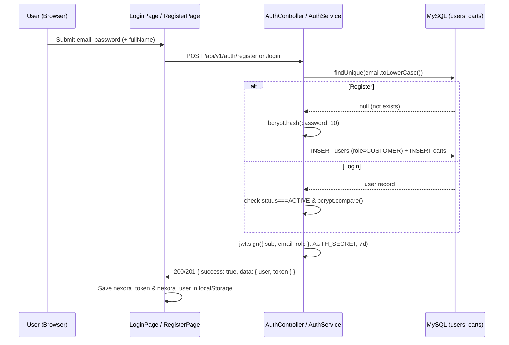

## 2. Product Browsing, Search & Filtering

```mermaid
flowchart LR
    A["User visits / or /search or /category/:slug"] --> B["StorefrontHome / SearchPage"]
    B --> C["GET /api/v1/catalog/products?q&category&brand&minPrice&maxPrice&specs&sort&page"]
    C --> D["CatalogRepository.findProducts()"]
    D --> E["Normalize category alias (e.g. gaming-gear, pc-nexora)"]
    E --> F["MySQL Query (status=ACTIVE + filters + pagination)"]
    F --> G["Return products + pagination meta"]
    G --> H["ProductCard.extractProductPills() (CPU/RAM/SSD/GPU/Display)"]
```

## 3. Add to Cart (Guest & Authenticated)

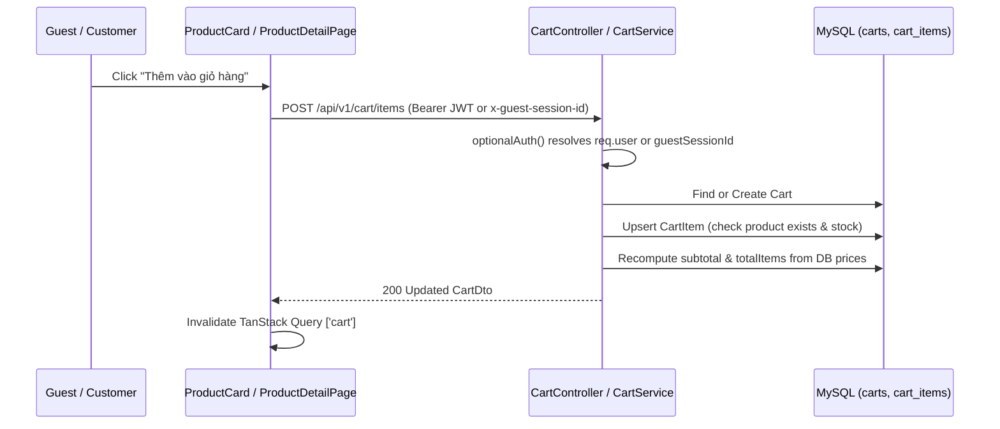

## 4. Checkout & Coupon Application

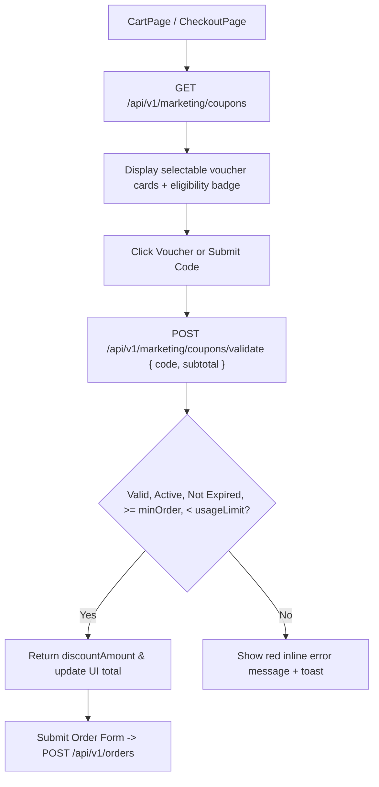

## 5. COD Order Creation (Atomic Stock Decrement)

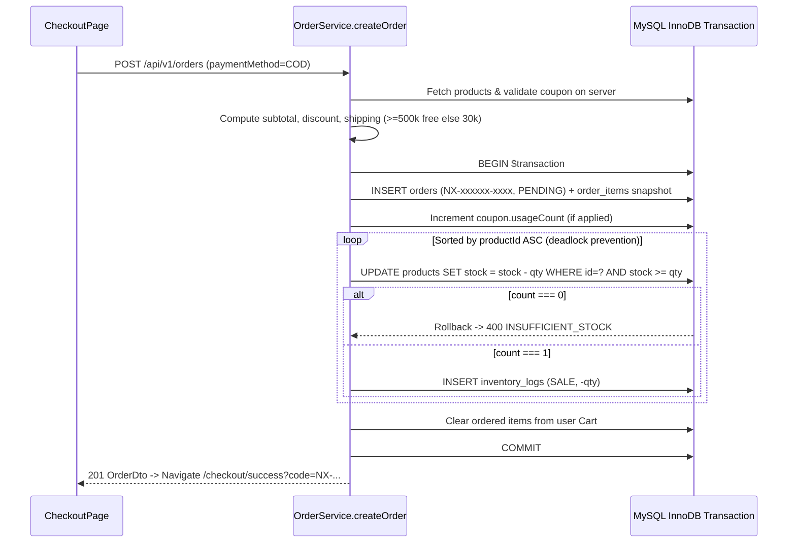

## 6. VNPay Online Payment & Idempotent Callback

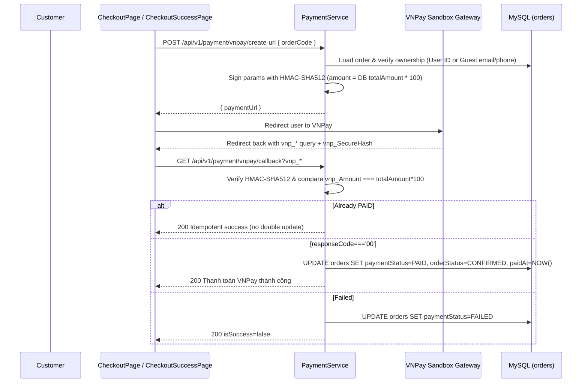

## 7. Customer Order Cancellation & Stock Restoration

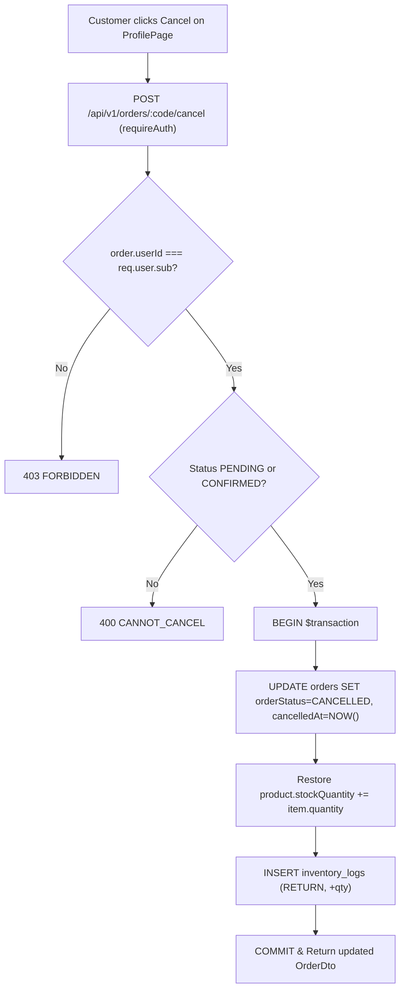

## 8. Return Request Workflow (Current Audit State)

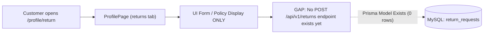

## 9. Password Reset Workflow (Including P0 Route Gap)

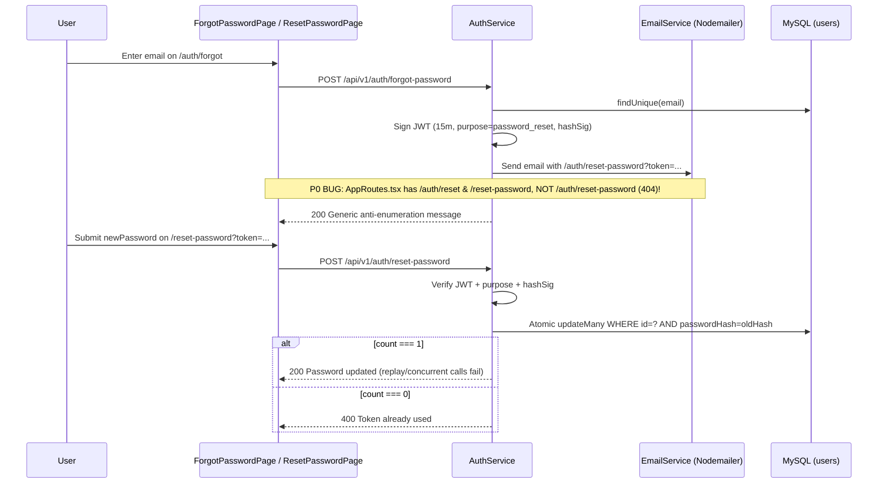

## 10. Admin Inventory Adjustment Workflow

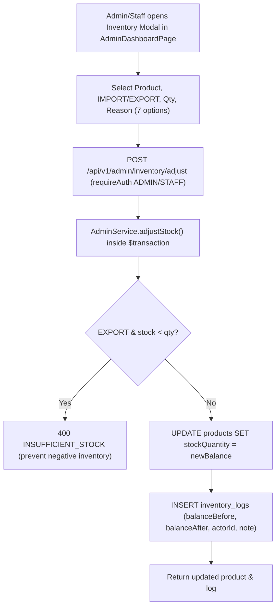

## 11. AI 5-Step Survey Recommendation Workflow

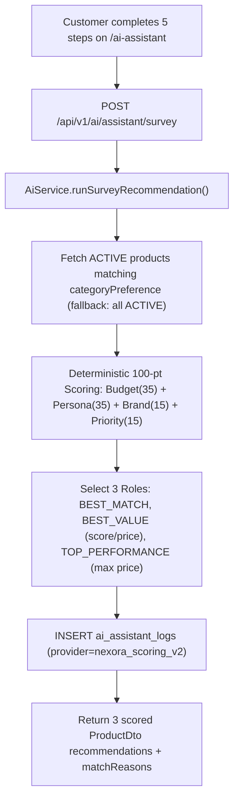
