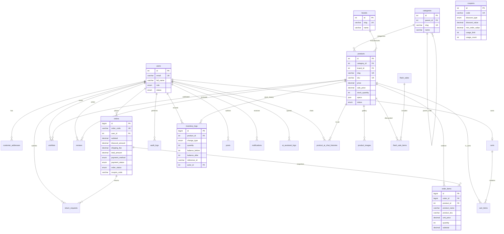

# 09. Database Schema & Entity-Relationship Diagram (ERD)

- **ORM:** Prisma `6.19.3` (`prisma/schema.prisma`, 533 dòng)
- **Database Engine:** MySQL `8.4.13` (InnoDB, `utf8mb4` / `utf8mb4_unicode_ci`, Isolation: `REPEATABLE-READ`)
- **Tổng số Prisma Models:** 24 models (24 bảng nghiệp vụ + `_prisma_migrations` = 25 bảng thực tế)
- **Tổng số Prisma Enums:** 9 enums
- **Xử lý tiền tệ:** 100% trường tiền tệ dùng `DECIMAL(18, 2)` (không dùng `FLOAT`/`DOUBLE`).

---

## 1. Danh mục 9 Prisma Enums

| Enum Name             | Values                                                                                 |
| --------------------- | -------------------------------------------------------------------------------------- |
| `UserRole`            | `CUSTOMER`, `STAFF`, `ADMIN`                                                           |
| `UserStatus`          | `ACTIVE`, `INACTIVE`                                                                   |
| `ProductStatus`       | `ACTIVE`, `INACTIVE`, `OUT_OF_STOCK`                                                   |
| `OrderStatus`         | `PENDING`, `CONFIRMED`, `PROCESSING`, `SHIPPING`, `DELIVERED`, `CANCELLED`, `RETURNED` |
| `PaymentMethod`       | `COD`, `VNPAY`, `VIETQR`, `BANK_TRANSFER`                                              |
| `PaymentStatus`       | `PENDING`, `PAID`, `FAILED`, `REFUNDED`                                                |
| `CouponDiscountType`  | `PERCENTAGE`, `FIXED`                                                                  |
| `InventoryChangeType` | `IMPORT`, `EXPORT`, `SALE`, `RETURN`, `ADJUSTMENT`                                     |
| `ReturnRequestStatus` | `PENDING`, `APPROVED`, `REJECTED`, `COMPLETED`                                         |

---

## 2. Tổng quan 24 Prisma Models

|   # | Model                  | MySQL Table                 | Scalar Fields | Primary Key  | Relations | Indexes / Uniques |
| --: | ---------------------- | --------------------------- | ------------: | ------------ | --------- | ----------------- |
|   1 | `User`                 | `users`                     |            10 | `id: Int`    | 10        | 1 idx, 0 @@unique |
|   2 | `CustomerAddress`      | `customer_addresses`        |            11 | `id: Int`    | 1         | 1 idx, 0 @@unique |
|   3 | `Brand`                | `brands`                    |             8 | `id: Int`    | 1         | 1 idx, 0 @@unique |
|   4 | `Category`             | `categories`                |            10 | `id: Int`    | 3         | 2 idx, 0 @@unique |
|   5 | `Product`              | `products`                  |            18 | `id: Int`    | 10        | 4 idx, 0 @@unique |
|   6 | `ProductImage`         | `product_images`            |             6 | `id: Int`    | 1         | 1 idx, 0 @@unique |
|   7 | `Banner`               | `banners`                   |             9 | `id: Int`    | 0         | 1 idx, 0 @@unique |
|   8 | `Cart`                 | `carts`                     |             5 | `id: BigInt` | 2         | 0 idx, 0 @@unique |
|   9 | `CartItem`             | `cart_items`                |             6 | `id: BigInt` | 2         | 1 idx, 1 @@unique |
|  10 | `Wishlist`             | `wishlists`                 |             4 | `id: Int`    | 2         | 1 idx, 1 @@unique |
|  11 | `Review`               | `reviews`                   |             6 | `id: Int`    | 2         | 2 idx, 0 @@unique |
|  12 | `StoreSetting`         | `store_settings`            |             5 | `id: Int`    | 0         | 0 idx, 0 @@unique |
|  13 | `AuditLog`             | `audit_logs`                |             7 | `id: BigInt` | 1         | 3 idx, 0 @@unique |
|  14 | `Order`                | `orders`                    |            26 | `id: BigInt` | 3         | 3 idx, 0 @@unique |
|  15 | `OrderItem`            | `order_items`               |            12 | `id: BigInt` | 2         | 2 idx, 0 @@unique |
|  16 | `Coupon`               | `coupons`                   |            14 | `id: Int`    | 0         | 1 idx, 0 @@unique |
|  17 | `FlashSale`            | `flash_sales`               |             7 | `id: Int`    | 1         | 1 idx, 0 @@unique |
|  18 | `FlashSaleItem`        | `flash_sale_items`          |             8 | `id: Int`    | 2         | 0 idx, 1 @@unique |
|  19 | `InventoryLog`         | `inventory_logs`            |            11 | `id: BigInt` | 2         | 1 idx, 0 @@unique |
|  20 | `Post`                 | `posts`                     |            13 | `id: Int`    | 1         | 2 idx, 0 @@unique |
|  21 | `Notification`         | `notifications`             |             8 | `id: BigInt` | 1         | 1 idx, 0 @@unique |
|  22 | `ReturnRequest`        | `return_requests`           |            10 | `id: Int`    | 2         | 2 idx, 0 @@unique |
|  23 | `AiAssistantLog`       | `ai_assistant_logs`         |            11 | `id: BigInt` | 0         | 2 idx, 0 @@unique |
|  24 | `ProductAiChatHistory` | `product_ai_chat_histories` |             7 | `id: BigInt` | 1         | 1 idx, 0 @@unique |

---

## 3. Complete Database ERD (Mermaid — Verified from `prisma/schema.prisma`)

---

## 4. Chi tiết toàn bộ 24 Models (Fields, Types, Constraints & Relations)

### Model `User` → Table `users`

| Field          | Prisma Type  | Attributes / DB Mapping / Constraints           |
| -------------- | ------------ | ----------------------------------------------- |
| `id`           | `Int`        | `@id @default(autoincrement()) @db.UnsignedInt` |
| `email`        | `String`     | `@unique @db.VarChar(150)`                      |
| `passwordHash` | `String?`    | `@map("password_hash") @db.VarChar(255)`        |
| `fullName`     | `String`     | `@map("full_name") @db.VarChar(150)`            |
| `phone`        | `String?`    | `@db.VarChar(30)`                               |
| `avatarUrl`    | `String?`    | `@map("avatar_url") @db.VarChar(255)`           |
| `role`         | `UserRole`   | `@default(CUSTOMER)`                            |
| `status`       | `UserStatus` | `@default(ACTIVE)`                              |
| `createdAt`    | `DateTime`   | `@default(now()) @map("created_at")`            |
| `updatedAt`    | `DateTime`   | `@updatedAt @map("updated_at")`                 |

- **Relations (10):** `addresses: CustomerAddress[]` ; `cart: Cart?` ; `wishlists: Wishlist[]` ; `reviews: Review[]` ; `orders: Order[]` ; `notifications: Notification[]` ; `returnRequests: ReturnRequest[]` ; `posts: Post[]` ; `inventoryLogs: InventoryLog[]` ; `auditLogs: AuditLog[]`
- **Indexes & Unique:** `@@index([role, status], map: "idx_users_role_status")`

### Model `CustomerAddress` → Table `customer_addresses`

| Field           | Prisma Type | Attributes / DB Mapping / Constraints           |
| --------------- | ----------- | ----------------------------------------------- |
| `id`            | `Int`       | `@id @default(autoincrement()) @db.UnsignedInt` |
| `userId`        | `Int`       | `@map("user_id") @db.UnsignedInt`               |
| `recipientName` | `String`    | `@map("recipient_name") @db.VarChar(150)`       |
| `phone`         | `String`    | `@db.VarChar(30)`                               |
| `streetAddress` | `String`    | `@map("street_address") @db.VarChar(255)`       |
| `ward`          | `String?`   | `@db.VarChar(100)`                              |
| `district`      | `String?`   | `@db.VarChar(100)`                              |
| `province`      | `String`    | `@db.VarChar(100)`                              |
| `isDefault`     | `Boolean`   | `@default(false) @map("is_default")`            |
| `createdAt`     | `DateTime`  | `@default(now()) @map("created_at")`            |
| `updatedAt`     | `DateTime`  | `@updatedAt @map("updated_at")`                 |

- **Relations (1):** `user: User` (@relation(fields: [userId], references: [id], onDelete: Cascade, onUpdate: Cascade))
- **Indexes & Unique:** `@@index([userId, isDefault], map: "idx_customer_addresses_user")`

### Model `Brand` → Table `brands`

| Field         | Prisma Type | Attributes / DB Mapping / Constraints           |
| ------------- | ----------- | ----------------------------------------------- |
| `id`          | `Int`       | `@id @default(autoincrement()) @db.UnsignedInt` |
| `name`        | `String`    | `@db.VarChar(100)`                              |
| `slug`        | `String`    | `@unique @db.VarChar(100)`                      |
| `logoUrl`     | `String?`   | `@map("logo_url") @db.VarChar(255)`             |
| `description` | `String?`   | `@db.Text`                                      |
| `isActive`    | `Boolean`   | `@default(true) @map("is_active")`              |
| `createdAt`   | `DateTime`  | `@default(now()) @map("created_at")`            |
| `updatedAt`   | `DateTime`  | `@updatedAt @map("updated_at")`                 |

- **Relations (1):** `products: Product[]`
- **Indexes & Unique:** `@@index([isActive], map: "idx_brands_active")`

### Model `Category` → Table `categories`

| Field         | Prisma Type | Attributes / DB Mapping / Constraints           |
| ------------- | ----------- | ----------------------------------------------- |
| `id`          | `Int`       | `@id @default(autoincrement()) @db.UnsignedInt` |
| `parentId`    | `Int?`      | `@map("parent_id") @db.UnsignedInt`             |
| `name`        | `String`    | `@db.VarChar(150)`                              |
| `slug`        | `String`    | `@unique @db.VarChar(150)`                      |
| `icon`        | `String?`   | `@db.VarChar(100)`                              |
| `description` | `String?`   | `@db.Text`                                      |
| `sortOrder`   | `Int`       | `@default(0) @map("sort_order")`                |
| `isActive`    | `Boolean`   | `@default(true) @map("is_active")`              |
| `createdAt`   | `DateTime`  | `@default(now()) @map("created_at")`            |
| `updatedAt`   | `DateTime`  | `@updatedAt @map("updated_at")`                 |

- **Relations (3):** `parent: Category?` (@relation("CategoryHierarchy", fields: [parentId], references: [id], onDelete: SetNull, onUpdate: Cascade)); `children: Category[]` (@relation("CategoryHierarchy")); `products: Product[]`
- **Indexes & Unique:** `@@index([parentId, sortOrder], map: "idx_categories_parent_order")`; `@@index([isActive], map: "idx_categories_active")`

### Model `Product` → Table `products`

| Field              | Prisma Type     | Attributes / DB Mapping / Constraints           |
| ------------------ | --------------- | ----------------------------------------------- |
| `id`               | `Int`           | `@id @default(autoincrement()) @db.UnsignedInt` |
| `categoryId`       | `Int`           | `@map("category_id") @db.UnsignedInt`           |
| `brandId`          | `Int?`          | `@map("brand_id") @db.UnsignedInt`              |
| `name`             | `String`        | `@db.VarChar(255)`                              |
| `slug`             | `String`        | `@unique @db.VarChar(255)`                      |
| `sku`              | `String`        | `@unique @db.VarChar(100)`                      |
| `price`            | `Decimal`       | `@db.Decimal(18, 2)`                            |
| `salePrice`        | `Decimal?`      | `@map("sale_price") @db.Decimal(18, 2)`         |
| `stockQuantity`    | `Int`           | `@default(0) @map("stock_quantity")`            |
| `thumbnailUrl`     | `String?`       | `@map("thumbnail_url") @db.VarChar(255)`        |
| `shortDescription` | `String?`       | `@map("short_description") @db.VarChar(500)`    |
| `description`      | `String?`       | `@db.Text`                                      |
| `specs`            | `Json?`         | `-`                                             |
| `isFeatured`       | `Boolean`       | `@default(false) @map("is_featured")`           |
| `isHot`            | `Boolean`       | `@default(false) @map("is_hot")`                |
| `status`           | `ProductStatus` | `@default(ACTIVE)`                              |
| `createdAt`        | `DateTime`      | `@default(now()) @map("created_at")`            |
| `updatedAt`        | `DateTime`      | `@updatedAt @map("updated_at")`                 |

- **Relations (10):** `category: Category` (@relation(fields: [categoryId], references: [id], onDelete: Restrict, onUpdate: Cascade)); `brand: Brand?` (@relation(fields: [brandId], references: [id], onDelete: SetNull, onUpdate: Cascade)); `images: ProductImage[]` ; `cartItems: CartItem[]` ; `wishlists: Wishlist[]` ; `reviews: Review[]` ; `orderItems: OrderItem[]` ; `inventoryLogs: InventoryLog[]` ; `flashSaleItems: FlashSaleItem[]` ; `productAiChatHistories: ProductAiChatHistory[]`
- **Indexes & Unique:** `@@index([categoryId, status], map: "idx_products_category_status")`; `@@index([brandId, status], map: "idx_products_brand_status")`; `@@index([isFeatured, isHot], map: "idx_products_flags")`; `@@index([status, price], map: "idx_products_status_price")`

### Model `ProductImage` → Table `product_images`

| Field       | Prisma Type | Attributes / DB Mapping / Constraints           |
| ----------- | ----------- | ----------------------------------------------- |
| `id`        | `Int`       | `@id @default(autoincrement()) @db.UnsignedInt` |
| `productId` | `Int`       | `@map("product_id") @db.UnsignedInt`            |
| `imageUrl`  | `String`    | `@map("image_url") @db.VarChar(255)`            |
| `altText`   | `String?`   | `@map("alt_text") @db.VarChar(255)`             |
| `sortOrder` | `Int`       | `@default(0) @map("sort_order")`                |
| `createdAt` | `DateTime`  | `@default(now()) @map("created_at")`            |

- **Relations (1):** `product: Product` (@relation(fields: [productId], references: [id], onDelete: Cascade, onUpdate: Cascade))
- **Indexes & Unique:** `@@index([productId, sortOrder], map: "idx_product_images_product")`

### Model `Banner` → Table `banners`

| Field       | Prisma Type | Attributes / DB Mapping / Constraints           |
| ----------- | ----------- | ----------------------------------------------- |
| `id`        | `Int`       | `@id @default(autoincrement()) @db.UnsignedInt` |
| `title`     | `String`    | `@db.VarChar(255)`                              |
| `imageUrl`  | `String`    | `@map("image_url") @db.VarChar(255)`            |
| `linkUrl`   | `String?`   | `@map("link_url") @db.VarChar(255)`             |
| `placement` | `String`    | `@default("hero") @db.VarChar(50)`              |
| `sortOrder` | `Int`       | `@default(0) @map("sort_order")`                |
| `isActive`  | `Boolean`   | `@default(true) @map("is_active")`              |
| `createdAt` | `DateTime`  | `@default(now()) @map("created_at")`            |
| `updatedAt` | `DateTime`  | `@updatedAt @map("updated_at")`                 |

- **Relations (0):** _None_
- **Indexes & Unique:** `@@index([placement, isActive, sortOrder], map: "idx_banners_placement")`

### Model `Cart` → Table `carts`

| Field            | Prisma Type | Attributes / DB Mapping / Constraints               |
| ---------------- | ----------- | --------------------------------------------------- |
| `id`             | `BigInt`    | `@id @default(autoincrement()) @db.UnsignedBigInt`  |
| `userId`         | `Int?`      | `@unique @map("user_id") @db.UnsignedInt`           |
| `guestSessionId` | `String?`   | `@unique @map("guest_session_id") @db.VarChar(100)` |
| `createdAt`      | `DateTime`  | `@default(now()) @map("created_at")`                |
| `updatedAt`      | `DateTime`  | `@updatedAt @map("updated_at")`                     |

- **Relations (2):** `user: User?` (@relation(fields: [userId], references: [id], onDelete: Cascade, onUpdate: Cascade)); `items: CartItem[]`
- **Indexes & Unique:** _Primary/Field uniques only_

### Model `CartItem` → Table `cart_items`

| Field       | Prisma Type | Attributes / DB Mapping / Constraints              |
| ----------- | ----------- | -------------------------------------------------- |
| `id`        | `BigInt`    | `@id @default(autoincrement()) @db.UnsignedBigInt` |
| `cartId`    | `BigInt`    | `@map("cart_id") @db.UnsignedBigInt`               |
| `productId` | `Int`       | `@map("product_id") @db.UnsignedInt`               |
| `quantity`  | `Int`       | `@default(1)`                                      |
| `createdAt` | `DateTime`  | `@default(now()) @map("created_at")`               |
| `updatedAt` | `DateTime`  | `@updatedAt @map("updated_at")`                    |

- **Relations (2):** `cart: Cart` (@relation(fields: [cartId], references: [id], onDelete: Cascade, onUpdate: Cascade)); `product: Product` (@relation(fields: [productId], references: [id], onDelete: Cascade, onUpdate: Cascade))
- **Indexes & Unique:** `@@index([productId], map: "idx_cart_items_product")`; `@@unique([cartId, productId], map: "uq_cart_product")`

### Model `Wishlist` → Table `wishlists`

| Field       | Prisma Type | Attributes / DB Mapping / Constraints           |
| ----------- | ----------- | ----------------------------------------------- |
| `id`        | `Int`       | `@id @default(autoincrement()) @db.UnsignedInt` |
| `userId`    | `Int`       | `@map("user_id") @db.UnsignedInt`               |
| `productId` | `Int`       | `@map("product_id") @db.UnsignedInt`            |
| `createdAt` | `DateTime`  | `@default(now()) @map("created_at")`            |

- **Relations (2):** `user: User` (@relation(fields: [userId], references: [id], onDelete: Cascade, onUpdate: Cascade)); `product: Product` (@relation(fields: [productId], references: [id], onDelete: Cascade, onUpdate: Cascade))
- **Indexes & Unique:** `@@index([productId], map: "idx_wishlists_product")`; `@@unique([userId, productId], map: "uq_wishlist_user_product")`

### Model `Review` → Table `reviews`

| Field       | Prisma Type | Attributes / DB Mapping / Constraints           |
| ----------- | ----------- | ----------------------------------------------- |
| `id`        | `Int`       | `@id @default(autoincrement()) @db.UnsignedInt` |
| `productId` | `Int`       | `@map("product_id") @db.UnsignedInt`            |
| `userId`    | `Int`       | `@map("user_id") @db.UnsignedInt`               |
| `rating`    | `Int`       | `@db.TinyInt`                                   |
| `comment`   | `String?`   | `@db.Text`                                      |
| `createdAt` | `DateTime`  | `@default(now()) @map("created_at")`            |

- **Relations (2):** `product: Product` (@relation(fields: [productId], references: [id], onDelete: Cascade, onUpdate: Cascade)); `user: User` (@relation(fields: [userId], references: [id], onDelete: Cascade, onUpdate: Cascade))
- **Indexes & Unique:** `@@index([productId, rating], map: "idx_reviews_product_rating")`; `@@index([userId], map: "idx_reviews_user")`

### Model `StoreSetting` → Table `store_settings`

| Field          | Prisma Type | Attributes / DB Mapping / Constraints           |
| -------------- | ----------- | ----------------------------------------------- |
| `id`           | `Int`       | `@id @default(autoincrement()) @db.UnsignedInt` |
| `settingKey`   | `String`    | `@unique @map("setting_key") @db.VarChar(100)`  |
| `settingValue` | `String`    | `@map("setting_value") @db.VarChar(500)`        |
| `description`  | `String?`   | `@db.VarChar(255)`                              |
| `updatedAt`    | `DateTime`  | `@updatedAt @map("updated_at")`                 |

- **Relations (0):** _None_
- **Indexes & Unique:** _Primary/Field uniques only_

### Model `AuditLog` → Table `audit_logs`

| Field        | Prisma Type | Attributes / DB Mapping / Constraints              |
| ------------ | ----------- | -------------------------------------------------- |
| `id`         | `BigInt`    | `@id @default(autoincrement()) @db.UnsignedBigInt` |
| `actorId`    | `Int?`      | `@map("actor_id") @db.UnsignedInt`                 |
| `action`     | `String`    | `@db.VarChar(100)`                                 |
| `entityType` | `String`    | `@map("entity_type") @db.VarChar(80)`              |
| `entityId`   | `String?`   | `@map("entity_id") @db.VarChar(100)`               |
| `metadata`   | `Json?`     | `-`                                                |
| `createdAt`  | `DateTime`  | `@default(now()) @map("created_at")`               |

- **Relations (1):** `actor: User?` (@relation(fields: [actorId], references: [id], onDelete: SetNull, onUpdate: Cascade))
- **Indexes & Unique:** `@@index([actorId, createdAt], map: "idx_audit_logs_actor_time")`; `@@index([entityType, entityId], map: "idx_audit_logs_entity")`; `@@index([createdAt], map: "idx_audit_logs_created_at")`

### Model `Order` → Table `orders`

| Field                | Prisma Type     | Attributes / DB Mapping / Constraints                    |
| -------------------- | --------------- | -------------------------------------------------------- |
| `id`                 | `BigInt`        | `@id @default(autoincrement()) @db.UnsignedBigInt`       |
| `orderCode`          | `String`        | `@unique @map("order_code") @db.VarChar(50)`             |
| `userId`             | `Int?`          | `@map("user_id") @db.UnsignedInt`                        |
| `customerName`       | `String`        | `@map("customer_name") @db.VarChar(150)`                 |
| `customerEmail`      | `String`        | `@map("customer_email") @db.VarChar(150)`                |
| `customerPhone`      | `String`        | `@map("customer_phone") @db.VarChar(30)`                 |
| `shippingAddress`    | `String`        | `@map("shipping_address") @db.VarChar(255)`              |
| `province`           | `String?`       | `@db.VarChar(100)`                                       |
| `district`           | `String?`       | `@db.VarChar(100)`                                       |
| `ward`               | `String?`       | `@db.VarChar(100)`                                       |
| `customerNotes`      | `String?`       | `@map("customer_notes") @db.Text`                        |
| `subtotal`           | `Decimal`       | `@db.Decimal(18, 2)`                                     |
| `shippingFee`        | `Decimal`       | `@default(0) @map("shipping_fee") @db.Decimal(18, 2)`    |
| `discountAmount`     | `Decimal`       | `@default(0) @map("discount_amount") @db.Decimal(18, 2)` |
| `totalAmount`        | `Decimal`       | `@map("total_amount") @db.Decimal(18, 2)`                |
| `paymentMethod`      | `PaymentMethod` | `@default(COD) @map("payment_method")`                   |
| `paymentStatus`      | `PaymentStatus` | `@default(PENDING) @map("payment_status")`               |
| `orderStatus`        | `OrderStatus`   | `@default(PENDING) @map("order_status")`                 |
| `couponCode`         | `String?`       | `@map("coupon_code") @db.VarChar(50)`                    |
| `trackingNumber`     | `String?`       | `@map("tracking_number") @db.VarChar(100)`               |
| `carrierName`        | `String?`       | `@map("carrier_name") @db.VarChar(100)`                  |
| `paidAt`             | `DateTime?`     | `@map("paid_at")`                                        |
| `cancelledAt`        | `DateTime?`     | `@map("cancelled_at")`                                   |
| `cancellationReason` | `String?`       | `@map("cancellation_reason") @db.VarChar(255)`           |
| `createdAt`          | `DateTime`      | `@default(now()) @map("created_at")`                     |
| `updatedAt`          | `DateTime`      | `@updatedAt @map("updated_at")`                          |

- **Relations (3):** `user: User?` (@relation(fields: [userId], references: [id], onDelete: SetNull, onUpdate: Cascade)); `items: OrderItem[]` ; `returnRequests: ReturnRequest[]`
- **Indexes & Unique:** `@@index([userId, orderStatus], map: "idx_orders_user_status")`; `@@index([orderStatus, createdAt], map: "idx_orders_status_time")`; `@@index([paymentStatus], map: "idx_orders_payment_status")`

### Model `OrderItem` → Table `order_items`

| Field            | Prisma Type | Attributes / DB Mapping / Constraints                    |
| ---------------- | ----------- | -------------------------------------------------------- |
| `id`             | `BigInt`    | `@id @default(autoincrement()) @db.UnsignedBigInt`       |
| `orderId`        | `BigInt`    | `@map("order_id") @db.UnsignedBigInt`                    |
| `productId`      | `Int?`      | `@map("product_id") @db.UnsignedInt`                     |
| `productName`    | `String`    | `@map("product_name") @db.VarChar(255)`                  |
| `productSku`     | `String`    | `@map("product_sku") @db.VarChar(100)`                   |
| `thumbnailUrl`   | `String?`   | `@map("thumbnail_url") @db.VarChar(255)`                 |
| `unitPrice`      | `Decimal`   | `@map("unit_price") @db.Decimal(18, 2)`                  |
| `quantity`       | `Int`       | `@default(1)`                                            |
| `discountAmount` | `Decimal`   | `@default(0) @map("discount_amount") @db.Decimal(18, 2)` |
| `cogsAmount`     | `Decimal?`  | `@map("cogs_amount") @db.Decimal(18, 2)`                 |
| `subtotal`       | `Decimal`   | `@db.Decimal(18, 2)`                                     |
| `createdAt`      | `DateTime`  | `@default(now()) @map("created_at")`                     |

- **Relations (2):** `order: Order` (@relation(fields: [orderId], references: [id], onDelete: Cascade, onUpdate: Cascade)); `product: Product?` (@relation(fields: [productId], references: [id], onDelete: SetNull, onUpdate: Cascade))
- **Indexes & Unique:** `@@index([orderId], map: "idx_order_items_order")`; `@@index([productId], map: "idx_order_items_product")`

### Model `Coupon` → Table `coupons`

| Field           | Prisma Type          | Attributes / DB Mapping / Constraints                    |
| --------------- | -------------------- | -------------------------------------------------------- |
| `id`            | `Int`                | `@id @default(autoincrement()) @db.UnsignedInt`          |
| `code`          | `String`             | `@unique @db.VarChar(50)`                                |
| `description`   | `String?`            | `@db.VarChar(255)`                                       |
| `discountType`  | `CouponDiscountType` | `@default(PERCENTAGE) @map("discount_type")`             |
| `discountValue` | `Decimal`            | `@map("discount_value") @db.Decimal(18, 2)`              |
| `minOrderValue` | `Decimal`            | `@default(0) @map("min_order_value") @db.Decimal(18, 2)` |
| `maxDiscount`   | `Decimal?`           | `@map("max_discount") @db.Decimal(18, 2)`                |
| `usageLimit`    | `Int?`               | `@map("usage_limit")`                                    |
| `usageCount`    | `Int`                | `@default(0) @map("usage_count")`                        |
| `startsAt`      | `DateTime?`          | `@map("starts_at")`                                      |
| `expiresAt`     | `DateTime?`          | `@map("expires_at")`                                     |
| `isActive`      | `Boolean`            | `@default(true) @map("is_active")`                       |
| `createdAt`     | `DateTime`           | `@default(now()) @map("created_at")`                     |
| `updatedAt`     | `DateTime`           | `@updatedAt @map("updated_at")`                          |

- **Relations (0):** _None_
- **Indexes & Unique:** `@@index([code, isActive], map: "idx_coupons_code_active")`

### Model `FlashSale` → Table `flash_sales`

| Field       | Prisma Type | Attributes / DB Mapping / Constraints           |
| ----------- | ----------- | ----------------------------------------------- |
| `id`        | `Int`       | `@id @default(autoincrement()) @db.UnsignedInt` |
| `name`      | `String`    | `@db.VarChar(150)`                              |
| `startTime` | `DateTime`  | `@map("start_time")`                            |
| `endTime`   | `DateTime`  | `@map("end_time")`                              |
| `isActive`  | `Boolean`   | `@default(true) @map("is_active")`              |
| `createdAt` | `DateTime`  | `@default(now()) @map("created_at")`            |
| `updatedAt` | `DateTime`  | `@updatedAt @map("updated_at")`                 |

- **Relations (1):** `items: FlashSaleItem[]`
- **Indexes & Unique:** `@@index([isActive, startTime, endTime], map: "idx_flash_sales_time")`

### Model `FlashSaleItem` → Table `flash_sale_items`

| Field            | Prisma Type | Attributes / DB Mapping / Constraints           |
| ---------------- | ----------- | ----------------------------------------------- |
| `id`             | `Int`       | `@id @default(autoincrement()) @db.UnsignedInt` |
| `flashSaleId`    | `Int`       | `@map("flash_sale_id") @db.UnsignedInt`         |
| `productId`      | `Int`       | `@map("product_id") @db.UnsignedInt`            |
| `flashSalePrice` | `Decimal`   | `@map("flash_sale_price") @db.Decimal(18, 2)`   |
| `quantityLimit`  | `Int`       | `@default(10) @map("quantity_limit")`           |
| `quantitySold`   | `Int`       | `@default(0) @map("quantity_sold")`             |
| `sortOrder`      | `Int`       | `@default(0) @map("sort_order")`                |
| `createdAt`      | `DateTime`  | `@default(now()) @map("created_at")`            |

- **Relations (2):** `flashSale: FlashSale` (@relation(fields: [flashSaleId], references: [id], onDelete: Cascade, onUpdate: Cascade)); `product: Product` (@relation(fields: [productId], references: [id], onDelete: Cascade, onUpdate: Cascade))
- **Indexes & Unique:** `@@unique([flashSaleId, productId], map: "uq_flash_sale_product")`

### Model `InventoryLog` → Table `inventory_logs`

| Field           | Prisma Type           | Attributes / DB Mapping / Constraints              |
| --------------- | --------------------- | -------------------------------------------------- |
| `id`            | `BigInt`              | `@id @default(autoincrement()) @db.UnsignedBigInt` |
| `productId`     | `Int`                 | `@map("product_id") @db.UnsignedInt`               |
| `changeType`    | `InventoryChangeType` | `@map("change_type")`                              |
| `quantity`      | `Int`                 | `-`                                                |
| `balanceBefore` | `Int`                 | `@map("balance_before")`                           |
| `balanceAfter`  | `Int`                 | `@map("balance_after")`                            |
| `referenceType` | `String?`             | `@map("reference_type") @db.VarChar(50)`           |
| `referenceId`   | `String?`             | `@map("reference_id") @db.VarChar(100)`            |
| `note`          | `String?`             | `@db.VarChar(255)`                                 |
| `actorId`       | `Int?`                | `@map("actor_id") @db.UnsignedInt`                 |
| `createdAt`     | `DateTime`            | `@default(now()) @map("created_at")`               |

- **Relations (2):** `product: Product` (@relation(fields: [productId], references: [id], onDelete: Cascade, onUpdate: Cascade)); `actor: User?` (@relation(fields: [actorId], references: [id], onDelete: SetNull, onUpdate: Cascade))
- **Indexes & Unique:** `@@index([productId, createdAt], map: "idx_inventory_logs_product_time")`

### Model `Post` → Table `posts`

| Field          | Prisma Type | Attributes / DB Mapping / Constraints           |
| -------------- | ----------- | ----------------------------------------------- |
| `id`           | `Int`       | `@id @default(autoincrement()) @db.UnsignedInt` |
| `authorId`     | `Int?`      | `@map("author_id") @db.UnsignedInt`             |
| `title`        | `String`    | `@db.VarChar(255)`                              |
| `slug`         | `String`    | `@unique @db.VarChar(255)`                      |
| `excerpt`      | `String?`   | `@db.VarChar(500)`                              |
| `content`      | `String`    | `@db.LongText`                                  |
| `thumbnailUrl` | `String?`   | `@map("thumbnail_url") @db.VarChar(255)`        |
| `category`     | `String`    | `@default("Tech") @db.VarChar(100)`             |
| `views`        | `Int`       | `@default(0)`                                   |
| `isPublished`  | `Boolean`   | `@default(true) @map("is_published")`           |
| `publishedAt`  | `DateTime?` | `@map("published_at")`                          |
| `createdAt`    | `DateTime`  | `@default(now()) @map("created_at")`            |
| `updatedAt`    | `DateTime`  | `@updatedAt @map("updated_at")`                 |

- **Relations (1):** `author: User?` (@relation(fields: [authorId], references: [id], onDelete: SetNull, onUpdate: Cascade))
- **Indexes & Unique:** `@@index([slug, isPublished], map: "idx_posts_slug_published")`; `@@index([category, isPublished], map: "idx_posts_category")`

### Model `Notification` → Table `notifications`

| Field       | Prisma Type | Attributes / DB Mapping / Constraints              |
| ----------- | ----------- | -------------------------------------------------- |
| `id`        | `BigInt`    | `@id @default(autoincrement()) @db.UnsignedBigInt` |
| `userId`    | `Int`       | `@map("user_id") @db.UnsignedInt`                  |
| `title`     | `String`    | `@db.VarChar(200)`                                 |
| `message`   | `String`    | `@db.Text`                                         |
| `type`      | `String`    | `@default("SYSTEM") @db.VarChar(50)`               |
| `linkUrl`   | `String?`   | `@map("link_url") @db.VarChar(255)`                |
| `isRead`    | `Boolean`   | `@default(false) @map("is_read")`                  |
| `createdAt` | `DateTime`  | `@default(now()) @map("created_at")`               |

- **Relations (1):** `user: User` (@relation(fields: [userId], references: [id], onDelete: Cascade, onUpdate: Cascade))
- **Indexes & Unique:** `@@index([userId, isRead], map: "idx_notifications_user_read")`

### Model `ReturnRequest` → Table `return_requests`

| Field        | Prisma Type           | Attributes / DB Mapping / Constraints           |
| ------------ | --------------------- | ----------------------------------------------- |
| `id`         | `Int`                 | `@id @default(autoincrement()) @db.UnsignedInt` |
| `orderId`    | `BigInt`              | `@map("order_id") @db.UnsignedBigInt`           |
| `userId`     | `Int`                 | `@map("user_id") @db.UnsignedInt`               |
| `reason`     | `String`              | `@db.VarChar(255)`                              |
| `status`     | `ReturnRequestStatus` | `@default(PENDING)`                             |
| `notes`      | `String?`             | `@db.Text`                                      |
| `images`     | `Json?`               | `-`                                             |
| `resolvedAt` | `DateTime?`           | `@map("resolved_at")`                           |
| `createdAt`  | `DateTime`            | `@default(now()) @map("created_at")`            |
| `updatedAt`  | `DateTime`            | `@updatedAt @map("updated_at")`                 |

- **Relations (2):** `order: Order` (@relation(fields: [orderId], references: [id], onDelete: Cascade, onUpdate: Cascade)); `user: User` (@relation(fields: [userId], references: [id], onDelete: Cascade, onUpdate: Cascade))
- **Indexes & Unique:** `@@index([orderId], map: "idx_return_requests_order")`; `@@index([userId, status], map: "idx_return_requests_user_status")`

### Model `AiAssistantLog` → Table `ai_assistant_logs`

| Field        | Prisma Type | Attributes / DB Mapping / Constraints              |
| ------------ | ----------- | -------------------------------------------------- |
| `id`         | `BigInt`    | `@id @default(autoincrement()) @db.UnsignedBigInt` |
| `userId`     | `Int?`      | `@map("user_id") @db.UnsignedInt`                  |
| `sessionId`  | `String?`   | `@map("session_id") @db.VarChar(100)`              |
| `systemType` | `String`    | `@map("system_type") @db.VarChar(50)`              |
| `prompt`     | `String`    | `@db.Text`                                         |
| `response`   | `String`    | `@db.LongText`                                     |
| `provider`   | `String`    | `@default("gemini") @db.VarChar(50)`               |
| `modelUsed`  | `String?`   | `@map("model_used") @db.VarChar(100)`              |
| `tokensUsed` | `Int?`      | `@map("tokens_used")`                              |
| `latencyMs`  | `Int?`      | `@map("latency_ms")`                               |
| `createdAt`  | `DateTime`  | `@default(now()) @map("created_at")`               |

- **Relations (0):** _None_
- **Indexes & Unique:** `@@index([userId, systemType], map: "idx_ai_logs_user_system")`; `@@index([createdAt], map: "idx_ai_logs_time")`

### Model `ProductAiChatHistory` → Table `product_ai_chat_histories`

| Field            | Prisma Type | Attributes / DB Mapping / Constraints              |
| ---------------- | ----------- | -------------------------------------------------- |
| `id`             | `BigInt`    | `@id @default(autoincrement()) @db.UnsignedBigInt` |
| `productId`      | `Int`       | `@map("product_id") @db.UnsignedInt`               |
| `userId`         | `Int?`      | `@map("user_id") @db.UnsignedInt`                  |
| `guestSessionId` | `String?`   | `@map("guest_session_id") @db.VarChar(100)`        |
| `userQuestion`   | `String`    | `@map("user_question") @db.Text`                   |
| `aiAnswer`       | `String`    | `@map("ai_answer") @db.LongText`                   |
| `createdAt`      | `DateTime`  | `@default(now()) @map("created_at")`               |

- **Relations (1):** `product: Product` (@relation(fields: [productId], references: [id], onDelete: Cascade, onUpdate: Cascade))
- **Indexes & Unique:** `@@index([productId, createdAt], map: "idx_product_ai_chat_product_time")`
