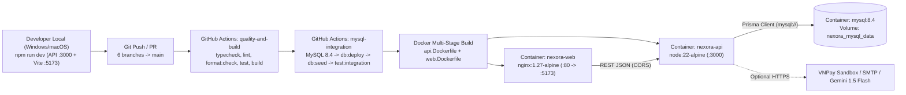

# 17. Infrastructure, Docker, CI/CD & Deployment Architecture

## 1. Kiểm kê tệp hạ tầng thực tế

| Thành phần            | File                                  | Cấu hình thực tế xác minh                                                                                                                                                                                                                             | Đánh giá Production Readiness                                                                                                                                                                     |
| --------------------- | ------------------------------------- | ----------------------------------------------------------------------------------------------------------------------------------------------------------------------------------------------------------------------------------------------------- | ------------------------------------------------------------------------------------------------------------------------------------------------------------------------------------------------- |
| **Docker Compose**    | `docker-compose.yml` (74 dòng)        | 3 services: `mysql:8.4` (utf8mb4, persistent volume `nexora_mysql_data`, healthcheck `mysqladmin ping`), `api` (port 3000, depends_on mysql healthy, healthcheck `/api/v1/health`), `web` (port 5173→80, depends_on api healthy, healthcheck `wget`). | **GOOD** — Thiếu giới hạn CPU/RAM (`deploy.resources`) và chưa truyền biến `VNPAY_*`, `SMTP_*`, `GEMINI_API_KEY` vào service `api`.                                                               |
| **API Dockerfile**    | `docker/api.Dockerfile` (39 dòng)     | Multi-stage `node:22-alpine`: Stage `builder` chạy `npm ci --ignore-scripts`, `prisma generate`, build 3 workspaces; Stage `runner` chạy `npm ci --omit=dev` và copy `dist` + `.prisma`.                                                              | **PARTIAL** — Chạy bằng user `root` (chưa có `USER node`); chưa tự chạy `prisma migrate deploy` qua entrypoint/init step.                                                                         |
| **Web Dockerfile**    | `docker/web.Dockerfile` (25 dòng)     | Multi-stage `node:22-alpine` → `nginx:1.27-alpine`, nhận build arg `VITE_API_BASE_URL`, phục vụ `apps/web/dist`.                                                                                                                                      | **GOOD**                                                                                                                                                                                          |
| **Nginx Config**      | `docker/nginx/default.conf` (10 dòng) | Listen 80, `try_files $uri $uri/ /index.html;`.                                                                                                                                                                                                       | **PARTIAL** — Thiếu gzip/brotli, cache headers cho `/assets/*`, security headers (`X-Frame-Options`, `X-Content-Type-Options`, `CSP`) và block reverse proxy `/api/`.                             |
| **MySQL Init Script** | `docker/mysql/01-dev-grants.sh`       | Cấp quyền rộng `ON *.*` cho user dev để chạy Prisma shadow DB.                                                                                                                                                                                        | **POSSIBLY UNUSED** — Không được mount trong `docker-compose.yml`; không dùng cho production.                                                                                                     |
| **GitHub Actions CI** | `.github/workflows/ci.yml` (104 dòng) | 2 jobs: `quality-and-build` (push 6 nhánh + PR vào `main`) và `mysql-integration` (dùng MySQL 8.4 service container).                                                                                                                                 | **FAILING RISK (P1)** — Job `quality-and-build` chạy `npm run format:check` (hiện fail 145 file) và chạy `npm run test` (gồm cả test tích hợp cần MySQL) **khi chưa có MySQL service container**! |

---

## 2. Quy trình từ Developer tới Runtime (Deployment Diagram)

---

## 3. Monitoring, Logging & Backup Status

- **Health Checks:** Đã có `GET /api/v1/health` kiểm tra kết nối DB thực tế và Docker healthchecks trên cả 3 container.
- **Logging:** Sử dụng `console.log` / `console.error` chuẩn stdout/stderr (chưa tích hợp structured JSON logger như Pino/Winston hay APM/Sentry).
- **Backup / Restore:** Chưa có script tự động sao lưu `mysqldump` định kỳ trong repo (cần thiết lập ở tầng hạ tầng vận hành trước khi go-live).
