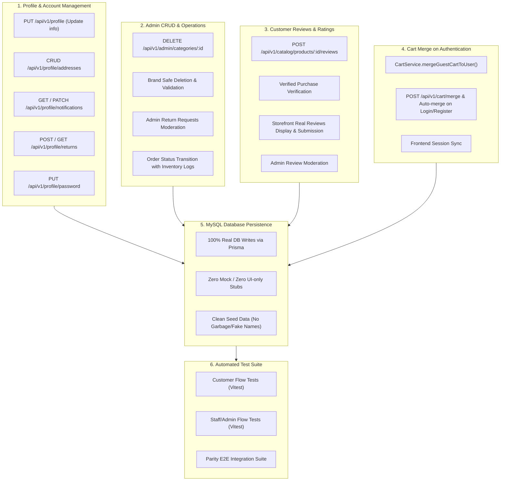

# PHASE_B_EXECUTION_PLAN.md — Kế Hoạch & Đặc Tả Nghiệm Thu Chi Tiết Phase B

- **Dự án:** **Nexora** (Tái cấu trúc từ hệ thống TechPilot)
- **Giai đoạn:** `Phase B — Functional Completion & Business Logic Parity`
- **Phiên bản:** `1.0.0`
- **Ngày lập:** `2026-11-22`
- **Trạng thái:** `Đã phê duyệt kế hoạch — Sẵn sàng triển khai`
- **Tài liệu căn cứ:** [AGENTS.md](file:///d:/Nexora/AGENTS.md), [AI_AGENT_WORKING_RULES.md](file:///d:/Nexora/docs/governance/AI_AGENT_WORKING_RULES.md), [DEFINITION_OF_DONE.md](file:///d:/Nexora/docs/governance/DEFINITION_OF_DONE.md), [SECURITY_REMEDIATION_REPORT.md](file:///d:/Nexora/docs/16-security-remediation/SECURITY_REMEDIATION_REPORT.md).

---

## 1. Tôn Chỉ Dự Án & Ranh Giới Nghiệp Vụ Bắt Buộc

1. **Bản sắc cốt lõi:** Nexora là bản tái xây dựng hệ thống **TechPilot** bằng công nghệ hiện đại (**TypeScript, Node.js, Express.js, ReactJS, Vite, Prisma ORM, MySQL 8.4 LTS**). Nexora **KHÔNG PHẢI** là một sản phẩm mới được thiết kế lại theo ý chí chủ quan.
2. **Mô hình Đơn Cửa Hàng (Single-Vendor Only):** Nghiêm cấm tuyệt đối việc biến Nexora thành Marketplace (sàn đa người bán). Hệ thống chỉ phục vụ một cửa hàng bán lẻ phần cứng duy nhất với 4 vai trò người dùng chuẩn mực:
   - `GUEST`: Khách vãng lai chưa đăng nhập.
   - `CUSTOMER`: Khách hàng mua lẻ phần cứng, có tài khoản cá nhân.
   - `STAFF`: Nhân viên vận hành cửa hàng (xử lý đơn, quản lý kho, duyệt bài viết).
   - `ADMIN`: Quản trị viên tối cao (quản lý người dùng, phân quyền, cấu hình hệ thống).
3. **Quy tắc giao diện trong Phase B:** **TUYỆT ĐỐI CHƯA di chuyển Storefront CSS sang Tailwind trong Phase B**. Việc chuẩn hóa CSS sẽ được thực hiện ở một giai đoạn riêng biệt nhằm tránh rủi ro trộn lẫn lỗi logic nghiệp vụ với tái cấu trúc styling.
4. **Quy chuẩn Git Commit:** Toàn bộ commit messages phải viết bằng **tiếng Việt không dấu** theo định dạng Conventional Commits (ví dụ: `feat(profile): ket noi api so dia chi khach hang`).
5. **Khu vực cấm:** Tuyệt đối không can thiệp, di chuyển hay chỉnh sửa thư mục gốc tham chiếu `TechPilot/` và `audit-output/`.

---

## 2. Bối Cảnh Sau Phase A & Kết Quả Kiểm Toán Thực Tế

### 2.1. Đóng Phase A Hợp Thức

Phase A (Bảo vệ RBAC, chống IDOR tra cứu đơn hàng, luồng đặt lại mật khẩu an toàn, Rate Limiting và ổn định CI) đã được chính thức nghiệm thu và đóng với:

- **Commit SHA:** `db33932750e3860538cf262b9a7c36a4382c4eb2`
- **GitHub Actions Run:** `44941462093` (2/2 jobs hoàn thành thành công 100%).
- **Kiểm thử tự động:** 94 tests (93 full-suite integration tests + 1 DB integration test, cùng 17 unit tests).
- **Working Tree:** Sạch (`clean`).
- **3 giới hạn tồn tại được ghi nhận minh bạch:**
  1. _JWT revocation:_ Khóa tài khoản cần cơ chế thu hồi token tức thời (hoặc blacklist/re-check) trước production.
  2. _In-Memory Rate Limiting:_ Đạt chuẩn single-instance; cần Redis khi scale ngang.
  3. _VNPay callback:_ Cần chuyển so sánh chữ ký sang `crypto.timingSafeEqual` trước khi tích hợp cổng thanh toán thật.

### 2.2. Kết Quả Kiểm Toán Mã Nguồn Cho Phase B (Empirical Gap Audit)

Khác với bảng tài liệu di chuyển trước đây từng ghi nhận nhãn `IMPLEMENTED` trên giấy tờ, kiểm toán thực tế mã nguồn phát hiện những thiếu hụt chức năng nghiêm trọng:

1. **Phân hệ Khách hàng (`ProfilePage.tsx`):**
   - Tab `profile`: `handleUpdateProfile` chỉ hiển thị `toast`, không hề có API backend cập nhật thông tin người dùng (`fullName`, `phone`, `avatarUrl`) vào bảng `users`.
   - Tab `addresses`: Thẻ địa chỉ "Nguyễn Văn An" được hardcode tĩnh 100%. Chưa có API CRUD kết nối với bảng `customer_addresses`.
   - Tab `notifications`: Danh sách 3 thông báo được gán cứng (`[{ id: 1, ... }]`), không truy vấn từ bảng `notifications` và không có thao tác đánh dấu đã đọc.
   - Tab `returns`: Form đổi trả chỉ hiển thị mock toast, không ghi nhận bản ghi vào bảng `return_requests`.
   - Tab `password`: Form đổi mật khẩu chỉ hiển thị mock toast, không có API backend kiểm tra mật khẩu hiện tại bằng `bcrypt` và cập nhật mật khẩu mới.
2. **Phân hệ Đánh giá (`Review`):**
   - Chưa hề có endpoint `POST /api/v1/catalog/products/:id/reviews` (hoặc `POST /api/v1/reviews`) để khách hàng gửi đánh giá.
   - Trang chi tiết sản phẩm (`ProductDetailPage.tsx`) đang hardcode điểm 5.0, số đánh giá 24 và bình luận mẫu của "Trần Văn Nam".
   - Chưa có logic xác thực mua hàng (`Verified Purchase`) kiểm tra xem khách đã nhận hàng thành công hay chưa.
3. **Phân hệ Giỏ hàng (`Cart Merge`):**
   - Khách vãng lai thêm sản phẩm vào giỏ hàng (`guestSessionId`), nhưng khi đăng nhập (`/auth/login`) hoặc đăng ký (`/auth/register`), hệ thống không có cơ chế gộp giỏ hàng khách vào giỏ hàng tài khoản (`userId`), làm gián đoạn trải nghiệm mua hàng.
4. **Phân hệ Quản trị (`Admin CRUD`):**
   - Endpoint `DELETE /api/v1/admin/categories/:id` hoàn toàn chưa tồn tại trong `admin.routes.ts` và `admin.service.ts`.
   - UI Admin chưa có nút xóa danh mục kèm kiểm tra an toàn ràng buộc khóa ngoại sản phẩm.
   - Quản trị yêu cầu đổi trả (`return_requests`) chưa có giao diện và endpoint duyệt/từ chối trạng thái.

---

## 3. Sáu Phân Hệ Trọng Tâm Của Phase B (Detailed Work Streams)



---

### Stream 1: Hoàn Thiện Phân Hệ Profile & Quản Lý Tài Khoản (Customer Profile Parity)

#### 1.1. Cập nhật thông tin cá nhân (Tab 1: `profile`)

- **Mục tiêu:** Cho phép khách hàng chỉnh sửa họ và tên, số điện thoại, avatar thực tế.
- **Backend Endpoint:** `PUT /api/v1/profile`
  - **Auth:** `requireAuth()`
  - **Request Body (Zod):**
    ```typescript
    {
      fullName: string; // min 2, max 150
      phone?: string;    // regex định dạng SĐT Việt Nam (10-11 số)
      avatarUrl?: string;
    }
    ```
  - **Xử lý:** Cập nhật bảng `users`. Trả về DTO người dùng đã chuẩn hóa.
  - **Frontend:** `ProfilePage.tsx` gọi endpoint qua `authService.updateProfile()`, cập nhật `currentUser` trong state và `localStorage`, hiển thị thông báo thành công.

#### 1.2. Sổ địa chỉ nhận hàng (Tab 2: `addresses`)

- **Mục tiêu:** Khách hàng quản lý nhiều địa chỉ giao hàng, chỉ định 1 địa chỉ mặc định.
- **Backend Endpoints:**
  - `GET /api/v1/profile/addresses`: Lấy danh sách địa chỉ của user từ bảng `customer_addresses`, sắp xếp `isDefault DESC, createdAt DESC`.
  - `POST /api/v1/profile/addresses`: Thêm địa chỉ mới.
    - Fields: `recipientName`, `phone`, `streetAddress`, `ward`, `district`, `province`, `isDefault`.
    - Logic: Nếu `isDefault === true`, tự động hủy cờ `isDefault` của các địa chỉ cũ thuộc user này trong transaction.
  - `PUT /api/v1/profile/addresses/:id`: Cập nhật địa chỉ (bảo vệ quyền sở hữu: chỉ chủ sở hữu mới được sửa).
  - `DELETE /api/v1/profile/addresses/:id`: Xóa địa chỉ (bảo vệ quyền sở hữu).
  - `PATCH /api/v1/profile/addresses/:id/default`: Đặt làm địa chỉ mặc định duy nhất.
- **Frontend:** Thay thế card tĩnh bằng danh sách thật, modal thêm/sửa địa chỉ có dropdown chọn tỉnh thành/quận huyện, nút xóa và nút đặt mặc định.

#### 1.3. Thông báo hệ thống (Tab 3: `notifications`)

- **Mục tiêu:** Hiển thị thông báo đơn hàng, khuyến mãi cá nhân từ bảng `notifications`.
- **Backend Endpoints:**
  - `GET /api/v1/profile/notifications`: Lấy danh sách thông báo theo `userId`, sắp xếp theo thời gian mới nhất. Trả về kèm số lượng thông báo chưa đọc (`unreadCount`).
  - `PATCH /api/v1/profile/notifications/:id/read`: Đánh dấu 1 thông báo là đã đọc (`isRead = true`).
  - `PATCH /api/v1/profile/notifications/read-all`: Đánh dấu tất cả thông báo của user là đã đọc.
- **Frontend:** Hiển thị badge số lượng chưa đọc, phân biệt giao diện thông báo chưa đọc (nền xanh nhạt) và đã đọc, nút "Đánh dấu tất cả đã đọc".

#### 1.4. Yêu cầu đổi trả & hoàn tiền (Tab 4: `returns`)

- **Mục tiêu:** Khách hàng gửi yêu cầu đổi trả đối với đơn hàng đã giao thành công (`DELIVERED`).
- **Backend Endpoints:**
  - `GET /api/v1/profile/returns`: Lấy danh sách yêu cầu đổi trả của user từ bảng `return_requests` kèm thông tin đơn hàng liên quan.
  - `POST /api/v1/profile/returns`: Gửi yêu cầu đổi trả mới.
    - Fields: `orderId` (hoặc `orderCode`), `reason`, `notes`, `images` (optional JSON).
    - Ràng buộc nghiệp vụ: Đơn hàng phải thuộc quyền sở hữu của user, trạng thái đơn hàng phải là `DELIVERED`, và trong thời hạn chính sách bảo hành/đổi trả (7 ngày kể từ khi giao hàng).
- **Frontend:** Form chọn đơn hàng từ danh sách đơn đã giao, chọn lý do, nhập mô tả lỗi, submit và hiển thị danh sách yêu cầu kèm trạng thái (`PENDING`, `APPROVED`, `REJECTED`, `COMPLETED`).

#### 1.5. Đổi mật khẩu (Tab 5: `password`)

- **Mục tiêu:** Đổi mật khẩu an toàn, bảo vệ bằng mã hóa chuẩn công nghiệp.
- **Backend Endpoint:** `PUT /api/v1/profile/password` (hoặc `POST /api/v1/profile/change-password`)
  - **Auth:** `requireAuth()`
  - **Request Body (Zod):**
    ```typescript
    {
      currentPassword: string; // min 6
      newPassword: string; // min 8, có chữ và số
      confirmPassword: string; // khớp newPassword
    }
    ```
  - **Xử lý:**
    - Truy vấn `passwordHash` của user từ DB.
    - Dùng `bcrypt.compare(currentPassword, user.passwordHash)`. Nếu sai, ném lỗi `400 INVALID_CURRENT_PASSWORD`.
    - Băm mật khẩu mới bằng `bcrypt.hash(newPassword, 10)`.
    - Cập nhật vào DB.
- **Frontend:** Form đổi mật khẩu thực tế, hiển thị lỗi chi tiết nếu mật khẩu hiện tại không đúng, reset form và báo thành công khi đổi xong.

---

### Stream 2: Hoàn Thiện Admin CRUD & Thao Tác Nghiệp Vụ Kho/Cửa Hàng

#### 2.1. Quản lý danh mục linh kiện (Category Deletion & Integrity)

- **Thiếu hụt hiện tại:** `DELETE /api/v1/admin/categories/:id` hoàn toàn chưa có trong mã nguồn.
- **Backend Endpoint:** `DELETE /api/v1/admin/categories/:id`
  - **Auth:** `requireAuth(['ADMIN', 'STAFF'])`
  - **Quy tắc toàn vẹn:**
    1. Kiểm tra danh mục có tồn tại không -> `404 CATEGORY_NOT_FOUND`.
    2. Đếm số lượng sản phẩm đang liên kết (`productsCount = await prisma.product.count({ where: { categoryId } })`).
    3. Nếu `productsCount > 0`: Từ chối xóa với lỗi `400 CATEGORY_IN_USE: Danh mục đang chứa ${productsCount} sản phẩm, không thể xóa để tránh mồ côi dữ liệu.` (Khuyến nghị chuyển sản phẩm sang danh mục khác hoặc tạm ẩn danh mục).
    4. Kiểm tra danh mục con (`childrenCount`): Nếu có danh mục con, yêu cầu xóa hoặc di chuyển danh mục con trước.
    5. Nếu an toàn: Xóa danh mục khỏi DB và ghi `audit_logs`.
- **Frontend:** Cập nhật bảng Danh mục trong `AdminDashboardPage.tsx`: Thêm nút "Xóa" bên cạnh nút "Sửa", hiển thị modal xác nhận xóa an toàn.

#### 2.2. Quản lý thương hiệu (Brand Deletion & Integrity)

- **Backend Endpoint:** `DELETE /api/v1/admin/brands/:id`
  - Kiểm tra số lượng sản phẩm liên kết: Nếu có sản phẩm, cảnh báo hoặc từ chối xóa để bảo toàn dữ liệu.
- **Frontend:** Thêm nút "Xóa" thương hiệu trong bảng Brands của `AdminDashboardPage.tsx` kèm modal xác nhận.

#### 2.3. Quản lý & kiểm duyệt yêu cầu đổi trả (Admin Return Requests)

- **Backend Endpoints:**
  - `GET /api/v1/admin/returns`: Lấy danh sách tất cả yêu cầu đổi trả, hỗ trợ filter theo `status` (`PENDING`, `APPROVED`, `REJECTED`, `COMPLETED`), phân trang 10 mục/trang.
  - `PATCH /api/v1/admin/returns/:id/status`: Cập nhật trạng thái yêu cầu (`status`, `notes`).
- **Frontend:** Thêm tab hoặc giao diện quản lý Đổi trả trong Admin để nhân viên/quản trị viên duyệt yêu cầu của khách hàng.

#### 2.4. Luồng chuyển trạng thái đơn hàng & nhật ký kho (Order Status & Inventory Logs)

- Đảm bảo tính toán vẹn khi chuyển trạng thái đơn hàng:
  - Khi đơn chuyển sang `CANCELLED`: Nếu đơn trước đó đã trừ kho, hệ thống hoàn kho (`InventoryChangeType.RETURN` hoặc `ADJUSTMENT`) và tạo bản ghi trong `inventory_logs`.
  - Không cho phép chuyển ngược trạng thái từ `DELIVERED` hoặc `CANCELLED` về `PENDING`.

---

### Stream 3: Hệ Thống Đánh Giá & Nhận Xét Sản Phẩm (Customer Reviews & Verified Purchase)

#### 3.1. Thiết kế Endpoint Tạo Đánh Giá

- **Backend Endpoint:** `POST /api/v1/catalog/products/:id/reviews`
  - **Auth:** `requireAuth(['CUSTOMER', 'STAFF', 'ADMIN'])`
  - **Request Body (Zod):**
    ```typescript
    {
      rating: number; // integer 1 đến 5
      comment?: string; // tối đa 1000 ký tự
    }
    ```
  - **Quy tắc nghiệp vụ:**
    1. Kiểm tra sản phẩm tồn tại và đang hoạt động.
    2. Kiểm tra xem user đã từng gửi đánh giá cho sản phẩm này chưa. Nếu đã có, cho phép cập nhật nội dung đánh giá (`upsert`).
    3. Kiểm tra huy hiệu "Đã mua hàng" (`isVerifiedPurchase`): Kiểm tra trong bảng `orders` và `order_items` xem user có đơn hàng nào ở trạng thái `DELIVERED` chứa `productId` này hay không.
    4. Lưu bản ghi vào bảng `reviews`.
    5. Trả về chi tiết đánh giá kèm thông tin người dùng (`fullName`, `avatarUrl`) và huy hiệu đã mua hàng.

#### 3.2. Cập nhật giao diện trang chi tiết sản phẩm (`ProductDetailPage.tsx`)

- Thay thế hoàn toàn số điểm tĩnh "5.0" và "24 đánh giá" bằng giá trị tính toán thực tế từ danh sách `product.reviews`:
  - Điểm trung bình = `tổng điểm / số lượng đánh giá` (làm tròn 1 chữ số thập phân, ví dụ: 4.8).
  - Hiển thị danh sách đánh giá thực tế từ MySQL.
  - Hiển thị badge xanh lá "Đã mua hàng tại Nexora" cho các đánh giá thỏa mãn điều kiện mua hàng.
  - Cung cấp form đánh giá (chọn số sao từ 1 đến 5, ô nhập nhận xét, nút gửi) cho khách hàng đã đăng nhập.

#### 3.3. Kiểm duyệt đánh giá phía Admin (`Admin Reviews Management`)

- `GET /api/v1/admin/reviews`: Truy vấn danh sách đánh giá thật từ MySQL, hiển thị đúng sản phẩm, khách hàng, số sao, nội dung và thời gian đăng.
- `DELETE /api/v1/admin/reviews/:id`: Cho phép Admin/Staff xóa đánh giá vi phạm (chứa từ ngữ xúc phạm, spam, quảng cáo ngoài).

---

### Stream 4: Đồng Bộ & Hợp Nhất Giỏ Hàng Khi Đăng Nhập (Guest Cart Merge)

#### 4.1. Bài toán nghiệp vụ

- Khách vãng lai (`GUEST`) duyệt website, thêm sản phẩm A (số lượng 2) vào giỏ hàng. Giỏ hàng được lưu trữ trong MySQL gắn với `guestSessionId`.
- Khi khách hàng tiến hành Đăng nhập hoặc Đăng ký tài khoản:
  - Nếu tài khoản trước đó đã có sản phẩm B (số lượng 1) trong giỏ: giỏ hàng mới sau khi đăng nhập phải chứa cả A (2) và B (1).
  - Nếu tài khoản trước đó đã có sản phẩm A (số lượng 1): số lượng sản phẩm A được cộng dồn thành 3 (có kiểm tra tồn kho `stockQuantity`).
  - Bản ghi giỏ hàng tạm thời của `guestSessionId` phải được dọn dẹp hoặc xóa bỏ để tránh rác cơ sở dữ liệu.

#### 4.2. Triển khai kỹ thuật

- **Backend Service:** Bổ sung phương thức `CartService.mergeGuestCartToUser(guestSessionId: string, userId: number)`:
  - Chạy trong `prisma.$transaction`.
  - Tìm `guestCart` theo `guestSessionId` và `userCart` theo `userId`.
  - Nếu không có `guestCart` hoặc `guestCart` không có sản phẩm nào: hoàn tất không cần thao tác.
  - Duyệt từng `item` trong `guestCart`:
    - Nếu sản phẩm đã có trong `userCart`: cập nhật số lượng = `userItem.quantity + guestItem.quantity` (nếu vượt quá kho thì lấy tối đa tồn kho).
    - Nếu sản phẩm chưa có trong `userCart`: tạo mới `cartItem` gắn vào `userCart.id`.
  - Xóa toàn bộ `cartItems` của `guestCart` và xóa `guestCart`.
- **Tích hợp Endpoint Auth:**
  - `POST /api/v1/auth/login` và `POST /api/v1/auth/register` nhận thêm `guestSessionId` tùy chọn trong request body. Nếu có, tự động kích hoạt `mergeGuestCartToUser`.
  - Bổ sung endpoint chủ động: `POST /api/v1/cart/merge` (nhận `guestSessionId`, yêu cầu `requireAuth()`).
- **Frontend Integration:**
  - `authService.login()` và `authService.register()` tự động gửi kèm `guestSessionId` (lấy từ `localStorage`) khi gọi API.
  - Sau khi đăng nhập thành công, làm mới truy vấn giỏ hàng (`queryClient.invalidateQueries({ queryKey: ['cart'] })`).

---

### Stream 5: Bảo Đảm Dữ Liệu Thực Tế Được Lưu Vào MySQL (Zero Mock / Zero Stubs)

#### 5.1. Tiêu chí bất biến

- **Tuyệt đối không dùng stub/mock trên giao diện:** Mọi hành động submit form (cập nhật thông tin, thêm địa chỉ, gửi yêu cầu đổi trả, đổi mật khẩu, gửi đánh giá, xóa danh mục) bắt buộc phải tạo HTTP request thực sự tới backend và ghi dữ liệu vào MySQL.
- **Toàn vẹn quan hệ cơ sở dữ liệu:**
  - `customer_addresses`: Khóa ngoại `user_id` tham chiếu `users(id) ON DELETE CASCADE`.
  - `notifications`: Khóa ngoại `user_id` tham chiếu `users(id) ON DELETE CASCADE`.
  - `return_requests`: Khóa ngoại `order_id` tham chiếu `orders(id)` và `user_id` tham chiếu `users(id)`.
  - `reviews`: Khóa ngoại `product_id` tham chiếu `products(id)` và `user_id` tham chiếu `users(id)`.

#### 5.2. Làm sạch Seed Data (`prisma/seed.ts`)

- Loại bỏ toàn bộ các tên lạ, tên rác hoặc sản phẩm thử nghiệm mang tên dị biệt (ví dụ: "Sản phẩm giới hạn kho 1", "test item bla bla").
- Cung cấp seed data mẫu chuẩn TechPilot cho:
  - 6 đánh giá thực tế (5 sao, 4 sao) gắn với các sản phẩm chủ lực (Laptop Gaming Legion, MacBook Pro M3, VGA RTX 4080...).
  - Địa chỉ nhận hàng mẫu chuẩn định dạng Việt Nam cho tài khoản khách hàng thử nghiệm (`customer@nexora.local`).
  - Thông báo mẫu hệ thống (chào mừng, ưu đãi thành viên, trạng thái đơn hàng).

---

### Stream 6: Bộ Kiểm Thử Tự Động Toàn Diện Cho Phase B (Automated Test Suite)

Tạo mới file kiểm thử tích hợp chuyên biệt: `apps/api/tests/phase_b_functional_parity.test.ts` bao phủ toàn bộ các tiêu chí nghiệm thu sau:

| Mã Test      | Phân hệ      | Mô tả kịch bản kiểm thử                                                           | Kết quả kỳ vọng                                                           |
| :----------- | :----------- | :-------------------------------------------------------------------------------- | :------------------------------------------------------------------------ |
| **PROF-B1**  | Profile      | Khách hàng cập nhật `fullName` và `phone` hợp lệ qua `PUT /api/v1/profile`        | `200 OK`, dữ liệu trong MySQL được cập nhật chính xác                     |
| **PROF-B2**  | Profile      | Cập nhật thông tin với số điện thoại sai định dạng                                | `400 BAD_REQUEST`, lỗi validation rõ ràng                                 |
| **ADDR-B3**  | Address      | Khách hàng thêm mới địa chỉ nhận hàng qua `POST /api/v1/profile/addresses`        | `201 Created`, bản ghi xuất hiện trong bảng `customer_addresses`          |
| **ADDR-B4**  | Address      | Khách hàng đặt cờ `isDefault = true` cho địa chỉ mới                              | `200/201`, địa chỉ cũ tự động chuyển `isDefault = false`                  |
| **ADDR-B5**  | Address      | Khách hàng A cố tình sửa/xóa địa chỉ của Khách hàng B (chống IDOR)                | `403 FORBIDDEN` hoặc `404 NOT_FOUND`                                      |
| **ADDR-B6**  | Address      | Khách hàng xóa địa chỉ hợp lệ của chính mình                                      | `200 OK`, bản ghi bị xóa khỏi MySQL                                       |
| **NOTIF-B7** | Notification | Lấy danh sách thông báo cá nhân qua `GET /api/v1/profile/notifications`           | `200 OK`, chỉ trả về thông báo của đúng `userId`                          |
| **NOTIF-B8** | Notification | Đánh dấu 1 thông báo là đã đọc qua `PATCH /api/v1/profile/notifications/:id/read` | `200 OK`, `isRead` chuyển thành `true`                                    |
| **RET-B9**   | Returns      | Khách hàng gửi yêu cầu đổi trả cho đơn hàng đã giao (`DELIVERED`)                 | `201 Created`, bản ghi lưu vào `return_requests` với trạng thái `PENDING` |
| **RET-B10**  | Returns      | Gửi yêu cầu đổi trả cho đơn hàng của người khác hoặc đơn chưa giao                | `403 FORBIDDEN` hoặc `400 BAD_REQUEST`                                    |
| **PASS-B11** | Password     | Đổi mật khẩu với mật khẩu hiện tại chính xác                                      | `200 OK`, đăng nhập lại bằng mật khẩu mới thành công                      |
| **PASS-B12** | Password     | Đổi mật khẩu với mật khẩu hiện tại sai                                            | `400 BAD_REQUEST`, báo lỗi mật khẩu cũ không đúng                         |
| **REV-B13**  | Review       | Khách hàng đã mua hàng gửi đánh giá cho sản phẩm                                  | `201 Created`, lưu vào `reviews`                                          |
| **REV-B14**  | Review       | Gửi đánh giá trùng lặp cho cùng 1 sản phẩm                                        | `200 OK`, cập nhật nội dung đánh giá thay vì tạo bản ghi rác              |
| **CART-B15** | Cart Merge   | Khách vãng lai có giỏ hàng, sau đó đăng nhập tài khoản                            | Giỏ hàng được gộp chính xác vào tài khoản `userId`, giỏ khách bị xóa      |
| **ADM-B16**  | Admin Cat    | Admin xóa danh mục đang chứa sản phẩm                                             | `400 BAD_REQUEST`, chặn xóa để bảo toàn dữ liệu                           |
| **ADM-B17**  | Admin Cat    | Admin xóa danh mục rỗng (không có sản phẩm)                                       | `200 OK`, danh mục bị xóa khỏi MySQL                                      |
| **ADM-B18**  | Admin Ret    | Admin xem danh sách và duyệt yêu cầu đổi trả                                      | `200 OK`, trạng thái chuyển thành `APPROVED`                              |

---

## 4. Bảng Kế Hoạch Triển Khai Chi Tiết (Milestones & Schedule)

|  Bước  | Hạng mục thực hiện                                           | Tệp tin bị ảnh hưởng                                                                                                                                                                          | Tiêu chuẩn nghiệm thu                                                                                      |
| :----: | :----------------------------------------------------------- | :-------------------------------------------------------------------------------------------------------------------------------------------------------------------------------------------- | :--------------------------------------------------------------------------------------------------------- |
| **M1** | **Lập kế hoạch & đặc tả chi tiết Phase B** _(Bước hiện tại)_ | `docs/17-functional-parity-phase-b/PHASE_B_EXECUTION_PLAN.md`                                                                                                                                 | Báo cáo chi tiết, xác định rõ 6 stream, API schemas và 18 test cases                                       |
| **M2** | **Xây dựng Profile Backend Module & DTOs**                   | `apps/api/src/modules/profile/*`<br>`apps/api/src/routes/index.ts`<br>`packages/shared/src/*`                                                                                                 | Hoàn thiện đầy đủ Controller, Service, Routes cho Profile, Address, Notification, Returns, Password        |
| **M3** | **Xây dựng Review & Cart Merge Backend**                     | `apps/api/src/modules/catalog/*`<br>`apps/api/src/modules/cart/*`<br>`apps/api/src/modules/auth/*`                                                                                            | Có endpoint tạo review kèm kiểm tra đơn hàng; logic merge giỏ hàng khi đăng nhập                           |
| **M4** | **Bổ sung Category Deletion & Admin Returns**                | `apps/api/src/modules/admin/*`                                                                                                                                                                | Có endpoint `DELETE /admin/categories/:id` kèm kiểm tra ràng buộc; endpoint duyệt đổi trả                  |
| **M5** | **Kết nối Frontend Storefront & Admin**                      | `apps/web/src/features/profile/ProfilePage.tsx`<br>`apps/web/src/features/catalog/ProductDetailPage.tsx`<br>`apps/web/src/features/admin/AdminDashboardPage.tsx`<br>`apps/web/src/services/*` | Xóa bỏ 100% mock toasts; form và các tab gọi API thật; hiển thị dữ liệu thật từ DB                         |
| **M6** | **Chuẩn hóa Seed Data MySQL**                                | `prisma/seed.ts`                                                                                                                                                                              | Nạp đánh giá thật, địa chỉ thật, thông báo thật; xóa bỏ hoàn toàn tên lạ rác                               |
| **M7** | **Bộ Kiểm thử tự động Phase B (18 Tests)**                   | `apps/api/tests/phase_b_functional_parity.test.ts`                                                                                                                                            | 18/18 test cases mới chạy pass 100%                                                                        |
| **M8** | **Kiểm định hồi quy, CI & Lập báo cáo nghiệm thu**           | `docs/17-functional-parity-phase-b/*`                                                                                                                                                         | `npm run typecheck`, `lint`, `format:check`, `test:unit` đều PASS; commit tiếng Việt không dấu và push Git |

---

## 5. Quy Chuẩn Đánh Giá Trạng Thái & Bằng Chứng Khách Quan

Theo quy định tại [AGENTS.md](file:///d:/Nexora/AGENTS.md) và [AI_AGENT_WORKING_RULES.md](file:///d:/Nexora/docs/governance/AI_AGENT_WORKING_RULES.md):

- Mọi kết luận nghiệm thu chỉ được phân loại rõ ràng thành:
  - `PASS`: Đã triển khai mã nguồn, kết nối cơ sở dữ liệu thật, có test tự động kiểm chứng và vượt qua 100%.
  - `PARTIAL`: Đã triển khai một phần, còn các điểm phụ trợ đang hoàn thiện.
  - `BLOCKED`: Bị chặn bởi yếu tố hạ tầng (ví dụ: thiếu dịch vụ ngoài, thiếu quyền).
  - `FAIL`: Không đạt yêu cầu hoặc kiểm thử thất bại.
- Tuyệt đối không suy đoán, không bịa đặt số liệu test hay kết quả CI. Mọi khẳng định phải dẫn chứng bằng đường dẫn file cụ thể và output thực tế của câu lệnh thực thi.
