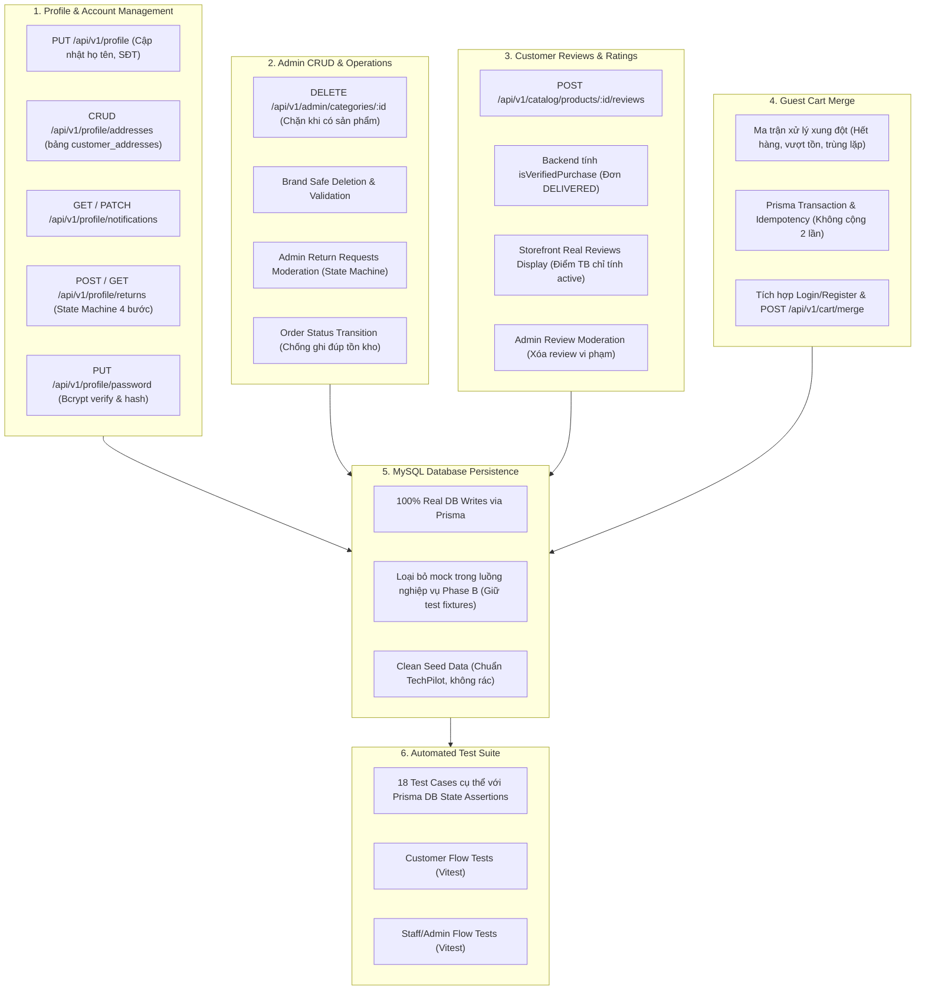
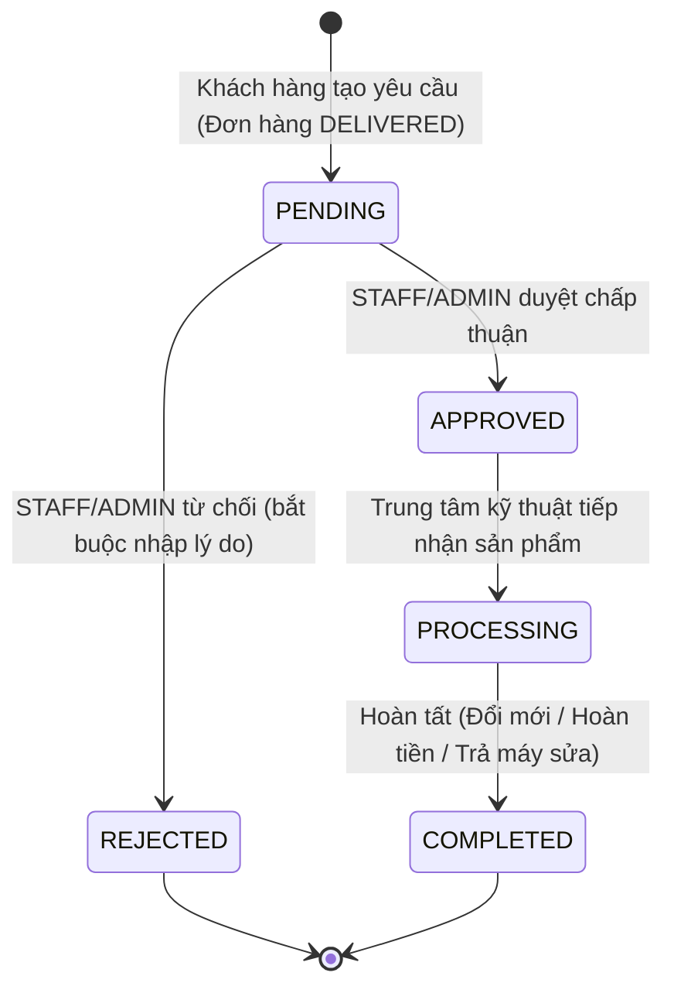

# PHASE_B_EXECUTION_PLAN.md — Kế Hoạch & Đặc Tả Nghiệm Thu Chi Tiết Phase B (Hiệu Chỉnh Chuẩn Hóa)

- **Dự án:** **Nexora** (Tái cấu trúc từ hệ thống TechPilot)
- **Giai đoạn:** `Phase B — Functional Completion & Business Logic Parity`
- **Phiên bản:** `1.1.0 (Finalized & Authorized)`
- **Ngày lập:** `2026-11-22`
- **Trạng thái:** `ĐÃ PHÊ DUYỆT ĐIỀU CHỈNH — SẴN SÀNG TRIỂN KHAI`
- **Tài liệu căn cứ:** [AGENTS.md](file:///d:/Nexora/AGENTS.md), [AI_AGENT_WORKING_RULES.md](file:///d:/Nexora/docs/governance/AI_AGENT_WORKING_RULES.md), [DEFINITION_OF_DONE.md](file:///d:/Nexora/docs/governance/DEFINITION_OF_DONE.md), [SECURITY_REMEDIATION_REPORT.md](file:///d:/Nexora/docs/16-security-remediation/SECURITY_REMEDIATION_REPORT.md).

---

## 1. Tôn Chỉ Dự Án, Ranh Giới Nghiệp Vụ & Làm Rõ Role/Architecture

1. **Bản sắc cốt lõi:** Nexora là bản tái xây dựng hệ thống **TechPilot** bằng công nghệ hiện đại (**TypeScript, Node.js, Express.js, ReactJS, Vite, Prisma ORM, MySQL 8.4 LTS**). Nexora **KHÔNG PHẢI** là một sản phẩm mới được thiết kế lại theo ý chí chủ quan.
2. **Làm rõ mô hình Role & RBAC (Chuẩn hóa):**
   - Hệ thống xác thực và phân quyền RBAC của Nexora có đúng **3 vai trò người dùng chuẩn mực** được định nghĩa trong `enum UserRole` tại `prisma/schema.prisma`:
     - `CUSTOMER`: Khách hàng mua lẻ phần cứng, có tài khoản cá nhân.
     - `STAFF`: Nhân viên vận hành cửa hàng (xử lý đơn, quản lý kho, duyệt bài viết, xem danh mục).
     - `ADMIN`: Quản trị viên tối cao (quản lý người dùng, phân quyền, cấu hình hệ thống).
   - **`GUEST` KHÔNG PHẢI LÀ MỘT ROLE TRONG HỆ THỐNG RBAC HOẶC BẢNG `users`:** `GUEST` là trạng thái người dùng chưa đăng nhập, được quản lý phiên duyệt web và giỏ hàng khách tạm thời thông qua `guestSessionId`. Tuyệt đối không thêm `GUEST` vào `enum UserRole` của Prisma hay bảng `users`.
3. **Mô hình Đơn Cửa Hàng (Single-Vendor Invariant):** Nghiêm cấm tuyệt đối việc biến Nexora thành Marketplace (sàn đa người bán). Không bổ sung role `SELLER`, không thiết kế đăng ký người bán ngoài, không có chiết khấu sàn hay chia đơn đa cửa hàng.
4. **Quy tắc giao diện trong Phase B:** **TUYỆT ĐỐI CHƯA di chuyển Storefront CSS sang Tailwind trong Phase B**. Việc chuẩn hóa CSS sẽ được thực hiện ở một giai đoạn riêng biệt nhằm tránh rủi ro trộn lẫn lỗi logic nghiệp vụ với tái cấu trúc styling.
5. **Quy chuẩn Git Commit:** Toàn bộ commit messages phải viết bằng **tiếng Việt không dấu** theo định dạng Conventional Commits (ví dụ: `feat(cart): hop nhat gio hang khach khi dang nhap`).
6. **Khu vực cấm:** Tuyệt đối không can thiệp, di chuyển hay chỉnh sửa thư mục gốc tham chiếu `TechPilot/` và `audit-output/`. Không chỉnh sửa các migration đã apply trong `prisma/migrations/`.

---

## 2. Bối Cảnh Sau Phase A & Kết Quả Kiểm Toán Thực Tế

### 2.1. Đóng Phase A Hợp Thức

Phase A (Bảo vệ RBAC, chống IDOR tra cứu đơn hàng, luồng đặt lại mật khẩu an toàn, Rate Limiting và ổn định CI) đã được chính thức nghiệm thu và đóng với:

- **Commit SHA:** `db33932750e3860538cf262b9a7c36a4382c4eb2`
- **GitHub Actions Run:** `44941462093` (2/2 jobs hoàn thành thành công 100%).
- **Kiểm thử tự động:** 94 tests (93 full-suite integration tests + 1 DB integration test, cùng 17 unit tests).
- **Working Tree:** Sạch (`clean`).
- **3 giới hạn tồn tại được ghi nhận minh bạch:**
  1. _JWT revocation:_ Khóa tài khoản cần cơ chế thu hồi token tức thời (hoặc blacklist/re-check) trước production.
  2. _In-Memory Rate Limiting:_ Đạt chuẩn single-instance; cần Redis khi scale ngang.
  3. _VNPay callback:_ Cần chuyển so sánh chữ ký sang `crypto.timingSafeEqual` trước khi tích hợp cổng thanh toán thật.

### 2.2. Kết Quả Kiểm Toán Mã Nguồn Cho Phase B (Empirical Gap Audit)

Khác với bảng tài liệu di chuyển trước đây từng ghi nhận nhãn `IMPLEMENTED` trên giấy tờ, kiểm toán thực tế mã nguồn phát hiện những thiếu hụt chức năng nghiêm trọng:

1. **Phân hệ Khách hàng (`ProfilePage.tsx`):**
   - Tab `profile`: `handleUpdateProfile` chỉ hiển thị `toast`, không hề có API backend cập nhật thông tin người dùng (`fullName`, `phone`, `avatarUrl`) vào bảng `users`.
   - Tab `addresses`: Thẻ địa chỉ "Nguyễn Văn An" được hardcode tĩnh 100%. Chưa có API CRUD kết nối với bảng `customer_addresses`.
   - Tab `notifications`: Danh sách 3 thông báo được gán cứng (`[{ id: 1, ... }]`), không truy vấn từ bảng `notifications` và không có thao tác đánh dấu đã đọc.
   - Tab `returns`: Form đổi trả chỉ hiển thị mock toast, không ghi nhận bản ghi vào bảng `return_requests`.
   - Tab `password`: Form đổi mật khẩu chỉ hiển thị mock toast, không có API backend kiểm tra mật khẩu hiện tại bằng `bcrypt` và cập nhật mật khẩu mới.
2. **Phân hệ Đánh giá (`Review`):**
   - Chưa hề có endpoint `POST /api/v1/catalog/products/:id/reviews` (hoặc `POST /api/v1/reviews`) để khách hàng gửi đánh giá.
   - Trang chi tiết sản phẩm (`ProductDetailPage.tsx`) đang hardcode điểm 5.0, số đánh giá 24 và bình luận mẫu của "Trần Văn Nam".
   - Chưa có logic xác thực mua hàng (`Verified Purchase`) kiểm tra xem khách đã nhận hàng thành công hay chưa.
3. **Phân hệ Giỏ hàng (`Cart Merge`):**
   - Khách vãng lai thêm sản phẩm vào giỏ hàng (`guestSessionId`), nhưng khi đăng nhập (`/auth/login`) hoặc đăng ký (`/auth/register`), hệ thống không có cơ chế gộp giỏ hàng khách vào giỏ hàng tài khoản (`userId`), làm gián đoạn trải nghiệm mua hàng.
4. **Phân hệ Quản trị (`Admin CRUD`):**
   - Endpoint `DELETE /api/v1/admin/categories/:id` hoàn toàn chưa tồn tại trong `admin.routes.ts` và `admin.service.ts`.
   - UI Admin chưa có nút xóa danh mục kèm kiểm tra an toàn ràng buộc khóa ngoại sản phẩm.
   - Quản trị yêu cầu đổi trả (`return_requests`) chưa có giao diện và endpoint duyệt/từ chối trạng thái.

---

## 3. Sáu Phân Hệ Trọng Tâm Của Phase B Sau Khi Điều Chỉnh



---

### Stream 1: Hoàn Thiện Phân Hệ Profile & Quản Lý Tài Khoản (Customer Account Parity)

#### 1.1. Xác minh Database Mapping: `customer_addresses` vs `user_addresses`

- **Kết quả đối chiếu:** Trong TechPilot legacy PHP, bảng địa chỉ từng mang tên `user_addresses` trong một số tài liệu. Tuy nhiên, trong mã nguồn Nexora hiện tại, bảng chuẩn tắc đã được di chuyển và áp dụng thành công trong MySQL 8.4 LTS là:
  ```sql
  CREATE TABLE `customer_addresses` (
      `id` INTEGER UNSIGNED NOT NULL AUTO_INCREMENT,
      `user_id` INTEGER UNSIGNED NOT NULL,
      `recipient_name` VARCHAR(150) NOT NULL,
      `phone` VARCHAR(30) NOT NULL,
      `street_address` VARCHAR(255) NOT NULL,
      `ward` VARCHAR(100) NULL,
      `district` VARCHAR(100) NULL,
      `province` VARCHAR(100) NOT NULL,
      `is_default` BOOLEAN NOT NULL DEFAULT false,
      `created_at` DATETIME(3) NOT NULL DEFAULT CURRENT_TIMESTAMP(3),
      `updated_at` DATETIME(3) NOT NULL,
      PRIMARY KEY (`id`)
  );
  ```
- **Quyết định kiến trúc:** Sử dụng **100% bảng hiện hữu `customer_addresses`** (model `CustomerAddress` trong Prisma Client). **TUYỆT ĐỐI KHÔNG TẠO BẢNG MỚI** hoặc tạo bảng `user_addresses` trùng lặp chức năng.

#### 1.2. Cập nhật thông tin cá nhân (Tab 1: `profile`)

- **Backend Endpoint:** `PUT /api/v1/profile`
  - **Auth:** `requireAuth()`
  - **Zod Validation:** `fullName` (2-150 ký tự), `phone` (regex SĐT Việt Nam: `^(0[3|5|7|8|9])+([0-9]{8})$`), `avatarUrl` (optional URL).
  - **Xử lý:** Cập nhật bảng `users`. Trả về `AuthUser` DTO.
  - **Frontend:** `ProfilePage.tsx` gọi `profileService.updateProfile()`, cập nhật `currentUser` trong state và `localStorage`.

#### 1.3. Sổ địa chỉ nhận hàng (Tab 2: `addresses`)

- **Backend Endpoints:**
  - `GET /api/v1/profile/addresses`: Lấy danh sách địa chỉ của user từ bảng `customer_addresses`, sắp xếp `isDefault DESC, createdAt DESC`.
  - `POST /api/v1/profile/addresses`: Thêm địa chỉ mới. Nếu `isDefault === true`, thực hiện hủy cờ mặc định của các địa chỉ khác của user trong transaction.
  - `PUT /api/v1/profile/addresses/:id`: Cập nhật địa chỉ (bảo vệ quyền sở hữu: chỉ chủ tài khoản mới được sửa).
  - `DELETE /api/v1/profile/addresses/:id`: Xóa địa chỉ (bảo vệ quyền sở hữu).
  - `PATCH /api/v1/profile/addresses/:id/default`: Đặt làm địa chỉ mặc định duy nhất trong transaction.
- **Frontend:** Thay thế card tĩnh bằng danh sách thật, form thêm/sửa địa chỉ, nút xóa và nút đặt mặc định.

#### 1.4. Thông báo hệ thống (Tab 3: `notifications`)

- **Backend Endpoints:**
  - `GET /api/v1/profile/notifications`: Lấy danh sách thông báo theo `userId`, sắp xếp theo thời gian mới nhất. Trả về kèm `unreadCount`.
  - `PATCH /api/v1/profile/notifications/:id/read`: Đánh dấu 1 thông báo là đã đọc (`isRead = true`).
  - `PATCH /api/v1/profile/notifications/read-all`: Đánh dấu tất cả thông báo của user là đã đọc.

#### 1.5. Đổi mật khẩu (Tab 5: `password`)

- **Backend Endpoint:** `PUT /api/v1/profile/password`
  - **Auth:** `requireAuth()`
  - **Zod Validation:** `currentPassword` (min 6), `newPassword` (min 8, bao gồm chữ và số), `confirmPassword` (phải khớp `newPassword`).
  - **Xử lý:**
    - Truy vấn `passwordHash` của user từ DB.
    - Dùng `bcrypt.compare(currentPassword, user.passwordHash)`. Nếu sai, ném lỗi `400 INVALID_CURRENT_PASSWORD`.
    - Băm mật khẩu mới bằng `bcrypt.hash(newPassword, 10)`.
    - Cập nhật vào DB.

---

### Stream 2: Hoàn Thiện Admin CRUD, Quản Lý Đổi Trả & Inventory Consistency

#### 2.1. Quản lý danh mục linh kiện (Category Deletion & Integrity)

- **Backend Endpoint:** `DELETE /api/v1/admin/categories/:id`
  - **Auth:** `requireAuth(['ADMIN', 'STAFF'])`
  - **Quy tắc toàn vẹn:**
    1. Kiểm tra danh mục có tồn tại không -> `404 CATEGORY_NOT_FOUND`.
    2. Đếm số lượng sản phẩm đang liên kết (`productsCount = await prisma.product.count({ where: { categoryId } })`).
    3. Nếu `productsCount > 0`: **Từ chối xóa** với lỗi `400 CATEGORY_IN_USE: Danh mục đang chứa ${productsCount} sản phẩm, không thể xóa để tránh mồ côi dữ liệu.`
    4. Kiểm tra danh mục con: Nếu có danh mục con, từ chối xóa và yêu cầu di chuyển/xóa danh mục con trước.
    5. Nếu an toàn (`productsCount === 0` và không có danh mục con): Xóa danh mục khỏi DB và ghi `audit_logs`.
- **Frontend:** Thêm nút "Xóa" bên cạnh nút "Sửa" trong [AdminDashboardPage.tsx](file:///d:/Nexora/apps/web/src/features/admin/AdminDashboardPage.tsx) kèm modal xác nhận an toàn.

#### 2.2. Vòng Đời Yêu Cầu Đổi Trả (Return Workflow State Machine)

Căn cứ chính sách TechPilot (hỗ trợ đổi mới, hoàn tiền hoặc gửi bảo hành chính hãng trong vòng 7 ngày đối với phần cứng bị lỗi kỹ thuật hoặc hư hại vận chuyển), vòng đời của một yêu cầu đổi trả được chuẩn hóa thành **State Machine 4 bước**:



- **Quy định nghiệp vụ chi tiết:**
  1. **Điều kiện tạo yêu cầu:** Chỉ đơn hàng ở trạng thái `DELIVERED` mới được gửi yêu cầu đổi trả.
  2. **Thời hạn 7 ngày:** Được tính toán nghiêm ngặt từ thời điểm giao hàng thành công `deliveredAt` (hoặc `updatedAt` khi đơn hàng chuyển sang `DELIVERED`), **KHÔNG TÍNH TỪ THỜI ĐIỂM TẠO ĐƠN**. Nếu quá 7 ngày, hệ thống từ chối tạo yêu cầu với mã lỗi `400 RETURN_WINDOW_EXPIRED`.
  3. **Giới hạn số lượng:** Số lượng sản phẩm yêu cầu đổi trả không được vượt quá số lượng thực tế đã mua trong đơn hàng (`quantity <= orderItem.quantity`).
  4. **Audit Metadata:** Mọi thay đổi trạng thái đều lưu thông tin nhân sự xử lý (`actorId`), thời điểm giải quyết (`resolvedAt`), ghi chú kỹ thuật (`notes`) và lý do từ chối bắt buộc nếu chuyển sang `REJECTED`.
  5. **Quyền chuyển trạng thái:** Chỉ người dùng có role `STAFF` hoặc `ADMIN` mới có quyền chuyển trạng thái yêu cầu đổi trả.

#### 2.3. Tính Toàn Vẹn Tồn Kho (Inventory Consistency Protocol)

Đối chiếu mã nguồn hiện tại trong [order.service.ts](file:///d:/Nexora/apps/api/src/modules/order/order.service.ts):

- **Trừ kho khi tạo đơn:** `OrderService.createOrder` đã thực hiện trừ tồn kho nguyên tử trực tiếp trong MySQL InnoDB (`stockQuantity: { decrement: item.quantity }` với điều kiện `stockQuantity: { gte: item.quantity }`) và ghi bản ghi `inventory_logs` với `changeType: InventoryChangeType.SALE`.
- **Quy tắc bất biến để chống trừ kho lần hai (Double-Deduction):**
  1. **Khi đơn hàng chuyển trạng thái:** Các trạng thái `CONFIRMED`, `PROCESSING`, `SHIPPING`, `DELIVERED` **TUYỆT ĐỐI KHÔNG TRỪ KHO LẦN THỨ HAI**.
  2. **Khi hủy đơn hàng (`CANCELLED`):** Hệ thống chỉ hoàn kho nếu đơn hàng đó trước đó đã trừ kho thành công. Thực hiện cộng kho và ghi `inventory_logs` với `changeType: InventoryChangeType.RETURN` (hoặc `CANCEL_ORDER`).
  3. **Xử lý tồn kho trong luồng Đổi Trả (`ReturnRequest`):**
     - Khi STAFF/ADMIN duyệt yêu cầu (`APPROVED`): **CHƯA CỘNG TỒN KHO NGAY**, vì sản phẩm lỗi chưa được gửi về và chưa qua thẩm định kỹ thuật.
     - Khi hoàn tất đổi trả (`COMPLETED`): Chỉ thực hiện cộng kho nếu sản phẩm được kiểm định thực tế đủ điều kiện nhập kho lại (ví dụ: sản phẩm đổi trả còn nguyên seal/chưa khui hộp hoặc linh kiện được nhà sản xuất cấp bù). Mọi điều chỉnh đều nằm trong `prisma.$transaction` và sinh log `InventoryChangeType.RETURN`.

---

### Stream 3: Hệ Thống Đánh Giá & Nhận Xét Sản Phẩm (Customer Reviews)

#### 3.1. Thiết kế Endpoint & Quy Tắc Xác Thực Đánh Giá

- **Backend Endpoint:** `POST /api/v1/catalog/products/:id/reviews`
  - **Auth:** `requireAuth(['CUSTOMER', 'STAFF', 'ADMIN'])`
  - **Zod Validation:**
    ```typescript
    {
      rating: number; // số nguyên từ 1 đến 5 sao
      comment?: string; // tối đa 1000 ký tự
    }
    ```
- **Xác thực mua hàng tự động phía Backend (`isVerifiedPurchase`):**
  - Backend tự động truy vấn bảng `orders` kết hợp `order_items` với điều kiện:
    ```typescript
    const hasPurchased = await prisma.orderItem.findFirst({
      where: {
        productId,
        order: {
          userId: currentUserId,
          orderStatus: 'DELIVERED',
        },
      },
    });
    const isVerifiedPurchase = !!hasPurchased;
    ```
  - **Frontend tuyệt đối không được tự ý gửi trường `isVerifiedPurchase` lên.** Mọi giá trị gửi từ client đều bị backend loại bỏ.
- **Tính duy nhất & Chỉnh sửa (Unique Review Policy):**
  - Một người dùng chỉ được có tối đa 1 đánh giá cho mỗi sản phẩm.
  - Nếu khách hàng đã từng đánh giá sản phẩm đó, việc gửi lại sẽ cập nhật (`upsert`) số sao và nội dung bình luận của đánh giá cũ, thay vì tạo thêm bản ghi mới gây sai lệch dữ liệu.
- **Công thức tính điểm trung bình (Rating Calculation):**
  - Điểm rating trung bình chỉ tính toán trên các đánh giá hợp lệ và đang hoạt động.
  - Các đánh giá bị Admin xóa hoặc tạm ẩn không bao giờ được đưa vào công thức tính trung bình cộng số sao.
- **Phân quyền kiểm duyệt:**
  - Khách hàng (`CUSTOMER`) chỉ được xem đánh giá công khai và chỉnh sửa đánh giá của chính mình.
  - `ADMIN` và `STAFF` có quyền xem toàn bộ danh sách đánh giá tại `GET /api/v1/admin/reviews` và thực hiện xóa các đánh giá có nội dung vi phạm tiêu chuẩn cộng đồng qua `DELETE /api/v1/admin/reviews/:id`.

---

### Stream 4: Ma Trận Xử Lý Xung Đột Hợp Nhất Giỏ Hàng (Guest Cart Merge)

#### 4.1. Bảng Ma Trận Xử Lý Xung Đột (Conflict Resolution Matrix)

| Tình huống thực tế                                                | Hành vi xử lý chuẩn mực của hệ thống                                                 | Kết quả sau hợp nhất                                                                         |
| :---------------------------------------------------------------- | :----------------------------------------------------------------------------------- | :------------------------------------------------------------------------------------------- |
| **Sản phẩm chỉ có trong Guest Cart**                              | Chuyển sản phẩm sang giỏ hàng của `userId`.                                          | Sản phẩm xuất hiện trong giỏ hàng tài khoản với đúng số lượng khách đã chọn.                 |
| **Sản phẩm tồn tại ở cả hai giỏ**                                 | Cộng dồn số lượng: `newQty = userQty + guestQty`.                                    | Số lượng được gộp lại, bảo đảm không bị mất món hàng đã chọn trước đó.                       |
| **Sản phẩm đã ngừng kinh doanh (`status !== 'ACTIVE'`)**          | Không đưa sản phẩm vào giỏ hàng hợp lệ của user; ghi log cảnh báo.                   | Giỏ hàng tài khoản chỉ chứa các sản phẩm còn kinh doanh hợp lệ.                              |
| **Sản phẩm hết hàng (`stockQuantity === 0`)**                     | Không cho phép đưa vào giỏ hoặc đặt số lượng về 0 kèm cảnh báo hết hàng.             | Tránh tình trạng khách hàng đặt được đơn với sản phẩm tồn kho bằng 0.                        |
| **Sản phẩm không đủ số lượng tồn kho (`newQty > stockQuantity`)** | Điều chỉnh số lượng về đúng mức tồn kho thực tế khả dụng (`newQty = stockQuantity`). | Khách hàng được thông báo số lượng đã được tự động điều chỉnh theo kho.                      |
| **Guest Cart không tồn tại hoặc rỗng**                            | Bỏ qua bước merge; người dùng đăng nhập bình thường.                                 | Giỏ hàng của tài khoản được giữ nguyên nguyên trạng.                                         |
| **Gửi lại cùng một `guestSessionId` (Replay Protection)**         | Idempotency: Sau khi gộp thành công, xóa bản ghi giỏ khách trong transaction.        | Gửi lại `guestSessionId` cũ sẽ không tìm thấy giỏ khách -> **Không bị cộng số lượng 2 lần**. |

#### 4.2. Bảo đảm tính nguyên tử (Transaction Consistency)

- Toàn bộ thao tác: Đọc giỏ khách -> Đọc giỏ user -> Kiểm tra tồn kho từng sản phẩm -> Cập nhật/Tạo mới `cart_items` của user -> Xóa giỏ khách và toàn bộ `cart_items` của khách được thực thi trong một `prisma.$transaction`.
- Nếu có lỗi xảy ra ở bất kỳ bước nào, toàn bộ giao dịch sẽ bị rollback, giữ nguyên vẹn trạng thái dữ liệu giỏ hàng.
- Tích hợp tự động trong `POST /api/v1/auth/login`, `POST /api/v1/auth/register` và cung cấp endpoint độc lập `POST /api/v1/cart/merge`.

---

### Stream 5: Giới Hạn Phạm Vi Loại Bỏ Mock & Chuẩn Hóa Dữ Liệu MySQL

#### 5.1. Ranh giới loại bỏ Mock (Mock Elimination Scope)

- **Phạm vi bắt buộc loại bỏ:**
  - Loại bỏ 100% mock toast hoặc dữ liệu gán cứng trên giao diện khách hàng và quản trị viên thuộc phạm vi Phase B:
    - [ProfilePage.tsx](file:///d:/Nexora/apps/web/src/features/profile/ProfilePage.tsx): Kết nối API thật cho 5 tab.
    - [ProductDetailPage.tsx](file:///d:/Nexora/apps/web/src/features/catalog/ProductDetailPage.tsx): Xóa bỏ số 24 và review tĩnh của "Trần Văn Nam", kết nối API đánh giá thật.
    - [AdminDashboardPage.tsx](file:///d:/Nexora/apps/web/src/features/admin/AdminDashboardPage.tsx): Xóa bỏ các modal giả lập, kết nối API xóa danh mục và duyệt đổi trả thật.
- **Phạm vi bảo lưu:**
  - **GIỮ NGUYÊN các mock phục vụ kiểm thử:** Mock request trong Unit test, Storybook components hoặc test fixtures hợp lệ trong thư mục `tests/` hoàn toàn được bảo lưu để phục vụ kiểm thử tự động độc lập.

#### 5.2. Chuẩn hóa Seed Data (`prisma/seed.ts`)

- Chỉ bổ sung dữ liệu mẫu có mục đích kiểm thử rõ ràng, đúng chuẩn danh mục phần cứng TechPilot:
  - 6 đánh giá thực tế (5 sao, 4 sao) gắn với các sản phẩm thật (Laptop Legion, MacBook Pro, VGA RTX 4080).
  - 2 địa chỉ nhận hàng mẫu chuẩn định dạng Việt Nam cho tài khoản khách hàng `customer@nexora.local`.
  - 3 thông báo hệ thống mẫu trong bảng `notifications`.
- Tuyệt đối không xóa dữ liệu seed cần thiết của hệ thống hoặc tạo các tên sản phẩm thử nghiệm mang tính chất rác gây hiểu nhầm (ví dụ: "Sản phẩm test kho 1").

---

### Stream 6: Ma Trận 18 Test Cases Chi Tiết Kèm Xác Minh MySQL

Toàn bộ 18 test cases sẽ được triển khai trong file kiểm thử tự động `apps/api/tests/phase_b_functional_parity.test.ts`. Mỗi test case đều có payload rõ ràng, kiểm tra mã HTTP và **truy vấn trực tiếp MySQL qua Prisma để xác minh trạng thái dữ liệu**:

| Mã Test      | Phân hệ  | Endpoint & HTTP Method                         | RBAC Role            | Payload kiểm thử                                                                                     | HTTP Status | Xác minh trực tiếp trong MySQL (Prisma Assertions)                                                        |
| :----------- | :------- | :--------------------------------------------- | :------------------- | :--------------------------------------------------------------------------------------------------- | :---------: | :-------------------------------------------------------------------------------------------------------- |
| **PROF-B1**  | Profile  | `PUT /api/v1/profile`                          | `CUSTOMER`           | `{ fullName: "Nguyễn Văn An", phone: "0901234567" }`                                                 |    `200`    | `user = await prisma.user.findUnique(...)` có `fullName === "Nguyễn Văn An"` và `phone === "0901234567"`. |
| **PROF-B2**  | Profile  | `PUT /api/v1/profile`                          | `CUSTOMER`           | `{ phone: "12345" }` (Sai định dạng)                                                                 |    `400`    | Dữ liệu `phone` trong MySQL không bị thay đổi.                                                            |
| **ADDR-B3**  | Address  | `POST /api/v1/profile/addresses`               | `CUSTOMER`           | `{ recipientName: "An", phone: "0901234567", streetAddress: "123 Lê Lợi", province: "Hồ Chí Minh" }` |    `201`    | Bản ghi tồn tại trong bảng `customer_addresses` với đúng `userId`.                                        |
| **ADDR-B4**  | Address  | `POST /api/v1/profile/addresses`               | `CUSTOMER`           | Payload có `isDefault: true`                                                                         |    `201`    | Bản ghi mới có `is_default = true`, các địa chỉ cũ của user đều có `is_default = false`.                  |
| **ADDR-B5**  | Address  | `PUT /api/v1/profile/addresses/:id`            | `CUSTOMER` (Khách B) | Cố sửa địa chỉ thuộc sở hữu của Khách A (IDOR)                                                       |  `403/404`  | Bản ghi của Khách A trong MySQL không bị thay đổi.                                                        |
| **ADDR-B6**  | Address  | `DELETE /api/v1/profile/addresses/:id`         | `CUSTOMER`           | Xóa địa chỉ của chính mình                                                                           |    `200`    | `await prisma.customerAddress.findUnique({ where: { id } })` trả về `null`.                               |
| **NOTIF-B7** | Notif    | `GET /api/v1/profile/notifications`            | `CUSTOMER`           | Không                                                                                                |    `200`    | 100% bản ghi trả về có `userId` khớp với ID người dùng đăng nhập.                                         |
| **NOTIF-B8** | Notif    | `PATCH /api/v1/profile/notifications/:id/read` | `CUSTOMER`           | Không                                                                                                |    `200`    | `notification.isRead` trong bảng `notifications` chuyển thành `true`.                                     |
| **RET-B9**   | Returns  | `POST /api/v1/profile/returns`                 | `CUSTOMER`           | Đơn hàng `DELIVERED`, gửi lý do đổi trả                                                              |    `201`    | Bản ghi trong `return_requests` có `status === 'PENDING'`, `resolvedAt === null`.                         |
| **RET-B10**  | Returns  | `POST /api/v1/profile/returns`                 | `CUSTOMER`           | Đơn hàng trạng thái `PENDING` (chưa giao)                                                            |    `400`    | Không có bản ghi mới nào được tạo trong `return_requests`.                                                |
| **PASS-B11** | Password | `PUT /api/v1/profile/password`                 | `CUSTOMER`           | `{ currentPassword: "Password123!", newPassword: "NewPass123!" }`                                    |    `200`    | `bcrypt.compare("NewPass123!", user.passwordHash)` trả về `true`.                                         |
| **PASS-B12** | Password | `PUT /api/v1/profile/password`                 | `CUSTOMER`           | `{ currentPassword: "WrongPassword!", newPassword: "NewPass123!" }`                                  |    `400`    | Mật khẩu hash trong MySQL không đổi, đăng nhập bằng mật khẩu mới thất bại.                                |
| **REV-B13**  | Review   | `POST /api/v1/catalog/products/:id/reviews`    | `CUSTOMER` (đã mua)  | `{ rating: 5, comment: "Máy dùng rất mượt!" }`                                                       |    `201`    | Bản ghi được tạo trong `reviews`, backend gán `isVerifiedPurchase = true`.                                |
| **REV-B14**  | Review   | `POST /api/v1/catalog/products/:id/reviews`    | `CUSTOMER`           | Gửi review lần 2 cho cùng 1 sản phẩm                                                                 |    `200`    | Không sinh thêm bản ghi; nội dung review cũ trong MySQL được cập nhật.                                    |
| **CART-B15** | Cart     | `POST /api/v1/cart/merge`                      | `CUSTOMER`           | `{ guestSessionId: "session-123" }`                                                                  |    `200`    | Các mục từ giỏ khách được chuyển/cộng vào giỏ user; giỏ `session-123` bị xóa khỏi MySQL.                  |
| **CART-B16** | Cart     | `POST /api/v1/cart/merge`                      | `CUSTOMER`           | Gửi lại cùng `guestSessionId: "session-123"` lần 2                                                   |    `200`    | Số lượng trong giỏ user không bị cộng dồn lần 2 (Idempotent).                                             |
| **ADM-B17**  | Admin    | `DELETE /api/v1/admin/categories/:id`          | `ADMIN`              | Xóa danh mục đang có sản phẩm liên kết                                                               |    `400`    | Danh mục vẫn tồn tại trong MySQL; sản phẩm không bị mồ côi.                                               |
| **ADM-B18**  | Admin    | `DELETE /api/v1/admin/categories/:id`          | `ADMIN`              | Xóa danh mục rỗng (0 sản phẩm)                                                                       |    `200`    | Danh mục bị xóa khỏi bảng `categories`.                                                                   |

---

## 4. Bảng Mapping 6 Work Streams với Milestones & Thứ Tự Triển Khai

Tuân thủ đúng thứ tự phụ thuộc kỹ thuật tuần tự theo chỉ đạo:

| Thứ tự | Milestone | Hạng mục công việc chi tiết       | Tệp tin bị ảnh hưởng                                                                                      | Điều kiện phụ thuộc             | Tiêu chí nghiệm thu (AC)                                                                                                     |
| :----: | :-------: | :-------------------------------- | :-------------------------------------------------------------------------------------------------------- | :------------------------------ | :--------------------------------------------------------------------------------------------------------------------------- |
| **1**  |  **M1**   | **Database & API Contracts**      | `packages/shared/src/*`<br>`docs/17-functional-parity-phase-b/*`                                          | Đã thống nhất tài liệu kế hoạch | Zod schemas, DTOs cho Profile, Address, Review, Cart Merge, Returns được định nghĩa đầy đủ.                                  |
| **2**  |  **M2**   | **Profile & Addresses Backend**   | `apps/api/src/modules/profile/*`<br>`apps/api/src/routes/index.ts`                                        | M1 hoàn tất                     | Các endpoint Profile, Address (bảng `customer_addresses`), Notifications, Password hoạt động trên API và kết nối MySQL thật. |
| **3**  |  **M3**   | **Guest Cart Merge Backend**      | `apps/api/src/modules/cart/*`<br>`apps/api/src/modules/auth/*`                                            | M2 hoàn tất                     | Hàm merge xử lý đúng 7 kịch bản xung đột, chạy trong transaction, bảo đảm tính idempotent.                                   |
| **4**  |  **M4**   | **Customer Reviews Backend**      | `apps/api/src/modules/catalog/*`                                                                          | M3 hoàn tất                     | Endpoint tạo review tự động xác thực `isVerifiedPurchase` từ đơn `DELIVERED`, chống spam, tính rating chuẩn.                 |
| **5**  |  **M5**   | **Returns & Admin CRUD Backend**  | `apps/api/src/modules/admin/*`<br>`apps/api/src/modules/order/*`                                          | M4 hoàn tất                     | Xóa danh mục an toàn (chặn khi có sản phẩm), State Machine đổi trả 4 bước, đảm bảo không trừ kho lần hai.                    |
| **6**  |  **M6**   | **Frontend UI Integration**       | `apps/web/src/features/profile/*`<br>`apps/web/src/features/catalog/*`<br>`apps/web/src/features/admin/*` | M2, M3, M4, M5 hoàn tất         | Loại bỏ 100% mock toasts; giao diện gọi API thật; cập nhật state thật từ MySQL.                                              |
| **7**  |  **M7**   | **Kiểm thử tự động & Nghiệm thu** | `apps/api/tests/phase_b_functional_parity.test.ts`<br>`prisma/seed.ts`                                    | M6 hoàn tất                     | 18/18 test cases chạy pass 100%, typecheck, lint, Prettier xanh 100%, CI GitHub Actions thành công.                          |

---

## 5. Xác Nhận Các Điểm Đối Chiếu Với TechPilot

| Hạng mục đối chiếu     | Hiện trạng tại TechPilot (Legacy)                                | Chuẩn hóa tại Nexora (Phase B)                                                                                                  |                               Xác nhận mức độ tương thích                               |
| :--------------------- | :--------------------------------------------------------------- | :------------------------------------------------------------------------------------------------------------------------------ | :-------------------------------------------------------------------------------------: |
| **Bảng địa chỉ**       | `user_addresses` (chứa tên, SĐT, địa chỉ chi tiết, tỉnh/thành)   | `customer_addresses` (chứa `recipient_name`, `phone`, `street_address`, `ward`, `district`, `province`, `is_default`)           | **Tương đương 100%** (Chỉ khác tên bảng vật lý, giữ nguyên toàn bộ ngữ nghĩa nghiệp vụ) |
| **Chính sách đổi trả** | Hỗ trợ 7 ngày đối với phần cứng lỗi kỹ thuật kể từ khi nhận hàng | Giới hạn 7 ngày tính từ `deliveredAt`, State Machine 4 bước (`PENDING` -> `APPROVED`/`REJECTED` -> `PROCESSING` -> `COMPLETED`) |      **Tương đương 100%** (Được bổ sung thêm audit trail chặt chẽ hơn bản legacy)       |
| **Hợp nhất giỏ hàng**  | Khách đăng nhập tự động lấy lại giỏ hàng trong session           | Hàm `mergeGuestCartToUser` cộng dồn số lượng, kiểm tra tồn kho và xóa phiên khách                                               |            **Nâng cấp an toàn** (Ngăn chặn lỗi mất hàng và lỗi vượt tồn kho)            |
| **Đánh giá sản phẩm**  | Đánh giá 1-5 sao kèm bình luận                                   | Đánh giá 1-5 sao kèm kiểm tra mua hàng thật (`Verified Purchase`), chỉ tính điểm rating từ đánh giá hợp lệ                      |                    **Nâng cấp an toàn** (Chống spam và đánh giá ảo)                     |
| **Quản trị danh mục**  | Xóa danh mục khi không có sản phẩm liên kết                      | Endpoint `DELETE /admin/categories/:id` chặn xóa khi `productsCount > 0`                                                        |                     **Tương đương 100%** (Bảo toàn dữ liệu quan hệ)                     |

---

## 6. Kết Luận & Tuyên Bố Sẵn Sàng Triển Khai

- **Tuân thủ chỉ đạo:** Trong bước này, tôi **TUYỆT ĐỐI CHƯA TRIỂN KHAI SOURCE CODE**. Mọi nội dung hiệu chỉnh đã được văn bản hóa hoàn chỉnh vào tài liệu kế hoạch.
- **Tình trạng Blocker:** Hiện tại **KHÔNG CÓ BLOCKER NÀO TỒN TẠI**. Hệ thống phân quyền, cấu trúc database và các luồng nghiệp vụ đã được định nghĩa minh bạch, chặt chẽ và sẵn sàng bước vào giai đoạn lập trình thực tế theo thứ tự Milestone từ M1 đến M7.
