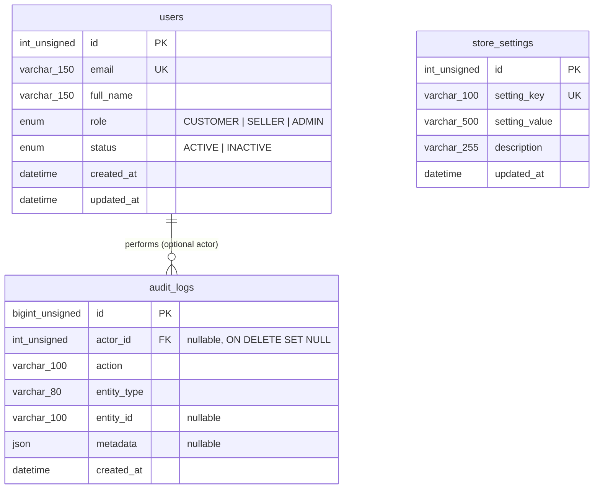

# Entity-Relationship Diagram (ERD) — Nexora

- **Status:** `Foundation Approved / Business Schema DRAFT`
- **Last Updated:** `2026-11-18`
- **Scope:** Reflects **only** the verified Prisma schema in [`prisma/schema.prisma`](../../prisma/schema.prisma). Unapproved business modules are explicitly marked **`DRAFT / NOT YET DESIGNED`**.

---

## 1. Phase 1 Foundation Entities (Implemented in `prisma/schema.prisma`)

Only minimal platform-foundation tables exist in Phase 1 to validate MySQL 8.4 connectivity, store identity baseline, role definitions, and auditability:

---

## 2. Planned Business Domain Entities (`DRAFT / NOT YET DESIGNED`)

Per [`PROJECT_SCOPE.md`](../governance/PROJECT_SCOPE.md) and [`DOCUMENTATION_RULES.md`](../standards/DOCUMENTATION_RULES.md), the following target domains remain **`DRAFT / NOT YET DESIGNED`** until their dedicated design phases & ADRs are approved:

- **Identity & Customer Profiles:** Sessions/refresh tokens, password reset tokens, multi-tier customer addresses _(DRAFT / NOT YET DESIGNED)_
- **Catalog & Specs:** Categories, Brands, Products, Product Variants/SKUs, Hardware Specifications, Galleries, Reviews, Wishlists _(DRAFT / NOT YET DESIGNED)_
- **Purchasing & Inventory Costing:** Suppliers, Purchase Orders, Goods Receipts, Inventory Stock, Cost Layers (`FIFO` vs `MWAC` pending `DEC-007`), Inventory Movements _(DRAFT / NOT YET DESIGNED)_
- **Cart, Promotions, Orders & Payments:** Carts, Coupons, Coupon Usages, Flash Sales, Reservations, Orders, Order Items (immutable price/discount/COGS snapshots), Payment Transactions, Shipments, Return Requests/Items/Refunds _(DRAFT / NOT YET DESIGNED)_
- **SellerMargin & AI/CMS:** Expenses, Expense Categories, Financial Rollups, AI Conversation Logs, Notifications, Banners, Content Articles _(DRAFT / NOT YET DESIGNED)_
